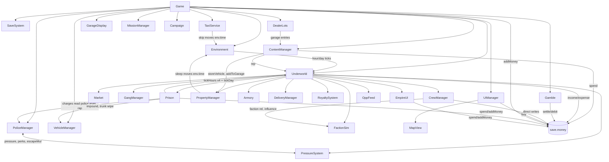

# OVERHAUL_STATUS.md — The Underworld overhaul

This file is the continuity bridge between Claude sessions. Read it after
`docs/THE_UNDERWORLD_MASTER_HANDOFF_FINAL.md` and `docs/THE_UNDERWORLD_BUILD_SESSION_PROMPTS.md`.
Line references (`index.html:NNNN`) are for base revision `3be344e`. Since Session 0.5 the source lives in
`src/` and `index.html` is generated, byte for byte, from it. Translate a reference with
`node underworld/tools/build.mjs --where NNNN` (for example `49776` → `src/game/520-underworld-prison.js:143`).
The mapping stays exact until a session changes the code above that line; after that, search by the quoted name.

---

## Current phase

- Session: **4B — Rival warehouses and offensive logistics** (prompt Session 4, second half per DC-33 / §45.27).
  4A was completed and regression-tested first.
- Commit/base revision: Session 4A `62782c4` → the Session 4B commits on `claude/practical-lamport-zld81y`.
- Date: 2026-10-22

## Completed this session (4B)

- **Rival warehouses** (`src/game/547-underworld-rivalwh.js`, `RivalWarehouses`; state `save.uw.rivals[fid]`).
  Details and numbers are in DC-34.
  - **Sites.** Five compounds, one per gang (`RIVAL_WH`), generated in world gen with Cannery Row's layout on the
    block's first open road (`_genRivalWh`). They are built by the same `CompoundSystem` in rival mode, with ids
    `rwh_<fid>`:
    - tiers come from their own state;
    - the gate admits only their people and vehicles;
    - a ram raises their alarm, and so do their cameras when you are in the yard.
  - **Authoritative stock.** Their stock is one saved inventory:
    - the interior (`rivalInteriorDef`) draws its racks from it and never writes it;
    - their stock is a transfer location (`rival:<fid>`) you can take from but never put into, reachable from
      inside or from a car in their loading bay;
    - every take raises the alarm.
  - **Raids.** A saved real-time clock (the threat clock's rules: own wall time, frozen when paused, hidden or
    suspended). Guards, then a squad at 270 s, armed squads at 420 s and 540 s, and an evacuation van at 600 s.
    Squads are keyed per stage, so a reload never stacks them. Leaving for 90 s winds the raid down, and an alert day
    follows.
  - **Evacuation.** The van loads lots off the shelves into a saved van load (`w.evac`) and drives to their HQ.
    Stolen, it's yours; wrecked, lost; arrived, back to their street stock.
  - **The safe** takes 15 s and pays Dirty (`heist`). Breaches on their compound mend after 24 econ hours.
- **Shipments** (`src/game/549-underworld-shipments.js`, `ShipmentSystem`; state `save.uw.ships`). This is the
  one implementation for every load on the road:
  - **Rival restocks.** `RivalWarehouses.tickDay` puts the load on the road; it is no longer added directly.
  - **The Tidewater boat.** Moved out of FactionAI/GangManager.
  - **Your imports.**
  - **One cargo, one place.** The record holds the cargo, a physical van's trunk *is* that object, and a theft
    moves it into the van for good. A reload resolves a rolling van once (it arrived) and redraws a landed import's
    crates.
  - **Hijack, wreck, overflow, seizure:** see DC-34.
- **Imports.**
  - **Ordering:** rank-gated (Territory Holder), one at a time, paid up front (vault first, `importOrder`), 8–16 h
    lead.
  - **At the docks:** crates on the quay at the pier by Shed 4. Customs may seize the load. It is impounded after
    24 h.
  - **Collecting:** by a Driver run from `import:<id>` (to a warehouse only), or by you in a van or box truck
    ("Load your import"). On foot or in a car you can't take it.
  - **UI:** Empire → Drivers → Imports.
- **Removed:** `FactionAI.scheduleShipment` and `landShipment`, `GangManager.spawnShipment`, `updateShipment` and
  `.ship`, and the abstract restock fallback. Convoy groups are kind `convoy`, owned by `ShipmentSystem`.

## Files / systems changed (4B)

- New: `src/game/547-underworld-rivalwh.js`, `src/game/549-underworld-shipments.js`, `tests/raid.mjs`,
  `tests/shipment.mjs`.
- `110-content-places.js`: `_genRivalWh` and the rival flag on the compound spec.
- `390-underworld-data.js`: `RIVAL_WH`, plus landmark-block registration for the rival blocks (it lives here because
  the data loads before world generation).
- `497-underworld-compounds.js`:
  - rival mode (`rival()`, `why()`, ram and camera alarms);
  - `spawnVan(…, { v })` adopts a van already on the road;
  - `V.goal`.
- `450-underworld-core.js`:
  - state `rivals` and `ships`, with migration;
  - construction, per-frame updates, the hourly and daily ticks;
  - `findAction`;
  - rival locations in `locations()` / `transfer()`.
- `460-underworld-factions.js`: the boat goes through `uw.shipments.scheduleBoat()`.
- `470-underworld-gangs.js`: the single-convoy code is removed, `convoy` groups are skipped by culling, and the
  want set covers raid squads and guards.
- `430-underworld-crew-deliveries.js`: `import:<id>` pickups (warehouse destinations only, no return to the quay).
- `540-underworld-empire-ui.js`: `openRivalStock` and the Imports card.
- `360-core-content-services.js`: the `rv:` interior spots.
- `035-core-money.js`: the `importOrder` source.
- `650-core-boot.js`: exports. `manifest.json`: 547 and 549.

## Save/schema changes (4B)

- `save.uw.rivals[fid]`, sanitized; a missing entry is fresh:
  - `{ up, breach, stock, cash, raid: { t, away, evacDone, start } | null, evac, alert, resupplied }`.
- `save.uw.ships = { list, next, log }`, sanitized:
  - each record is `{ id, kind: supply | boat | import, fid, cargo, state: due | rolling | landed, at, until?, from,
    to, n0, paid }`;
  - finished records leave the list, and the log keeps the last 12.
- `save.uw.shipment` (the old single boat) migrates to a boat record and is deleted.
- There is no schema version bump: every addition is defaulted by sanitize.

## Tests run (4B)

New suites: `tests/raid.mjs` **18 / 18** and `tests/shipment.mjs` **22 / 22**. Each requirement from §45.27 and what
proves it:

| Requirement (§45.27) | Proof |
| --- | --- |
| Physical rival warehouses | `raid`: all five exist with saved stock and cash; their gate admits their own people, not you or another gang |
| Inventory is authoritative world state, not regenerated by the interior | `raid`: going in and out twice leaves the stock byte-identical |
| Persistent loot depletion | `raid`: taking is an exact transfer, and nothing can be put back. Take half, unload at your warehouse, come back: the remainder is still there. Save → reload keeps both sides exactly |
| Reinforcement timing (~4.5 min, stronger at 7–10 min) | `raid`: guards only at 260 s; squads at 275, 425 and 545 s; a repeated stage sends nothing; the real clock is frozen by the pause menu |
| Physical evacuation | `raid`: what leaves the shelves is on the van, nothing doubled; stealing the van gives you exactly its load; walking away winds the raid down |
| The remainder persists until a real resupply or evacuation | `raid`: the restock is on the road (out of their street stock, in the shipment), held during a raid, and on the shelves only when it arrives. `shipment`: no second van stacks |
| Physical shipments and hijacking | `shipment`: with you near, a real van whose trunk is the record's cargo drives in, docks, and only then stocks the shelves. Taking it puts the load in your trunk and nowhere else (+30 pressure); a wreck loses it |
| Save/reload duplication protection | `shipment`: reload while due (identical); reload with the van on the road (arrived exactly once, and a second reset/bind adds nothing); a stolen load never returns to them; an import on the quay survives reload once, crates and all |
| Major/cartel imports (§3, §8) | `shipment`: rank and warehouse gates; full price paid up front; one at a time; cost basis travels; lands and waits 24 h; not on foot or in a car; box truck → loading bay → warehouse stock; a Driver run only to a warehouse; impounded when nobody comes; customs seizure |
| The Tidewater boat | `shipment`: one at a time; customs seizure; delivered to their warehouse with overflow to street stock; an old `save.uw.shipment` migrates |

Full regression against the 4B build:
- **All checks pass:** arrest 126, breach 13, build 5, business 40, camera 20, cargo 36, carmoney 10, casino 39,
  city 25, core 64, dealers 34, fixer 17, gambling 57, gangs 23, homes 26, interiors 22, inventory 58, kingpin 6,
  ledger 54, map 22, money 10, offline 14, phoneapps 19, police 13, prison 48, progression 33, property 33, pwa 5,
  raid 18, ramps 21, roads 20, royale-sim 23, session 35, shipment 22, shooting 37, smoke 16, soak 22,
  static-money 8, stations 17, street 11, survival 9, tutorial 13, ui 23, vehicles 39, warehouse 29.
- **Under parallel load, pass alone:**
  - stress 30 (a 3.4 s frame stall under load);
  - phone 71 (a 568×320 jail overlap check under load);
  - taxi 20 (passed in three solo runs; its ride check failed in one run that shared the machine, as in 4A).
- **Test code updated for 4B:**
  - `compound`: the mobile budget toggles only the measured compound's meshes. Velvet's warehouse at 6,10 is in
    view of Cannery at 7,10 and counted as 12 calls. With only Cannery toggled it is back under 8, and 56 / 56.
  - `threat`: before spawning its own fight, it clears police raid scenes and warehouse guards, so the gang cap
    has room. The new-game start is 73 m from the Vipers yard, whose guards take 3 places. Now 25 / 25.
  - `raid`: the restock check follows the shipment.
- **Screenshot suites** (shots, cityshots, qashots, frontshots, carshots) and contact run with no errors.
- **Performance** (`perf.mjs`, under parallel load): draw calls 114 / 121 (119 / 121 in 4A), update times within
  noise.
- **Van access at the five rival compounds** (probe, not a suite): see the risks below.

## Known bugs / risks (4B)

- A stolen load in a vehicle that is not stored in a garage is not saved (true of every trunk). The load is lost on
  reload, never duplicated.
- The new-game start is in Vipers ground beside their warehouse. Their guards (2–6) count against the gang cap
  (18) while you are near.
- A physical convoy only exists if you are within 380 m when it is due. Otherwise it is abstract and simply
  arrives. A van out of your sight for long (260 m and not in view, or 10 minutes on the road) also counts as
  arrived.
- Rival shipments don't use the §8 route-risk tiers yet. Imports and their price are first balance guesses (DC-34).

## Exact next recommended task

Owner review of DC-34. Then prompt **Session 5** per `docs/THE_UNDERWORLD_BUILD_SESSION_PROMPTS.md`.

## Completed this session (4A)

- **`ThreatSystem`** (`src/game/545-underworld-threats.js`; state `save.uw.threats`, pressure on each faction).
  - **Pressure only from actual player pressure.** Each faction's grievance (0–100, with a short history of why):
    - taking its turf +30;
    - a member knocked out +2 (put down +0.5);
    - its boss beaten +25;
    - its shipment stolen +30;
    - each sale on its corners +1.

    It decays daily (×0.85 − 2), falls 12 when a strike fails and 20 when one succeeds. A new career has no
    grievance, so there are no threats and no move on your turf.
  - **Stages:** intimidation at 20+ (corners and businesses), hits at 40+ (adding safehouse stashes and deliveries on
    the road), coordinated strikes at 70+ (adding warehouses and turf takebacks).
  - **When they act:** once a day a faction may pick one asset of yours near its ground: 35% / 55% / 80% by stage,
    ×1.3 in a coalition, ×0.4 if afraid of you, scaled down by your power (the old deterrence). There is at most one
    open threat per faction, three in all, and never two on the same asset. Rival-vs-rival wars are unchanged.
  - **The threat flow** (§10, §45.10, §45.16):
    - A warning arrives as a message and a toast, never a modal.
    - After 120 s of real active play comes THREAT IMMINENT, and after another 60 s the threat executes.
    - The clock keeps its own wall time (frame-rate independent, day-length independent). The pause menu, a hidden
      tab and loading freeze it, and so does any gap of more than 5 s (a suspended app). The map and the phone
      don't.
    - The Feed lists live threats with their clocks. "Go there" (opening the threat) routes you to the asset.
  - **Execution:**
    - **You there** (within 140 m, not jailed): the attackers turn up in person (3–6 of them) and head for the door
      or the corner. At a warehouse whose gate a car can break, they bring a car and ram it, and the 3B ram rules
      decide whether it gives (a real, saved breach). At a reinforced or massive gate they come on foot and are kept
      out. Your guards fight them.
    - **How a fight ends:** with every attacker down (held); with one holding the door or corner for 6 s (hit); with
      you leaving (the crew settle it); or after 120 s with both sides standing (settled with your presence counted).
    - **You away, or jailed:** the crew defend on their own (§45.16).
  - **Defense from what is actually there:**
    - the district's Lieutenant (and, through them, half the Enforcers on neighbouring turfs);
    - for a corner, its Enforcers and Dealers;
    - for a delivery, the runner's odds;
    - for a stash, the safehouse's security;
    - for a business, its staff, manager and the security firm;
    - for a warehouse: security level ×10, its Enforcers and Lieutenant, camera coverage now (up to 12), an open
      breach −8 each, a patch −3 each, an open lot −10, no gate −6, an unrammable intact gate +6.
    - Maximum Security with staffing turns back anything short of a coordinated strike, and a strike faces its
      defense ×1.5.
    - Each threat's strength (faction strength × stage, +15% per earlier successful hit on that asset, capped at
      +45%) and its dice are fixed when it is created.
  - **Losses are real:**
    - a corner: its people hurt, 60% of the corner stock gone, influence down;
    - a delivery: robbed (the run's own report);
    - a stash: 40% of the stock and 30% of the cash (to $50k, booked as theft);
    - a business: wrecked until repaired;
    - a warehouse: 30% of the stock and 20% of the vault (to $250k), Enforcers maybe hurt, and the gate broken — a
      saved breach until mended.
  - **A turf takeback** is announced the same way. On execution it becomes the faction's showdown on that turf,
    decided by the existing war system with your crew and you.
- **Persistence and exploits:**
  - Threats are saved with their clock, strength, history bonus, dice and state. A reload neither resets, rerolls,
    duplicates nor stacks them.
  - A reload in the middle of a physical fight (the attackers are not saved) settles it exactly once, as if you had
    left.
- **Kingpin deterrence carried over (DC-25).** Threats keep the old war rules:
  - the coalition boost doesn't apply against the Kingpin;
  - against the Kingpin, a turf takeback needs a real grudge (rel ≤ −60) or a coalition he doesn't outweigh 1.5
    to 1, only one push at a time, and never from a crew he outweighs 2.5 to 1;
  - the more you outweigh a crew, the less it picks your turf (weight × (1 − (ratio − 1) × 0.7), at least 0.1).

  `tests/kingpin.mjs` now gives every faction the same strike-level grievance and counts turf-takeback threats:
  260 against the Kingpin vs 729 against an ordinary boss over three seeds (36%; it was 38% with wars), and none
  from a crew outweighed 2.5 to 1.
- **Replaced:** `PropertyManager.rivalAttacks` (a daily dice roll that hit businesses and warehouses without
  warning) is gone. `chooseWar` no longer picks the player's turf: threats are the one way rivals come at the player.
- Ledger: `Money.robbedAt` books stolen vault cash as theft.

## Files / systems changed (4A)

- New `src/game/545-underworld-threats.js` (manifest after the fixer), `tests/threat.mjs` (25 checks).
- Tests updated for the new model: `kingpin` (takebacks instead of wars, as above), `warehouse` (its raid-immunity
  check goes through a threat on the worst dice instead of the removed `rivalAttacks`).
- `390` (`PRESSURE`, `PRESS_STAGE`, `THREAT_T`), `035` (`robbedAt`), `450` (state, sanitize, update, pressure on turf
  taken), `460` (threat tick replaces rival attacks; `chooseWar` leaves player turf to threats; boss pressure),
  `470` (pressure for knockdowns and the stolen shipment; assault groups kept), `490` (`rivalAttacks` removed),
  `540` (Feed threats, "Go there", pressure for sales on rival corners), `640`, `650`.

## Save/schema changes (4A)

- `uw.threats` (`{ list, next, log }`) and faction `press` / `hist`. All are sanitized and default to empty, with no
  schema bump.

## Tests run (4A)

New `tests/threat.mjs`: **25 / 25**. Each requirement from §45.27 and what proves it:

| Requirement (§45.27) | Proof in `threat.mjs` |
| --- | --- |
| Pressure and retaliation from what the player actually does | A new career gets no grievances, no threats and no move on your turf over 14 days; taking turf and knockdowns build pressure, with history; daily decay; each stage goes for the right kinds of asset |
| Warnings and threat timers (§45.10, §45.16) | Warning, then IMMINENT, then execution. The clock matches the wall time between frames exactly at 8- and 120-minute days; pause, a hidden tab and loading freeze it; the map doesn't; the Feed shows it and "Go there" routes you |
| Persistence with no duplicate, reset or stack | Save → reload keeps clock, strength, dice and state; no second threat on the same asset after reloads and new days; a reload mid-fight settles it exactly once, with no second assault |
| Uses the actual security state | Warehouse defense counts Enforcers, Lieutenant and cameras; open breach < patch < repaired; Maximum Security with staffing turns back an ordinary hit on the worst dice; same attack and dice: a strong warehouse holds, a weak one with its gate down is hit |
| History counts | A gang comes back stronger to an asset it already hit, and not to others |
| Real losses | Stock and vault cash lost, the gate left broken (persistent); a corner's Dealer hurt and stock gone; a business wrecked |
| Automatic crew defense when jailed | The threat lands on time and the crew settle it with no fight and one result |
| Physical assault when present | At a basic gate they ram it down for real and the fight is settled; at Maximum Security they bring no car and the gate stays shut |
| Turf takeback | Announced, then becomes their showdown on that turf |

Full regression against the 4A build:
- **All checks pass:** arrest 126, breach 13, build 5, business 40, camera 20, cargo 36, carmoney 10, casino 39,
  city 25, compound 56, core 64, dealers 34, fixer 17, gangs 23, homes 26, interiors 22, inventory 58, kingpin 6,
  ledger 54, map 22, money 10, offline 14, phone 71, phoneapps 19, prison 48, progression 33, pwa 5, ramps 21,
  roads 20, royale-sim 23, session 35, shooting 37, smoke 16, soak 22, static-money 8, stations 17, street 11,
  survival 9, threat 25, tutorial 13, ui 23, vehicles 39, warehouse 29.
- **Load-sensitive, pass alone or on a re-run:** gambling 57, police 13, property 33, stress 30, taxi 20.
- **Test code updated:**
  - `kingpin`: takebacks instead of wars.
  - `warehouse`: raid immunity through a threat.
  - `compound`: the loading-bay check now empties your pockets of the product first, because storing takes from
    your pockets before the trunk, and product picked up in an earlier fight made it move 9 instead of 5.
- **Seen once and not reproduced:** in one parallel run a Driver's van ended its compound round trip 1.4 health down
  with no compound contact. The solo run was clean, and the cause is not established (traffic contact is the likely
  suspect).
- **Screenshot suites** run with no errors.
- **Performance** (`perf.mjs`, run under parallel load): draw calls 119 / 121 vs 118 / 120 in 3B, update times
  within the noise of a loaded run. The threat system does nothing per frame beyond a clock step and its open
  threats.

## Known bugs / risks (4A)

- Physical assaults on corners, stashes and businesses are a hostile crew walking to the door or corner; their
  dressing (cars, a smashed window) is for the graphics pass.
- A turf takeback's showdown is the existing war system, unchanged.
- Rival warehouses can't be raided yet (Session 4B).

## Exact next recommended task

**Session 4B** (§45.27): physical rival warehouses with authoritative, persistent inventory; reinforcements after
~4.5 minutes and a stronger response at 7–10; physical evacuation; physical shipments and hijacking; save/reload
duplication protection from the start.

## Working tree (4A)

- Clean after the final Session 4A commit; see `git log` on `claude/practical-lamport-zld81y`.

---

# Session 3B record (warehouse compounds)

## Session 3B follow-up (§45.26: DC-32 rulings)

- **Breaches persist and stay open until mended** (`uw.whse[id].breach`, sanitized on load). Each entry records the
  state, the economic hour of the breach, the tier it breached, and when crew started work. The end-of-day auto-heal
  is gone.
- **Crew repair** (`CompoundSystem.tickHours`, on the economic clock): with anyone assigned to the warehouse, work
  starts that hour.
  - A **patch** follows an hour later: it holds again, but breaks at 6 m/s. It costs $150 a panel or $400 for the
    gate.
  - A **full repair** follows eight hours after work started: price × 0.2% a panel or 1.2% for the gate, times the
    tier restored. It restores the bought tier's strength.
  - Both are paid in Dirty Cash from that warehouse's vault first (new ledger source `whRepair`, booked as upkeep).
  - No money: no work, and one news line. Nobody assigned: nothing happens, and the work clock resets.
- **You:** patch on site (Security tab, at the warehouse), or pay contractors from Clean Bank at 1.5× to repair
  everything today. Buying the next tier of a category replaces the breached part.
- **Task passes** (`grantPass(id, crewId, hours, why)`, saved in `uw.whse[id].passes`): a crew member who doesn't
  work at a warehouse (an ordinary Dealer is refused) can be let in for one job until the pass expires.
- Tests: new `tests/breach.mjs` (13 checks); `compound.mjs` ram cleanup now uses the contractor repair.

## Completed this session (3B)

- **Two compounds** (`world.compounds`, laid out once by `_whCompound` in `110-content-places.js`):
  - **Cannery Row** takes the whole of block 7,10, which is now a landmark block. It has a 58 × 58 m lot, a
    48 × 26 m building with two raised loading docks, painted bays, yard parking and a personnel door. The property
    door moved off the pavement into the yard. The gate sits 4.5 m east of the block centre: a street lamp stands in
    front of the centre, and it blocked both the vans and the gate camera.
  - **Tidewater Shed 4** got a 46 × 40 m yard in the terminal's south-west corner, with its gate on the east side
    off the z = 916 lane. Containers inside the yard and the clutter there were removed, and lane paint trimmed.
  - Both compounds record their lot, gate, docks, bays, parking, door, booth spot, perimeter segments and drive
    lanes (in and out, with reverse legs).
- **`CompoundSystem`** (`src/game/497-underworld-compounds.js`) builds what the saved tiers buy and keeps it working.
  - **Rebuilds:** the build runs on every change of tiers or ownership (checked each frame), immediately on an
    upgrade, and on load.
  - **Perimeter:** open lot → chain-link 2.2 m → tall fence 3.2 m with bollards on the traffic sides → anti-climb
    3.6 m behind jersey barriers → hardened 2.6 m wall with fencing to 4.4 m. Fence panels have colliders, and mesh
    panels let sight lines through. Chain-link (7 m/s) and tall fence (11 m/s) panels break when a car rams them
    hard enough; a hit where panels meet takes both. The barrier tiers never break.
  - **Access:** gap → basic sliding gate (rammable at 7 m/s) → motorised gate (12 m/s, controlled loading) →
    reinforced gate and guard booth (unrammable) → massive gate, booth, access posts and a rising wedge barrier. The
    wedge only drops for someone the gate admits.
  - **Who gets in:** one rule, `why()` / `allows()`:
    - the player, on foot or driving;
    - an active crew member assigned to this warehouse, or one escorting the player;
    - a vehicle driven by such a crew member;
    - a vehicle with an unexpired delivery manifest for this warehouse.
    Everyone else is denied by default, rivals and traffic included. The gate never holds open for an unadmitted
    vehicle, and a Driver's van loses its authorization once it has left. Gates open on approach with the same
    speed-scaled reach as `DoorSystem`.
  - **Surveillance:** 0 / 2 / 4 / 6 / 10 cameras. They are mounted on the yard-face corners, then the gate posts
    (looking out and in), then yard poles, then corner domes. Each has a field of view, a range of 18 → 32 m and a
    line-of-sight test. Lighting shortens the range at night (65% → 100% kept, `WH_SURV`). The same test drives
    `coverage()` (the security tab and the tests) and the intruder alarm (a news message and a toast; the raid odds
    are unchanged). Wall packs, floodlight poles and ground light pools follow the same tiers.
  - **Dock doors:** each dock has a roll-up (`DoorSystem` gained a per-door `want` hook). It opens for an authorized
    vehicle in its bay; from the motorised gate up, the vehicle must also have stopped.
  - **Loading bay:** stopping your car in a dock bay prompts "Loading bay". It opens the warehouse's product tab
    with the trunk in reach (`access()` treats the dock bay as being at the warehouse).
  - **Guards:** Enforcers assigned to the warehouse stand at posts in the yard while you are within 150 m. They are a
    crew group kept by the gang presence system, so they fight hostiles with the usual crew brain.
  - **Drivers:** when a run starts from or ends at a warehouse while you are near, a van drives the lane: in, nose
    to the dock, back out, out through the gate, then into traffic. `LaneDriver` follows the lane points, reversing
    where a point is marked for it.
  - **Inside:** the interior is built from the tiers when you walk in (`warehouseInteriorDef`):
    - a loading area behind the dock doors;
    - racking, caged from vault tier 1;
    - back rooms by vault tier: a cash box → a safe → a cash room → a vault and an armory → a large vault, a product
      vault and a ready room;
    - a mezzanine up a 16-step stair with the Lieutenant's office and the CCTV desk, which becomes a security room
      and then a command room.
    Each room has an interaction point that opens its tab. Buying an upgrade while inside rebuilds the rooms around
    you.
  - **Breaches** (revised in the follow-up below): rammed panels and gates are saved and stay open until mended.
- **Security tab** shows what is on site: fence, gate, camera count with day and night coverage, lights, breaches.
- **Fixed:** the delivery report still printed a "Fee" (DC-31 leftover), and comments still mentioned run fees.

## Files / systems changed (3B)

- New `src/game/497-underworld-compounds.js`, `tests/compound.mjs`.
- `090` (`world.compounds`), `110-content-places.js` (Cannery Row landmark, `_whCompound`, shed4 place),
  `120-content-city-v2.js` (Shed 4 yard in the terminal; `DoorSystem` `want` hook), `240` (collider `onHit` on
  impact), `390` (`WH_FENCE`, `WH_GATE`, `WH_SURV`; Cannery Row is a place), `430` (van hooks, report text), `450`
  (system, update, hourly breach work, loading bay action and access), `470` (guard groups), `490` (warehouse door →
  Enter), `495` (upgrade rebuilds), `500` (yard parking), `360` (`w:` interior points), `540` (security tab), `640`,
  `650`, `manifest.json`.

## Save/schema changes (3B)

- No schema bump. The compound follows `uw.whse[id].up`. The follow-up adds `uw.whse[id].breach` (per part:
  `{ s: 'broken' | 'patched', t, tier, w? }`) and `uw.whse[id].passes` (`{ crew, until, why }`); both sanitized,
  and both default to empty.

## Tests run (3B)

New `tests/compound.mjs`: **56 / 56**, both warehouses. Each requirement from §45.25 and what proves it:

| Requirement (§45.25) | Proof in `compound.mjs` |
| --- | --- |
| Every security tier visually changes | Every perimeter, access and surveillance step gives a different mesh signature and the expected feature set; every vault tier gives different rooms; all five levels differ; a bought upgrade rebuilds at once |
| Tier state survives save/reload | Mixed tiers on both warehouses: identical signature and status after a reload |
| The gate opens for the player, authorized crew, Drivers and delivery vehicles | The player on foot and driving; an assigned Enforcer walks through to the door; a Driver's van docks and leaves; a manifest-only vehicle reaches the dock |
| The gate rejects rivals and unauthorized NPCs | Rejected and kept outside: crew of another warehouse, fired crew, an expired delivery, and a hostile rival crew with their car plus ordinary traffic (at security 5 and 2) |
| Vehicles enter and leave without clipping | Vans and the player's own car, in and out at both warehouses: zero contacts with any compound collider, zero damage, zero stalls |
| Loading bay | The dock door opens for you, the prompt moves trunk cargo into storage, and a stranger's car doesn't open it |
| All interior areas reachable; no blocked doors, stairs or interactions | Flood fill with the player's radius, floor heights and step limit, at 8 tier mixes × 2 warehouses: exit, mezzanine and every point reachable; interaction points open the right tabs |
| Maximum Security supports its defense | Perimeter closed on foot; gate and fence hold against 22 m/s rams; the wedge stops a tailgater; cameras cover 100% by day and night; immunity only at level 5 |
| Lower tiers don't inherit it | Open lot / no gate / no fence let people in; basic and motorised gates and chain-link break at 16 m/s (but hold a 4 m/s push); camera coverage below 100%, worse at night, rising per tier |
| Mobile performance within budget | Compound update 0.005 ms a frame, 7 draw calls, about 12.5k triangles (budget 0.35 ms / 8 / 40k) |

Bugs this suite caught and that are fixed:
- A rebuild without a wedge kept a stale wedge reference.
- A street lamp stood in Cannery Row's driveway (the gate was moved 4.5 m east).
- Reversing out of a bay steered the wrong way.
- Departed vans stayed authorized.
- A guard posted by the booth held the gate open for everyone.
- Gates carried no ram threshold (any touch broke a basic gate).
- A ram where two panels meet broke only one.

Full regression against the 3B build, three suites at a time:
- **All checks pass:** every other assertion suite. That includes warehouse 29, kingpin 6, inventory 58, property 33,
  interiors 22, homes 26, arrest 126, core 64, ledger 54, progression 33, fixer 17, carmoney 10 and static-money 8.
- **Load-sensitive, pass alone:** stress 29 / 30 → **30 / 30 alone** and gambling 56 / 57 → **57 / 57 alone**
  (the known timing checks). police 12 / 13 → **13 / 13 alone**.
- **city 24 / 25 → 25 / 25:** test code. It read `world.terminalShed`, which this session removed; it now reads
  Shed 4's compound.
- **pwa:** fails only against a staged copy without the icon files next to it; **5 / 5** against the real build.
- **Screenshot suites** (cityshots, qashots, frontshots, carshots, contact) run with no errors.

Phone performance (`PHONE=1 tests/perf.mjs`: 4× CPU throttle, 800×400, alternating builds, two runs each):
- pre-3B update 6.48 / 3.98 ms calm and 4.29 / 4.77 busy;
- 3B update 4.92 / 4.75 calm and 4.06 / 3.46 busy;
- draw calls 244-246 against 248-251, triangles within ±1%.

No change beyond noise.

## Known bugs / risks (3B)

- Abstract rival raids (`rivalAttacks`) still don't use the physical breaches or guards; Session 4's raids should.
- Driver vans appear only for runs that start or end while you are near. Runs elsewhere stay abstract, as before.
- Block 7,10 lost its procedural buildings, and a few terminal containers are gone (deliberate, DC-32).

## Exact next recommended task

Owner review of DC-32. Then **Session 4** (shipments, raids and gang wars), which can now stage warehouse raids
against the physical compound.

## Working tree (3B)

- Clean after the final Session 3B commit; see `git log` on `claude/practical-lamport-zld81y`.

---

# Session 3A record (warehouse systems)

## Completed this session (3A)

- **Warehouse model** (`src/game/495-underworld-warehouses.js`, `WarehouseSystem`; state `save.uw.whse[id]`).
  - Four security categories (§6): Perimeter, Surveillance, Access control, Vault and interior, each bought up
    through four tiers named after the §6 level descriptions, paid from Clean Bank (15% / 30% / 60% / 120% of the
    warehouse's price, to the $500). The **security level** (1 Basic … 5 Maximum Security) is 1 + the weakest
    category, so a level means every part of the warehouse is that good.
  - **Dirty Cash vault** (§7): capacity by vault tier, $100k / $500k / $2.5M / $10M / $50M; product storage grows
    with it (×1 … ×2). The ledger enforces it: a deposit stops at capacity, and remote income that finds the vault
    full passes on down the §45.22 order (operation warehouse → Treasury → home safehouse → you), none lost.
  - **Treasury Warehouse** designated (and cleared) on the warehouse's Dirty Cash tab (§45.22).
  - **15 crew slots** (§5): up to 10 Enforcers (guarding it), 4 Drivers (based there), 1 Lieutenant. A warehouse
    adds 15 to your crew capacity (it added 2). A crew member's post there is `assign = 'w:<id>'`.
  - **Lieutenants** run either a district (as before) or a warehouse, which means its district too
    (`CrewManager.ltZone`, the one reader for every Lieutenant effect: influence, defense, royalties, business
    income, betrayal).
- **Logistics** (§5, §8):
  - **Dealers sell only the stock on their corner** (`uw.turfStock[i]`, up to 60 units). Before you have Drivers you
    hand it over yourself: the corner is an Inventory location when you stand at the turf's deal spot (product only,
    no hot goods or hardware). The takings go to the warehouse that supplies the Dealer (linked in the Crew card,
    default the nearest), else the Treasury, home or you. Dealers no longer sell from any stash in the city.
  - **Only Drivers make deliveries** (Runner and Driver merged). Runs now also go to a Dealer's corner and come
    from a supplier: a **supply run** buys at the supplier's wholesale price with the vault's cash (payroll order,
    the destination warehouse first), and the product is on the road until it arrives.
  - **Route risk** (§8): each of the route's three stretches is own / friendly / neutral / rival / hostile-or-war,
    with hijack risk 0.2% / 1% / 3% / 7% / 12% per stretch; police risk (pressure, patrols, task force, crackdown)
    is counted and shown separately, and each weighs its own failure outcome (hijack vs police stop).
  - **Lieutenant automation**: each day a warehouse with a Lieutenant (setting on, default) sends free Drivers to
    top up its Dealers' corners to 40 from its stock, and, when its sellable stock falls under 60 units of space,
    sends one to the best-margin supplier who deals with you for a lot of up to 80.
- **Defense and immunity** (§6): a rival raid on a warehouse is less likely the higher its defense (level ×10, each
  Enforcer and the Lieutenant). At Maximum Security with at least 4 Enforcers and a Lieutenant on site, an ordinary
  raid can't knock it off (it turns back at the gate). Police raids and exceptional threats are unaffected.
- **City Kingpin needs an operating warehouse** (a Lieutenant and at least one Driver) (DC-25's infrastructure).
- **Warehouse screen**: an owned warehouse's property screen has Product, Weapons, Dirty Cash, Security, Crew and
  Logistics tabs (§7).
- **Bug found and fixed (Session 1 follow-up):** the Treasury designation was lost on every reload (the save merge
  won't copy a string over a `null` default). Caught by the new save/reload check.

## Files / systems changed (3A)

- New `src/game/495-underworld-warehouses.js` (in `src/manifest.json` after the property manager),
  `tests/warehouse.mjs` (29 checks).
- `390-underworld-data.js` (warehouse, route-risk and corner constants; crew role texts; warehouses `crew: 15`;
  Kingpin `wh`), `035-core-money.js` (`roomAt`, `stashOrder`, overflowing income, capped moves, `supplyRun`),
  `030-core-save-system.js` (treasury on load), `410` (corner location class), `430-underworld-crew-deliveries.js`
  (Drivers only, places, supply runs, route tiers), `450-underworld-core.js` (state, corner locations, daily
  automation, `power().wh`), `460`, `440`, `480-underworld-crew.js` (warehouse posts, `ltZone`, corner sales,
  dead `storedStock` / `takeStored` removed), `490-underworld-property.js` (warehouse storage, raid defense),
  `540-underworld-empire-ui.js` (warehouse panel, crew targets, runs screen), `640`, `650`.
- Tests: `inventory` (couriers are Drivers; the elite-runner check over your own turf), `session` (the dealer
  sells corner stock, not the stash), `progression` and `kingpin` (Kingpin's operating warehouse).

## Save/schema changes (3A)

- `uw.whse` (`{ [id]: { up: { perimeter, surveillance, access, vault }, auto } }`) and `uw.turfStock` (corner
  stock per turf), crew `from` (a Dealer's supplying warehouse) and `assign` values `'w:<id>'`; runs may carry
  `rival`, `police`, `auto`, a `from` of `'spot:<id>'` and a `to` of `'turf:<i>'`. Defaults on load; schema stays 9.

## Tests run (3A)

Every assertion suite ran against the Session 3A build, three at a time; failures were re-run alone:

| Result (3 in parallel) | Suites |
| --- | --- |
| all checks pass | soak 22, interiors 22, homes 26, casino 39, prison 48, session 35, property 33, ramps 21, vehicles 39, cargo 36, city 25, arrest 126, phone 71, taxi 20, stations 17, map 22, roads 20, shooting 37, ui 23, survival 9, smoke 16, money 10, offline 14, business 40, street 11, pwa 5, camera 20, police 13, dealers 34, tutorial 13, phoneapps 19, static-money 8, build 5, gangs 23, ledger 54, progression 33, fixer 17, carmoney 10, **warehouse 29 (new)**, royale-sim 23, core 64 |
| stress 29 / 30 → **30 / 30 alone** | the software-GL frame-stall check (load-sensitive, as before) |
| gambling 56 / 57 → **57 / 57 alone** | scratch-card timing under load (as before) |
| inventory: stopped at 41 → **58 / 58** | test code: the delivery loops left a runner "idle" after a betrayal, and only Drivers deliver now; the loops restore the Driver role. Its "elite runner" check is now stated over your own turf (93% observed against 93.5% quoted, 300 runs): over the Old Quarter (rival ground) the rate is lower by design (§8) |
| kingpin 2 / 6 → **6 / 6** | test code: City Kingpin now needs an operating warehouse, so the test's empire gets one (a Lieutenant and a Driver at Cannery Row); deterrence 128 / 332 over three seeds |

Performance (`tests/perf.mjs`, alone, alternating builds): update 0.78 / 0.82 ms (2.5 follow-up) vs 0.76 / 1.15 ms
(3A) calm, 1.33 / 0.96 vs 1.18 / 1.21 busy, draw calls 117-123: no change beyond noise. The new work runs once per
world day (automation) or on player action.

## Known bugs / risks (3A)

- Existing development saves: Dealers sell nothing until their corners are stocked (by hand, or a Driver).
- The warehouse is not yet physical: levels have no visible fence, gate, cameras or interior, and there is no
  automatic gate (Session 3B, DC-30).
- Cartel/major shipments still land as before (Session 4 brings shipments, raids and gang wars).

## Session 3A: next task (done in 3B)

**Session 3B — warehouse presentation** (DC-30): the five security levels as visible exterior and interior changes
for each category tier, the authorized automatic gate (player, crew, Drivers and delivery vehicles open it; rivals
don't), and the interior layout (vault, product cages, Lieutenant office, security room, ready room), with
persistence of what was bought. Then Session 4.

## Working tree (3A)

- Clean after the Session 3A commit; see `git log` on `claude/practical-lamport-zld81y`.

---

# Session 2.5 record (laundering fixer, vehicle provenance)

## Session 2.5: phase

- Session: **2.5 — Early laundering fixer** (§45.6, §45.22; prompt "Session 2.5"), and its follow-up for the DC-29
  ruling (§45.24, vehicle provenance).
- Commit/base revision: `36d9a47` (Session 2 follow-up) → `7f78d30` (Session 2.5) → the Session 2.5 follow-up
  commit on `claude/practical-lamport-zld81y`.
- Date: 2026-10-21
- Precondition met: the unexplained ledger cash was traced and fixed before the fixer was added (Session 2 follow-up,
  below).

## Session 2.5 follow-up (§45.24: vehicle provenance, DC-29)

- **Provenance is recorded at purchase.** `DealerLots.buy` measures what actually paid (Saltworks takes Dirty Cash
  first, then the bank; Meridian and the prestige lot take the bank only) into the garage entry: `e.prov = { dirty,
  clean }`. Tuning paid from the bank adds to `prov.clean`. Provenance is separate from `e.origin` (how the car was
  acquired) and from HOT (Session 5): a car that isn't stolen is not assumed clean.
- **Resale follows the money** (`ContentManager.saleOf(e)` → `{ total, dirty, clean }`): an ordinary bought car pays
  each currency in proportion to what went in (all Dirty, all Clean, or split for a mixed purchase); a stolen car
  pays Dirty Cash through the garage or the chop shop; found, reward and mission cars, which were never paid for,
  follow their own explicit rule in `CAR_RESALE` (Clean, as before, for review in Session 5). New ledger source
  `dirtyCarSale` (the Dirty share, to you).
- **Never above the price.** An ordinary car's resale is the old value formula capped at `RESALE_CAP` 85% of what
  was put into it (purchase + tuning; repairs are upkeep and don't count), so buying and selling always loses at
  least 15%: no arbitrage, no laundering loop.
- **Older saves:** a bought car with no record of what paid for it is Dirty-origin at its old resale base (50% of
  list), both on load and if any code creates one without a record. Development saves only (§45.2).
- The sale confirmation says which currency (or the split) you'll get.
- Tests: new `tests/carmoney.mjs` (10 checks, all purchases through `DealerLots.buy` and sales through the garage
  screen): Dirty-bought → Dirty; Clean-bought → Clean; mixed $500 cash + $1,500 bank → the same 1:3 split; stolen →
  Dirty (garage and chop shop); 300 real used-lot stalls bought with Dirty and sold back each return ≤ 85% and no
  Clean; a 25-round buy-sell loop only loses Dirty and makes no Clean; a Clean-bought new car resells below its
  price; save/reload keeps provenance and the split. Run against the Session 2.5 build it fails (no provenance, Clean
  out of a Dirty purchase), passes on the follow-up. `ledger` 54 (+1: a bought car with no record sells for Dirty).
- Files: `035-core-money.js`, `360-core-content-services.js` (`CAR_RESALE`, `RESALE_CAP`, `saleOf`, sale routing,
  tuning provenance), `500-underworld-homes-parking.js` (record at purchase), `030-core-save-system.js` (provenance
  sanitize); handoff §45.24 with notes in §2, §13 and §14.

## Completed this session (2.5)

- **The fixer** (`src/game/535-underworld-fixer.js`, `LaunderFixer`; state `save.uw.fixer`). Dina Vance, in the Old
  Quarter (spot `fixer`, `[3, 1, 3, 30]`, the block of Spin City Laundromat), open to anyone from a fresh career
  (no Rep gate, so the first Clean dollar has no circular requirement, §41). You hand her **Dirty Cash you carry**
  (never a stash or the bank) in $500 / $1,000 / $2,500 amounts or "as much as she'll take"; she keeps **32%**
  (`FIXER_FEE`) and pays the rest into **Clean Bank 12 economic hours later** (`FIXER_DELAY`), at most **$5,000 of
  Dirty Cash per economic day** (`FIXER_DAY_CAP`), at least $100 a time. The screen shows the cash on you, what she
  will still take today, the fee, a quote for the next hand-over, the batches with her and when each lands, and
  the running total washed and paid in fees. A phone message says when a batch has landed. Ledger sources
  `launderIn` (pay, Dirty on you) and `launderOut` (earn, Clean; it repays medical debt first like any Clean
  income). On the map she is a contact ("L") with her fee and limit.
- **Money with her is not on you.** An arrest seizes only what you carry and the caught car (§2); a batch with the
  fixer survives it and still lands while you are in jail. You can't hand her anything from a cell.
- **The economic clock** (`uw.S.econH`, `Underworld.econRate`). §45.9 forbids economic accrual that speeds up with
  the day-length setting, and a per-world-day cap would have done exactly that (a 4-minute day would wash 7.5×
  more per hour of play). Each world hour adds `dayLength / 30` economic hours outside jail, so an economic day is
  30 real minutes of play at any setting; in jail (world time 1:1, §45.8) one world hour is one economic hour. Taxi
  time skips move it in proportion. Sessions 3 and 9 can put other per-day economics on this clock (DC-06).
- **Stolen cars give no Clean Bank** (§45.22): checked through the garage screen and the chop shop.
- **Not done, raised instead:** the Saltworks used lot is a better laundering route than the fixer and can make
  money (DC-29, measured). No car pricing or classification was changed.

## Files / systems changed (2.5)

- New `src/game/535-underworld-fixer.js` (in `src/manifest.json` after the opportunities feed), `tests/fixer.mjs`
  (17 checks).
- Tests: `tests/kingpin.mjs` (one shared snapshot for all seeds), `tests/casino.mjs` (seeded three-seed poker
  simulation).
- `390-underworld-data.js` (the spot; `FIXER_*`, `ECON_REF_DAY`), `035-core-money.js` (`launderIn`, `launderOut`),
  `450-underworld-core.js` (`econH`, `fixer` state, `econRate`, the clock and delivery in `tickHours`),
  `540-underworld-empire-ui.js` (`openFixer`, map icon, "Rep" wording on suppliers), `600-core-ui-manager.js` (map
  index entry), `650-core-boot.js` (`LaunderFixer` exposed to tests).

## Save/schema changes (2.5)

- `uw.econH` (number, economic hours) and `uw.fixer` (`{ day, used, batches: [{ id, dirty, clean, due }], next,
  washed, fees }`), both sanitized with defaults: a batch is clamped to the daily cap and can never pay out more
  than the fee allows. Schema stays 9 (new fields only, defaults on load).

## Tests run (2.5)

Every assertion suite ran against the Session 2.5 build, three at a time; the failures were re-run alone:

| Result (3 in parallel) | Suites |
| --- | --- |
| all checks pass | soak 22, interiors 22, homes 26, prison 48, session 35, ramps 21, vehicles 39, inventory 58, cargo 36, arrest 126, city 25, phone 71, stations 17, map 22, roads 20, shooting 37, ui 23, offline 14, smoke 16, money 10, business 40, survival 9, street 11, pwa 5, camera 20, police 13, dealers 34, tutorial 13, phoneapps 19, static-money 8, build 5, gangs 23, ledger 53, progression 33, **fixer 17 (new)**, royale-sim 23, core 64 |
| stress 29 / 30 → **30 / 30 alone** | the software-GL frame-stall check (load-sensitive, as before) |
| gambling 54 / 57 → **57 / 57 alone** | scratch-card timing and casino frame rate under load |
| property 32 / 33 → **33 / 33 alone** | the timed motor-court drive (as in Session 2) |
| taxi 18 / 20 → **20 / 20 alone** | the cab drive and skip timing (as before) |
| kingpin 5 / 6 → **6 / 6, three runs alone** | see below: the three-seed version was not deterministic |
| casino 38 / 39 → **39 / 39** | see below: the poker edge check was a flaky test |

Two flaky tests found and fixed in this session (test code only):

- **kingpin:** the three-seed comparison added in the Session 2 follow-up took a fresh snapshot of the live game for
  each seed, and the game keeps running between calls at a pace that depends on load, so the seeds did not start
  from the same state (0.53 in the parallel run). All seeds now start from one shared snapshot: 124 / 324, 121 / 319,
  124 / 324 (0.38) in three solo runs.
- **casino poker:** "a small positive edge" (EV > -0.5 big blinds) was judged on one unseeded 1,500-hand run. With
  the same seed both builds give identical results (EV +2.36), so the game code is not involved; across 8 seeds EV
  ranged from -0.88 to +2.63 and 3 of 8 failed the bar, so the check failed about a third of the time on any
  build (the earlier passes were luck). It now uses three fixed seeds judged together: EV +0.50, 63% of decided
  hands won.

Performance (`tests/perf.mjs`, alone, alternating builds): update 0.72 / 1.31 ms (follow-up) vs 1.16 / 0.99 ms
(2.5) calm, 1.46 / 1.06 vs 0.96 / 0.99 busy, draw calls 118-123: no change beyond noise. The fixer adds work only
once per world hour.

## Known bugs / risks (2.5)

- DC-29 is resolved (§45.24, follow-up above).
- The economic clock is used only by the fixer so far; every other per-day economy still runs on world days (DC-06,
  Sessions 3, 9 and 13).

## Session 2.5: next task (done)

**Session 3 — Warehouses / vault / logistics** (prompt Session 3, handoff phase 4), including the Treasury Warehouse
designation control (§45.22) and Kingpin's infrastructure condition (DC-25).

## Working tree (2.5)

- Clean after the Session 2.5 commit; see `git log` on `claude/practical-lamport-zld81y`.

---

# Session 2 record (Rank, Reputation, turf)

## Session 2: phase

- Session: **2 — Rank / Reputation / core progression** (handoff phase 3), following §1, §4, §18, §31, §45.7,
  §45.12, §45.13, and the Session 2 follow-up for the DC-25 to DC-28 rulings (§45.23).
- Commit/base revision: `804850c` (Session 1 follow-up) → `4e707fb` (Session 2) → the Session 2 follow-up commit
  on `claude/practical-lamport-zld81y`.
- Date: 2026-10-21

## Session 2 follow-up (§45.23: DC-25 to DC-28 rulings, and the ledger flake)

- **The $167 ledger flake: explained and fixed (test contamination by a designed game event).** Instrumented runs
  (every ledger call wrapped and logged with its call stack) reproduced it in 7 of 18 runs. Each time the extra cash
  was a `glovebox` earn from `Underworld.lootCar` ← `Game.completeEnter`: the test spawns a parked sedan and gets
  in, and entering a stranger's parked car searches its glovebox, which pays $15–110 × district wealth 32% of the
  time ($45, $72, $100, $130, $175 logged). Every other positive change in those runs was a deliberate test call.
  The same game code and the same test step were in the Session 1 commit, so this was a latent defect in a test I
  wrote in Session 1 (its passes were luck), not new money creation. Fix: the step marks the glovebox searched and
  now records every ledger event during the step, asserting the $5,000 move is the only one. Verified: the fixed
  suite passed 6 of 6 runs (53 / 53); a variant with the glovebox left unsearched fails the new check by name in 2
  of 3 (`glovebox` +$241, +$84). No money is created outside the ledger.
- **Money and crew loyalty (DC-26, revised).** Money now buys **morale**, which is temporary and capped; it never
  buys loyalty out of betrayal:
  - a bonus settles back pay and adds morale: 8 for the first, then 8 / (1 + recent bonuses), the count fading 15%
    a day, never above `MORALE_CAP` 10; morale fades 1.5 a day;
  - a raise adds 5 lasting loyalty, at most 10 over a member's career;
  - diner, coffee shop, grocery and convenience-store perks put a capped floor under morale (perk × 10, at most 10)
    instead of adding loyalty every day;
  - wages paid on time stop decay; loyalty still grows with time together and the respect of the peak Rank, and
    traits, wins, fear, promotions, rival offers and unpaid days move it as before;
  - every betrayal check reads loyalty + morale, so money shifts the thresholds by at most 10: a disloyal Lieutenant
    with full morale still stages a coup (tested). The crew card shows morale.
- **Property presence capped (DC-27).** Showdown strength from owned property on a turf is 6 for one, 9 for two,
  approaching and never above 12 (`PropertyManager.presenceDefense`), where it was +6 per property without limit.
  Property no longer stops your hold fading: with no crew on the turf it fades at half the rate. It never grants
  ownership or influence.
- **Non-destructive downranking (DC-28).** Rank stays current power. Losing Rank deletes or disables nothing (no code
  did; now tested: properties, cars, upgrades, crew roles and assignments and paid officers all survive losing every
  turf). The two effects that could feed a spiral now read the peak Rank (`uw.rankMax`): crew loyalty growth and
  fear, and witnesses' reluctance on turfs you still hold. Expansion waits for the current Rank (crew cap and
  candidates, luxury purchases, approaching new officers).
- **DC-25 approved as implemented** (Lieutenant gates; 450 / 800 kept until Session 13).
- Tests: `progression` 33 checks (+11: bonuses diminish, cap and never touch loyalty; betrayal still possible at full
  morale; raises capped; morale fades and paid wages keep loyalty; the business morale floor; presence 0/6/9/… ≤ 12;
  property halves decay; a downrank lowers Rank and keeps the peak; nothing dismantled; loyalty grows at the peak
  rate; luxury refused); `ledger` 53 (+1: the car step's only money event is the move).
- `kingpin` now compares three seeds' totals. After the presence cap, its single seed (12345) gave 45 kingpin wars
  against 96 ordinary (0.47, over the 0.45 bar). Six further seeds on each build showed the bar sits inside the seed
  spread on the Session 2 build too (0.31-0.45) and that the follow-up deters slightly more, not less (mean 0.36
  against 0.40). Over three seeds: 138 / 328 = 0.42. The other kingpin checks hold on every seed.
- Re-run on the follow-up build: progression 33 / 33, ledger 53 / 53, kingpin 6 / 6, inventory 58, session 35,
  business 40, gangs 23, homes 26, property 33, prison 48, phoneapps 19, tutorial 13, dealers 34, smoke 16, money 10,
  static-money 8, build 5.
- Files: `390-underworld-data.js` (morale and presence constants, perk texts), `460-underworld-factions.js`,
  `480-underworld-crew.js`, `490-underworld-property.js`, `510-underworld-police-pressure.js`,
  `540-underworld-empire-ui.js`; `tests/progression.mjs`, `tests/ledger.mjs`, `tests/kingpin.mjs`; `README.md`; handoff §45.23
  (and a §11 note).

## Completed this session (2)

- **One Rank authority.** `RANKS` (`390-underworld-data.js`) holds the seven titles and what each needs;
  `Underworld.rankOf(power())` is the only reader; `uw.rank` replaces `uw.stage`, `S.rankMax` replaces
  `S.stageMax`. Each Rank needs everything below it: Street Hustler 100 Rep · Known Operator 400 Rep · Crew Leader
  + 2 active crew · Territory Holder + 1 turf · Underworld Power 8 turfs, 1 Lieutenant running a district, 450
  influence · City Kingpin 16 turfs, 2 Lieutenants, 800 influence (Lieutenant conditions are new, DC-25).
  `kingpin()` is now "Rank is City Kingpin" (it was "Rank 6 **or** 800 influence", a single number, against §31).
  The Empire overview shows Rank and Rep as separate tiles and lists what the next Rank still needs.
- **Reputation is a number** (§1). `REP_LEVELS` (Courier/Runner/Wheelman/Operator/Legend), `repLevel`, `repName`,
  `_repHud` and the hidden `#rep` HUD meter are removed. Every gate is a numeric threshold with the same value as
  before: dealer models (`CAR_REP` 0/150/400/800/1300/2000), tuning stages (`TUNE_REP` 0/800/1300), the Kevlar vest
  (400), the penthouse (1300); mission pay keeps its +6 % steps at the same Rep marks. Texts read "Needs 800 Rep".
  The dead `DEALER` table is removed; the Fuel & Go handler now enforces the Rep gate the button showed.
- **Money buys no power** (§1, §45.7). Removed: Rep for buying (+40 business / +20 property) and upgrading
  (+15×level) property; +10 turf influence for buying on a turf; influence from homes, the loft and penthouse,
  neighbourhoods (Crestmoor, Financial District) and the Old Quarter's +2 Rep a day. A business adds influence only
  once established (`PropertyManager.established`: nothing for 7 world days, linear to full by day 21, `BIZ_INFL` 15
  + its own prestige); the hotel/restaurant influence perks follow the same ramp. The test buys and upgrades every
  property with $100M: Rep, influence, turf hold and Rank are unchanged.
- **Turf ownership is saved state** (§4, §45.13, DC-10). `uw.turfs[i].own` is authoritative; `uw.owner` is its
  read view. `Underworld.recompute` no longer changes owners; it only marks turfs contested. The only writer is
  `Underworld.transferTurf`, called when a showdown is won:
  - **Take Turf** (Empire → Turf map card): needs a weakened hold (40 influence and 8 more than the owner; 32 on
    neutral ground), no truce with the owner, not in jail. It starts a war with the player as attacker
    (`war.a === 'pc'`), played live if the player is there (the owner's people turn on the player, the player's
    Enforcers on the turf join), otherwise auto-resolved by `FactionSim.warStep` from the player's force on the
    turf (`playerDefense`). Win → the turf is yours; lose → it stays theirs.
  - **Rival wars** end with `transferTurf` to the winner (the ownership change the influence threshold used to make
    silently).
  - **Ceding** (`cedeTurf`) is now an offer (`uw.turfs[i].offer`, 3 days): Take Turf there and it changes hands
    without a fight.
  - **A betraying Lieutenant** moves influence and starts showdowns for those turfs instead of flipping them.
  - **A revived faction** fights for its regroup turf instead of appearing on it.
- **Removed upgrades** (§18, §45.12): Handling ("Wheelman"), Cooldown ("Low Profile"), Body Armor, and the dead
  `upgrades.engine/brakes/durability`. Their reads (grip, police escape time, damage reduction) are gone. Training
  sells Stamina and Health only.
- **Session 1 regression fixed:** the Armorer's "wear a vest now" and every ammo box had refused all purchases since
  Session 1 (`!Money.can(450), 'armorer')`: a misplaced parenthesis left the source outside the call, and the comma
  expression was always truthy). Both fixed; `ledger` checks them (verified failing on the Session 1 build);
  `static-money` now fails any ledger call that has no source argument.

## Files / systems changed (2)

- Game: `030-core-save-system.js` (schema 9, upgrade refund), `190-core-player.js`, `230-core-vehicle.js`,
  `310-core-police-manager.js` (removed upgrade reads), `340-core-missions.js`, `360-core-content-services.js`,
  `380-core-campaign.js`, `500-underworld-homes-parking.js` (numeric Rep gates; home influence removed),
  `390-underworld-data.js` (`RANKS`, `CREW_RANKS` (renamed from the crew's `RANKS`), officer `minRank`, business
  establishment constants, hood perks), `450-underworld-core.js` (turf authority, Take Turf, Rank),
  `460-underworld-factions.js` (wars resolve ownership, cede offers, revive by war, `startWar` force option),
  `470-underworld-gangs.js` (player-called showdown groups, `warLive`), `480-underworld-crew.js` (coup by war,
  `uw.rank`), `490-underworld-property.js` (no purchase Rep/influence, `established`), `510`, `530`, `540`
  (Rank tile, Take Turf, Armorer fixes, truce ends your showdown too), `590`, `600` (upgrades), `630` (main-menu
  Rank line), `640`, `650`;
  `shell/10-body.html` and `styles/main.css` (`#rep` removed).
- Tests: new `tests/progression.mjs` (22 checks); `ledger` +1 (Armorer purchases); `static-money` +1 (sourceless
  calls); `session` turf step rewritten for Take Turf (+1 check: a dominant hold alone doesn't flip); `kingpin` sets
  up a real Kingpin (Rep, two Lieutenants, owned turfs); `gangs`, `inventory`, `homes` use `rank`; `dealers`
  expects "Needs N Rep"; schema expectations 8 → 9 in 7 suites.
- `README.md` (Rank, Reputation and turf section; architecture and test list).

## Save/schema changes (2)

- **Schema 8 → 9.** `uw.turfs[i].own` and `uw.turfs[i].offer` added; a save without `own` takes the owner its
  influence showed (the old rule, broken factions excluded), once. `uw.stageMax` → `uw.rankMax`. `upgrades` is
  `{ stamina, health }`; levels of the removed upgrades are refunded to Clean Bank at their prices
  (Handling 1,200/2,600/5,200, Low Profile 1,500/3,200/6,400, Body Armor 2,000/4,000/8,000). A war may have
  `a: 'pc'`. Save key unchanged.

## Tests run (2)

Every browser and Node suite ran against the Session 2 build, three at a time; each suite with a failure was then re-run alone on the in-repo build:

| Result (3 in parallel) | Suites |
| --- | --- |
| all checks pass | stress 30, gambling 57, soak 22, casino 39, homes 26, interiors 22, prison 48, session 35, ramps 21, vehicles 39, inventory 58, cargo 36, city 25, arrest 126, stations 17, map 22, roads 20, shooting 37, ui 23, offline 14, smoke 16, money 10, business 40, survival 9, street 11, camera 20, police 13, kingpin 6, gangs 23, tutorial 13, static-money 8, phoneapps 19, build 5, **progression 21 (new; 22 after the menu check below)**, ledger 52, core 64, royale-sim 23 |
| property 32 / 33 → **33 / 33 alone** | "drive into the exit lane" (a timed drive in the mansion motor court, load-sensitive) |
| phone 70 / 71 → **71 / 71 alone** | the 568×320 jail overlap check under load |
| taxi 18 / 20 → **20 / 20 alone** | the 25-second cab drive (also 18 / 20 on the Session 0.5 build in parallel) |
| dealers 33 / 34 → **34 / 34** | test expected the word "reputation"; it now expects "Needs N Rep" (wording change, test updated) |
| pwa 0 / 1 → **5 / 5** | the runner served a copy of the build without its icons and manifest; run on the in-repo file |

The `ledger` suite also ran three times during development: once with the intermittent +$167 (Known bugs), twice
clean. The Armorer check was run against the Session 1 follow-up build to prove it catches the bug (fails there:
vest 0, rounds 0) and passes on Session 2.

Performance (`tests/perf.mjs`, alone, alternating builds, desktop SwiftShader, low quality):

| | Session 1 follow-up | Session 2 |
| --- | --- | --- |
| update ms/frame, calm | 1.05 / 1.07 | 1.01 / 0.91 |
| update ms/frame, busy | 1.06 / 1.05 | 1.21 / 1.25 |
| draw calls | 118-121 | 118-124 |

Calm-scene logic cost is unchanged. The busy samples are higher but inside the spread the identical Session 0.5
build produced (0.97-1.48 ms); the per-second `recompute` is now cheaper (no ownership derivation), and nothing
new runs per frame.

Found in the pre-commit diff review and fixed: the main menu's continue line read `uw.stageMax`, which schema 9
removes, so it would always have said "Nobody"; it reads `uw.rankMax` now, and `progression` checks the line
(22 / 22, `smoke` 16 / 16 re-run on the fixed build).

Screenshot scripts: `frontshots`, `carshots` and `contact` completed in the parallel run; `shots`, `cityshots` and
`qashots` timed out under that load (the runner also hit its two-hour limit during `qashots`) and completed alone
(exit 0, no page errors).

## Deprecated / removed code (2)

- Removed: `REP_LEVELS`, `repLevel`, `repName`, `_repHud`, `#rep`; `DEALER`; `STAGES`, `uw.stage`, `S.stageMax`
  (renamed, no alias); influence-derived ownership in `recompute`; the handover in `cedeTurf` and the flip in the
  coup; purchase Rep/influence; home/hood influence and Old Quarter Rep; `UPGRADES` handling/cooldown/armor and their
  reads; dead `upgrades.engine/brakes/durability`.

## Known bugs / risks (2)

- **Influence marks are steep without purchased influence** (DC-25): 800 for Kingpin now needs infamy from bosses
  or established businesses on top of 16 turfs. Re-tune in Session 13.
- **The showdown is the existing war machinery.** It is explicit and announced, but not yet a staged encounter;
  Session 4 (gang wars / threats) deepens it, including the jail-time Critical messages (§45.16).
- The intermittent `ledger` flake is explained and fixed (see the follow-up above).

## Session 2: next task (done)

**Session 2.5 — the early laundering fixer** (§45.22, `docs/THE_UNDERWORLD_BUILD_SESSION_PROMPTS.md`).

## Working tree (2)

- Clean after the Session 2 commit; see `git log` on `claude/practical-lamport-zld81y`.

---

# Session 1 record (money foundation)

## Session 1: phase

- Session: **1 — Save schema + money foundation** (handoff phase 2), following §45.1–§45.22, including the
  Session 1 follow-up commit for the DC-22 / DC-23 / DC-24 rulings (§45.22).
- Commit/base revision: `53370ad` (final classification rulings) → `a14aae0` (Session 1) → the Session 1 follow-up
  commit on `claude/practical-lamport-zld81y`.
- Date: 2026-10-20

## Session 1 follow-up (§45.22: DC-22, DC-23, DC-24 rulings)

- **Remote Dirty income routing (DC-22).** `Money.stashFor(op)` now routes, in order: the warehouse assigned to the
  operation (`opts.op`, where the caller knows it), the designated Treasury Warehouse (`wallet.treasury`), the
  primary safehouse (`save.home` if it is an owned safehouse, else the most valuable owned safehouse), and only
  then cash on you. "First warehouse owned" is gone. `Money.treasury` / `Money.setTreasury(id | null)` validate that
  the id is a warehouse you own; selling it clears the designation (sanitize drops any id that is not an owned
  warehouse). **Not built yet:** the player-facing control to designate the Treasury Warehouse, which lands with the
  warehouse rebuild (Session 3), and per-operation warehouse assignment, which needs supply chains (Session 3).
  Until then, with no treasury set, remote Dirty income goes to the primary safehouse.
- **Stolen-car sale (DC-23).** Selling a garage car whose origin is `stolen` now pays Dirty Cash on you (new
  source `stolenCarSale`), not Clean Bank; the confirm text says so. Bought, reward, found and mission cars still
  sell to Clean Bank. This closes the interim Dirty → Clean loophole noted in Session 1.
- **Hospital bill (DC-24, revised).** `Money.hospitalBill(discount)` = max($1,000, 10% of Clean Bank), capped at
  $25,000, then the Medic perk discount. Config: `CONFIG.hospital { min, max, share }` (replaces
  `medicalDebtCap`). Medical debt is still capped at one outstanding bill (§45.20), now up to $25,000.
- **Money in jail (DC-24).** The commissary (`uw.jail.commissary`, earned by jail work and the dice table) pays
  ordinary jail spending: the $500 guard favour, Smokey's filed screwdriver ($1,500) and cartons ($200). Outside
  Dirty Cash reaches the jail only through a courier, a crew member still on the street (Bodyguard, else
  Lieutenant, else any active crew); it is drawn in payroll order. The paperwork bribe, the smuggled phone and the
  release offer need a courier; with no crew outside they are disabled, and the guard screen says why. The
  `contraband` source tag is removed. Contacts, guards, inmate favours and smuggling routes as further channels
  belong to the jail rebuild (Session 8).
- **Unchanged and approved:** Armorer and suppliers take carried Dirty Cash only; phone-placed crew expenses use
  the payroll order.
- **Session order:** the early laundering fixer is now **Session 2.5**, immediately after Session 2 and before the
  warehouse and vehicle sessions (prompt added to `docs/THE_UNDERWORLD_BUILD_SESSION_PROMPTS.md`).
- **Tests:** `ledger` 51 checks (new: treasury routing and validation, the hospital formula at the floor, mid-range
  and cap, the stolen-car garage sale paying Dirty, commissary favour, paperwork refused with no courier and paid
  through one); `prison` 48 checks (crew courier set up for the outside-money bribes; Smokey from the commissary).
  Re-run on the follow-up build: ledger 51/51, prison 48/48, property 33/33, homes 26/26, session 34/34, smoke
  16/16, money 10/10, static-money 7/7, build 5/5.

## Completed this session (1)

- **One money authority.** `src/game/035-core-money.js` (`Money`) is the only code that holds or changes the
  player's money. State lives in `save.wallet`: Clean Bank (`clean`), medical debt (`debt`), Dirty Cash by place
  (`dirty.me`, `dirty.veh[garage uid]`, `dirty.prop[property id]`; a car you don't own carries `v.cash` like its
  trunk). API: `earn(n, src)`, `pay(n, src, {partial})`, `can`, `available`, `move(A, B, n)`, `seize(car)`,
  `wager(stake, win)`, `crewTheft`, `adoptCar` / `emptyCar`, `payrollOrder` / `payrollSources` /
  `payrollReserve`, `html(src)` for displays.
- **Source table.** `MONEY_SOURCES` gives each of 51 source tags its currency and where it lands or is paid
  from (`me`, `stash`, `clean` / `dirty`, `payroll`, `clean`, `either`, `medical`), exactly as Appendix B and
  §45.17–§45.18 rule. Changing a ruling is one table entry. An unknown tag throws (a programming error, never a
  silent write); `tests/static-money.mjs` checks every tag used anywhere exists and every tag is used.
- **Every write path converted.** The 14 direct writes and 85 funnel calls inventoried in Session 0, and all 133
  reads, now go through the ledger with a source tag. `Game.addMoney`, `ContentManager.spend`,
  `Underworld.income` / `expense` and the `save.money` accessor are gone.
- **Rulings implemented:**
  - Dirty income lands on you; passive criminal income (dealers, territory tax, tribute, bounties) lands in a stash
    (see DC-22); business income is Clean Bank.
  - Property, licensed dealers and garages, Fuel & Go shop goods, Training, the lawyer, the penthouse: Clean Bank.
    Armorer, suppliers, street-race buy-ins, respect/truce envelopes, Pay & Spray: Dirty Cash on you. Saltworks
    Used Autos, taxi, bar, food, first aid, the tip line: either, Dirty first.
  - Casino wagers, chips and scratch cards: Clean Bank only; winnings Clean Bank (§45.5). Odds are unchanged until
    Session 9.
  - Payroll and remote Dirty costs (wages, crew fees, deliveries, protection, police bribes, jail bribes,
    contraband): warehouse vaults → safehouses → cash on you, never the bank (§45.21). The Crew screen shows daily
    payroll, payroll reserve, days covered and the sources in order.
  - Crew theft takes Dirty Cash only from stashes and vaults, never your pockets or the bank (§45.18).
  - Hospital bill: Clean Bank; the shortfall becomes medical debt, capped at one bill ($1,500; revised in the
    follow-up to max($1,000, 10% of bank) capped at $25,000), repaid from
    incoming Clean first, never touching Dirty Cash, never blocking respawn (§45.20). Shown in the HUD and phone.
  - Stunt cash: Clean Bank; repeatable stunts capped at $1,500 per in-game day; a first unique jump's $500 pays in
    full (§45.19). Repeat-farming Rep diminishing returns are not built yet (deferred, "if needed").
  - Jail work and the dice table use a commissary balance on the sentence (`uw.jail.commissary`) (§45.18).
  - Lieutenant and Driver stipends removed; the Driver no longer steals cars or risks an arrest for it (§45.18,
    §37 #2). The Driver description says logistics arrive with the warehouse rebuild.
  - Civilian knock-down cash and valuables drops removed; gang/criminal drops stay (§45.18). Mugging wording
    removed from the stage hint and the new-career tip.
- **Arrest seizure (§2).** `Prison.arrest` seizes Dirty Cash on you and in the caught car (garage-owned or not).
  Stashes, vaults and the bank survive. The news line says how much was taken; `uw.st.seizedCash` counts it.
- **Cash moves by hand (§2, §7).** The phone's Inventory transfer screen has a Dirty Cash row ($1k / $10k /
  $100k / All) between any two places within reach that can hold cash (pockets, a car, a safehouse stash, a
  warehouse vault), using the same reach rules as product. Every location card shows its cash.
- **Displays.** HUD: cash on you on the money line, `BANK $x` (and `DEBT $y`) beneath. Popups mark bank changes
  "+$n bank". Every shop and service shows the balance that pays for it (`Money.html`). Empire overview: cash on
  you, Dirty in stashes, Bank (and debt). Main menu continue line: Dirty · Bank.
- **Removed (§45.12):** the hidden legacy `ARMS` shop, its `#shopArms` / `#shopCars` markup and buy handler; the
  never-called `SaveSystem.migrateV1`.
- **Schema 8** with the pre-merge migration: a development save's old balance becomes Clean Bank (§45.2), its
  `money` field is deleted, and `Money.sanitize` repairs any wallet (negative / NaN / infinite / unknown places).
- **The empire's daily books** (Empire › Overview) still list only the running of the operation (dealers,
  territory tax, tribute, bounties, businesses, upkeep, protection, wages, bribes, deliveries) under their old
  labels; personal spending is not booked there, as before.

## Files / systems changed (1)

- New: `src/game/035-core-money.js` (the ledger; added to `src/manifest.json` after the save system),
  `tests/ledger.mjs` (44 checks).
- Changed game files: `030-core-save-system.js` (schema 8, migration, wallet sanitize, MoneyFeed listens to the
  ledger), `340-core-missions.js`, `360-core-content-services.js`, `370-core-activities.js`,
  `390-underworld-data.js`, `430-underworld-crew-deliveries.js`, `440-underworld-territory-royalties.js`,
  `450-underworld-core.js`, `460-underworld-factions.js`, `480-underworld-crew.js`, `490-underworld-property.js`,
  `500-underworld-homes-parking.js`, `510-underworld-police-pressure.js`, `520-underworld-prison.js`,
  `530-underworld-opportunities.js`, `540-underworld-empire-ui.js`, `550-underworld-gambling.js`,
  `560-underworld-taxis.js`, `600-core-ui-manager.js`, `630-core-game.js`, `640-core-game-config.js`;
  `shell/10-body.html` (`#bank`, ARMS markup removed); `styles/main.css` (`#bank`, bank popups).
- Tests: `static-money.mjs` rewritten (the old balance must not exist; wallet only in the ledger and save system;
  every source tag valid and used); 24 suites moved off `save.money`; `money.mjs` rewritten for two currencies;
  `session.mjs` step 2 now tests that civilians drop nothing and a gang dealer drops Dirty Cash, and its Sully
  step no longer depends on pocket space left by the pickpocket step (the pre-existing flake from Session 0.5);
  `prison.mjs` work and dice measure the commissary; schema expectations 7 → 8.
- `index.html` rebuilt from `src/`.

## Save/schema changes (1)

- **Schema 7 → 8.** `money` (number) removed; `wallet` added (`{ v, clean, debt, dirty: { me, veh, prop }, stunt:
  { day, paid } }`). `uw.jail.commissary` (number, per sentence). `uw.st.seizedCash` (number). `uw.st.mugs`
  dropped from new saves. `uw.ledger` keys unchanged for the books.
- Migration (development saves only, §45.2): before merge, `wallet = { clean: old money }` and `money` is
  deleted. A malformed saved blackjack hand is refunded to Clean Bank.

## Tests run (1)

All 41 browser and Node suites ran against the Session 1 build, two at a time; every suite with a failure was
re-run alone. Every suite was then green, apart from known flakes that predate Session 1:

| Suite | Session 0.5 build (2 in parallel) | Session 1 build (2 in parallel) | Session 1, solo re-run |
| --- | --- | --- | --- |
| ledger | new | 43 / 43 |  |
| prison | 47 / 47 | 47 / 47 |  |
| business | 40 / 40 | 40 / 40 |  |
| homes | 26 / 26 | 26 / 26 |  |
| inventory | 58 / 58 | 57 / 58 | 58 / 58 |
| gambling | 57 / 57 | 55 / 57 | 57 / 57 |
| session | 33 / 33 | 33 / 34 | 34 / 34 |
| casino | 38 / 39 | 39 / 39 |  |
| taxi | 18 / 20 | 20 / 20 |  |
| dealers | 34 / 34 | 34 / 34 |  |
| stations | 17 / 17 | 17 / 17 |  |
| interiors | 22 / 22 | 22 / 22 |  |
| cargo | 36 / 36 | 36 / 36 |  |
| property | 33 / 33 | 33 / 33 |  |
| phone | 71 / 71 | 71 / 71 |  |
| ui | 23 / 23 | 23 / 23 |  |
| smoke | 16 / 16 | 16 / 16 |  |
| money | 10 / 10 | 10 / 10 |  |
| stress | 29 / 30 | 29 / 30 | 30 / 30 |
| arrest | 126 / 126 | 126 / 126 |  |
| vehicles | 39 / 39 | 39 / 39 |  |
| ramps | 21 / 21 | 21 / 21 |  |
| city | 25 / 25 | 25 / 25 |  |
| soak | 22 / 22 | 22 / 22 |  |
| map | 22 / 22 | 22 / 22 |  |
| roads | 20 / 20 | 20 / 20 |  |
| shooting | 37 / 37 | 37 / 37 |  |
| survival | 9 / 9 | 9 / 9 |  |
| offline | 14 / 14 | 14 / 14 |  |
| street | 11 / 11 | 11 / 11 |  |
| pwa | 5 / 5 | 5 / 5 |  |
| camera | 20 / 20 | 20 / 20 |  |
| police | 13 / 13 | 13 / 13 |  |
| gangs | 23 / 23 | 23 / 23 |  |
| kingpin | 6 / 6 | 6 / 6 |  |
| tutorial | 13 / 13 | 13 / 13 |  |
| phoneapps | 19 / 19 | 19 / 19 |  |
| static-money | 11 / 11 | 7 / 7 |  |
| build | 5 / 5 | 5 / 5 |  |
| core | 64 / 64 | 64 / 64 |  |
| royale-sim | 23 / 23 | 23 / 23 |  |

How to read the failures in the parallel run:

- **inventory "v3 save … money is now Clean Bank"**, **gambling "malformed saved hand is refunded"** and
  **session "walking over the drop collects it"** were test-code mistakes in the first conversion (a v3 fixture
  built from a save that already had a wallet; a check still reading the old field; collecting a fresh drop before
  its 0.45 s settle time). Fixed in the tests; all pass alone.
- **gambling "reload at the poker table"** asserts at least $990 in chips after one blind; the seat rotation
  sometimes posts two blinds (the README lists this as timing-sensitive). The cash-out arithmetic was exact (+$980).
- **stress "no frame stall over 2.5 s"** is the software-GL stall check the README lists as load-sensitive; it
  failed the same way on the Session 0.5 build under load and passes alone.

New and rewritten suites: `ledger` (44 checks, new; 43 in the table run, one added after review, below), `static-money` (7 checks, rewritten), `money` (10, rewritten
for two currencies), `session` (34, one check added: civilians drop nothing). Screenshot scripts (`shots`, `cityshots`, `qashots`,
`frontshots`, `carshots`, `contact`): all ran to completion (exit 0); the casino and HUD shots show the cash line
with `BANK` beneath it.

Performance (`tests/perf.mjs`, run alone, four alternating runs per build, desktop SwiftShader, low quality):

| | original `3be344e` | Session 1 |
| --- | --- | --- |
| update ms/frame, calm | 1.15 / 1.00 / 1.00 / 0.88 | 0.90 / 1.14 / 1.03 / 1.11 |
| update ms/frame, busy | 0.93 / 0.91 / 0.96 / 1.02 | 1.06 / 1.35 / 1.01 / 1.29 |
| draw calls, calm | 119-122 | 116-120 |
| console errors | 0 | 0 |

**Bug found in the pre-commit review of the diff and fixed:** the Armorer's "buy 5 hardware" button had been
converted to `!Money.can(hw, 'armorer') * 5` (the regex used for the phone screens captured `hw` instead of
`hw * 5`), so it was enabled when you could afford one unit, not five. No suite covered it. Fixed to
`!Money.can(hw * 5, 'armorer')`, and `ledger` gained a check that fails on the bugged build (verified) and passes
on the fix. The original source was searched for every other `money < <expression with an operator>`; the only
other one (`p * lots`) had been converted by hand correctly. `inventory`, `phoneapps`, `ledger` and `smoke` were
re-run on the fixed build: all pass.

Calm-scene logic cost is unchanged. The busy samples sit a little higher (median 1.18 vs 0.95 ms) but inside the
range the identical Session 0.5 file produced (0.97-1.48 ms). The only per-frame addition is two balance reads and a
string compare for the HUD bank line.

## Deprecated / removed code (1)

- Removed: `save.money` and the `MoneyFeed.bind` accessor; `Game.addMoney`; `ContentManager.spend`;
  `Underworld.income` / `expense`; `SaveSystem.migrateV1`; `ARMS` + `#shopArms` / `#shopCars` + `UIManager.buy('arm')`;
  civilian knock-down drops and `st.mugs`; Driver car-stealing payout and arrest roll; Lieutenant stipend;
  `MONEY_SOURCES` never carries an unused tag (checked).
- Still present, scheduled: Handling / Cooldown / old Armor upgrades (Session 2, §45.12); the casino's no-limit
  player-favoured odds (Session 9).

## Known bugs / risks (1)

- **Interim Clean Bank bootstrap is thin until the laundering fixer exists** (DC-23, now Session 2.5): early Clean
  comes from capped stunt cash and from selling bought, reward or found cars. The stolen-car loophole is closed in
  the follow-up (a stolen car sells for Dirty).
- **A garage car's origin is the only "known stolen" signal before HOT.** Entries from older saves without an
  origin are sanitized to `bought` (pre-existing rule), so a stolen car parked before the origin field existed
  would still sell Clean. Development saves only; production starts a fresh career (§45.2).
- **No Treasury Warehouse control yet** (DC-22): the API exists, the UI lands in Session 3.
- **The day-length setting still scales per-real-hour income** (§45.9, DC-06): not addressed in Session 1; the
  ledger is world-time agnostic, so the fix lands with the income systems (Sessions 3 and 9).
- The casino still says "No table limits" and keeps its player-favoured odds; only its currency changed.
- Dirty Cash in a car you don't own is lost with the car when it despawns, like its cargo (as designed for
  stolen cars; the transfer row warns nothing about it yet).

## Session 1: next task (done)

**Session 2 — Rank / Reputation / core progression** (prompt Session 2, handoff phase 3), with DC-04/§45.7
(business influence only once established), DC-10/§45.13 (authoritative turf owner, explicit takeover), removal of
the `REP_LEVELS` ladder and the Handling / Cooldown / old Armor upgrades (§45.12), and a Nobody → City Kingpin
dependency test. Then **Session 2.5 — the early laundering fixer** (§45.22).

## Working tree / commit state (1)

- Clean after the Session 1 commit; see `git log` on `claude/practical-lamport-zld81y`.

---

# Session 0.5 record (source split)

## Session 0.5: phase

- Session: **0.5 — Source module split** (owner amendment §45.3). Behavior-preserving; no gameplay change.
- Commit/base revision: `aedb83f` (Session 0 amendments) → the Session 0.5 commit on
  `claude/practical-lamport-zld81y`.
- Date: 2026-10-20

## Completed this session (0.5)

- Split `underworld/index.html` into `underworld/src/` (72 parts, listed in build order in `src/manifest.json`):
  - `shell/00-head.html`, `shell/10-body.html`, `shell/20-game-open.html`, `shell/90-tail.html`: the page around the
    scripts (head and meta tags, HUD/menu markup, the two small boot scripts, closing tags);
  - `styles/main.css`: the whole `<style>` block body;
  - `vendor/three-r160-bundle.js`: the unmodified three.js bundle (31,720 lines);
  - `game/000-prologue.js` … `game/650-core-boot.js`: 66 files, one per section header of the game module, in
    load order, numbered in steps of 10 so later sessions can insert files without renaming.
- Added `tools/build.mjs`: concatenates the parts byte for byte (no transforms), validates the manifest (every
  file under `src/` listed exactly once, Unix newlines, trailing newline) and syntax-checks both module scripts
  with `node --check`, reporting an error as `src/<file>:<line>`. `--check` verifies without writing; `--out`
  writes elsewhere; `--where N` maps an `index.html` line to its source file and line.
- Added `tests/build.mjs` (Node, no browser): fails if `index.html` isn't exactly what `src/` builds.
- README: "Source layout and the build" section; the three.js rebuild instructions now write into `src/vendor/`.

### Why concatenation and not ES `import`/`export` modules (engineering decision, recorded)

The game module is one shared top-level scope: hundreds of `const`/`class` names declared in one section are
used in others (for example `PROP_BY_ID`, `fmtMoney`, `GOODS`, `VEHICLES` everywhere). Rewriting that into
explicit imports would change evaluation order, hoisting and temporal-dead-zone behavior, so it can't be
behavior-preserving in one step, and it would require a bundler at runtime or build time. Ordered concatenation
keeps the single scope, gives a byte-identical deliverable that still opens offline from `file://`, and makes
"behavior-preserving" provable (identical bytes). Later sessions can narrow a subsystem's surface to an explicit
API object (for example the Session 1 `Money` ledger) without a module system. If a real module graph is ever
wanted, it should be its own session.

## Files / systems changed (0.5)

- New: `underworld/src/**` (72 files + `manifest.json`), `underworld/tools/build.mjs`, `underworld/tests/build.mjs`.
- Changed: `underworld/README.md`.
- `underworld/index.html`: regenerated by the build, **byte-identical** to `3be344e`
  (SHA-256 `81ae6a0ec6a63b2dd53cfdcb1d46139f1ef990029316f74b91f93d1ba8211c95`, 2,980,084 bytes).

## Save/schema changes (0.5)

- None. Schema 7, key `pvunderworld.save.v1`.

## Tests run (0.5): full suite before and after

Every available suite (45 browser/Node suites plus the 6 screenshot scripts), run twice, two at a time, as the
README's validation does: first against a frozen copy of the original `3be344e` file, then against the
`index.html` built from `src/`. Every suite that failed in either run was re-run alone on both files. The built
file is byte-identical to the original, so any difference between runs can only come from randomness or machine
load; the table shows that is what happened.

| Suite | before (original, 2 in parallel) | after (built, 2 in parallel) | solo re-run before | solo re-run after |
| --- | --- | --- | --- | --- |
| stress | 30 / 30 | 29 / 30 | 30 / 30 | 30 / 30 |
| soak | 22 / 22 | 22 / 22 |  |  |
| gambling | 56 / 57 | 57 / 57 | 57 / 57 | 56 / 57 |
| casino | 39 / 39 | 38 / 39 | 39 / 39 | 39 / 39 |
| arrest | 126 / 126 | 126 / 126 |  |  |
| homes | 26 / 26 | 26 / 26 |  |  |
| interiors | 22 / 22 | 22 / 22 |  |  |
| prison | 47 / 47 | 47 / 47 |  |  |
| property | 33 / 33 | 33 / 33 |  |  |
| session | 30 / 33 | 33 / 33 | 30 / 33 | 30 / 33 |
| ramps | 21 / 21 | 21 / 21 |  |  |
| vehicles | 39 / 39 | 39 / 39 |  |  |
| inventory | 58 / 58 | 58 / 58 |  |  |
| cargo | 36 / 36 | 36 / 36 |  |  |
| city | 25 / 25 | 25 / 25 |  |  |
| phone | 71 / 71 | 71 / 71 |  |  |
| map | 22 / 22 | 22 / 22 |  |  |
| taxi | 20 / 20 | 18 / 20 | 20 / 20 | 18 / 20 |
| stations | 17 / 17 | 17 / 17 |  |  |
| roads | 20 / 20 | 20 / 20 |  |  |
| shooting | 37 / 37 | 37 / 37 |  |  |
| survival | 9 / 9 | 9 / 9 |  |  |
| ui | 23 / 23 | 23 / 23 |  |  |
| offline | 14 / 14 | 14 / 14 |  |  |
| smoke | 16 / 16 | 16 / 16 |  |  |
| money | 10 / 10 | 10 / 10 |  |  |
| business | 40 / 40 | 40 / 40 |  |  |
| dealers | 34 / 34 | 34 / 34 |  |  |
| street | 11 / 11 | 11 / 11 |  |  |
| pwa | 5 / 5 | 5 / 5 |  |  |
| camera | 20 / 20 | 20 / 20 |  |  |
| police | 13 / 13 | 13 / 13 |  |  |
| gangs | 23 / 23 | 23 / 23 |  |  |
| kingpin | 6 / 6 | 6 / 6 |  |  |
| tutorial | 13 / 13 | 13 / 13 |  |  |
| phoneapps | 19 / 19 | 19 / 19 |  |  |
| static-money | 11 / 11 | 11 / 11 |  |  |
| build | — | 5 / 5 |  |  |
| core | 63 / 64 | 64 / 64 | 64 / 64 | 64 / 64 |
| royale-sim | 23 / 23 | 23 / 23 |  |  |
| shots | exit 0 | exit 0 |  |  |
| cityshots | exit 0 | exit 0 |  |  |
| frontshots | exit 0 | exit 0 |  |  |
| qashots | exit 0 | exit 0 |  |  |
| contact | exit 0 | exit 0 |  |  |
| carshots | exit 0 | exit 0 |  |  |

**Verdict: no behavior change.** Every failure appeared on only one side, or on both, and none is tied to the
split:

| Check | Seen in | Cause |
| --- | --- | --- |
| session: "bought smokes wholesale from Sully" (+2 checks that depend on it) | before ×2, after ×1 of 4 runs | **pre-existing test fragility**: earlier steps (pickpocket, mugging) can leave hot goods in the 12-unit pockets, so only 8 of the 10 smokes fit. Fix the test in Session 1 (it seeds money and pockets anyway). |
| taxi: "the cab actually drives you through town" / "it stays on the roads" | after ×2 of 2; then 5 alternating solo runs: built 5/5 pass, original 4/5 (failed once) | **pre-existing flake**: the cab AI in random traffic covers < 150 m in 25 s now and then, on both files. |
| gambling: "casino interior renders without a frame-rate collapse" | before (parallel) | software-GL frame rate under parallel load; listed in the README |
| gambling: "slot: the three reels stop one after another" | after (solo) | reel-stop timing; listed in the README as timing-sensitive |
| casino: "poker: ~60–68% of played hands win" | after (parallel) | 1,500-hand random sample (62.5% here; the bound sits on a random rate); listed in the README |
| stress: "no frame stall over 2.5 s" | after (parallel) | software-GL stall under parallel load (2,683 ms); listed in the README |
| core: "melee facing W+D (moving): no snap back" | before (parallel) | frame timing under load; 64/64 in all three other runs |

Screenshots (`shots`, `cityshots`, `qashots`, `frontshots`, `carshots`, `contact`): 182 images per run, compared
pixel by pixel. None is identical (paint colours, pedestrians and traffic are random per run): median mean
difference 0.96 / 255 per channel, 90th percentile 7.3. The largest differences were inspected by eye: a car
painted a different random colour, and a rank banner caught mid-fade in one run. The two contact sheets that
differ in size tile whatever images are in the folder at the time. No geometry, lighting or UI difference.

## Performance (0.5)

`tests/perf.mjs`, desktop profile, low quality, SwiftShader, run alone (nothing else running), four alternating
runs per build. The built file is byte-identical, so any difference is run-to-run noise:

| | original `3be344e` | built from `src/` |
| --- | --- | --- |
| update ms/frame, calm | 0.98 / 0.95 / 0.99 / 1.19 | 1.43 / 0.84 / 0.98 / 1.20 |
| update ms/frame, busy | 1.48 / 0.97 / 1.46 / 1.42 | 1.13 / 1.27 / 1.17 / 1.34 |
| render ms/frame, calm | 2.5 / 3.8 / 3.8 / 3.7 | 3.3 / 2.4 / 2.7 / 3.5 |
| draw calls, calm | 116 / 116 / 118 / 121 | 117 / 118 / 118 / 118 |
| triangles, calm | 373.8k-377.6k | 369.6k-378.8k |
| console errors | 0 | 0 |

## Deprecated / removed code (0.5)

- None. Editing `index.html` directly is now deprecated as a workflow: edit `src/`, rebuild.

## Known bugs / risks (0.5)

- `index.html` is a committed build artifact. A deployment that bumps the `build-version` meta tag must edit
  `src/shell/00-head.html` and rebuild; `tests/build.mjs` catches a hand edit.
- Line references elsewhere in this file are for `index.html`; use `--where` (above).
- Flaky checks that predate the split and should be fixed before they mask a real regression: the session
  suite's pocket-space assumption (Session 1), the taxi 25-second drive check, and the four load- or
  sample-sensitive checks above. A full-suite run should be judged with a solo re-run of anything that fails.

## Session 0.5: next task (done)

**Session 1 — Save schema + money foundation**, following the plan under "Exact next recommended task
(Session 1 plan)" below, now as edits to `src/game/030-core-save-system.js`, `450-underworld-core.js`,
`630-core-game.js` and the other files the money inventory lists. Do not convert any money behavior until the 8 AWAITING rows in the Appendix B review table are approved
(§45.14, §45.17), and settle DC-19 to DC-21 (they shape the ledger's fields).

## Working tree / commit state (0.5)

- Clean after the Session 0.5 commit; see `git log` on `claude/practical-lamport-zld81y`.

---

# Session 0 record (orientation)

## Session 0: phase

- Session: **0 — Orientation / plan only** (handoff phase 1). No gameplay code changed.
- Commit/base revision: `3be344e` ("Underworld: build-version meta tag (deployment only)"), the head of
  `claude/underworld-gameplay-pass-849yr8`. The uploaded `index_update.html` is byte-identical to
  `underworld/index.html` at that commit (checked with `cmp`). The handoff calls the reviewed build
  "index 16(2).html"; in the repo it is the v7 / schema 7 build described in `underworld/README.md`.
- Working branch: `claude/practical-lamport-zld81y` (fast-forwarded to `3be344e`, then the commit below).
- Date: 2026-10-20

## Session 0: completed

- Read the full Master Handoff and Build Session Prompts. Both are now in the repo under `underworld/docs/`
  (wording unchanged, Markdown layout only), so later sessions don't depend on chat history.
- Audited `underworld/index.html` (55,157 lines; game module from line 32,625, after the inlined three.js r160
  bundle) and `underworld/README.md`. Classified every major subsystem (Appendix A).
- Inventoried every player-money read/write (Appendix B), mapped every §37 conflict to exact code (Appendix C),
  drew the dependency graph (Appendix D), listed save breakpoints (Appendix E), regression hotspots and the tests
  each risky refactor needs (Appendix F), hidden coupling (Appendix G), and started the deprecation list
  (Appendix H) and schema changelog (Appendix I).
- Raised 16 DESIGN CHALLENGES (below; DC-17 and DC-18 were added after the owner's review). Five are IMPORTANT (DC-01 to DC-05); DC-02, DC-03 and DC-04 shape the
  Session 1-2 work.
- Added one test scaffold: `underworld/tests/static-money.mjs` (Node, no browser). It inventories money access
  by function and fails if a direct `save.money` write appears outside today's allowlist. Session 1 shrinks the
  allowlist to the ledger alone.
- Ran a baseline of the suites Session 1 will touch (results under "Tests run").

## Session 0: files / systems changed

- `underworld/OVERHAUL_STATUS.md` (new, this file)
- `underworld/docs/THE_UNDERWORLD_MASTER_HANDOFF_FINAL.md` (new, transcribed spec)
- `underworld/docs/THE_UNDERWORLD_BUILD_SESSION_PROMPTS.md` (new, transcribed prompts, plus a numbering note)
- `underworld/tests/static-money.mjs` (new test, read-only against `index.html`)
- `underworld/README.md` (an "Overhaul in progress" pointer and the new test in the test list)
- `underworld/index.html`: **unchanged**

## Session 0: save/schema changes

- None. Save key `pvunderworld.save.v1`, `SAVE_VERSION = 7`, `UW_VERSION = 1` (index.html:33012-33022, 46903).

## Session 0: deprecated / removed code

- Nothing removed yet. The deprecation list Session 1+ must work through is Appendix H.

## Session 0: tests run

Baseline on the unmodified build, headless Chromium + SwiftShader, offline, run one at a time.

| Test | Result |
| --- | --- |
| `node underworld/tests/static-money.mjs` (new) | PASS: 14 direct writes in 11 functions, 85 funnel calls in 65 call sites, 133 reads in 67 functions |
| `node underworld/tests/smoke.mjs` | 16 / 16 |
| `node underworld/tests/money.mjs` | 10 / 10 |
| `node underworld/tests/cargo.mjs` | 36 / 36 |
| `node underworld/tests/arrest.mjs` | 126 / 126 |
| `node underworld/tests/prison.mjs` | 47 / 47 |
| `node underworld/tests/session.mjs` | 33 / 33 |

The other 39 browser suites were not re-run in this session: no game code changed. Their last recorded results are in
`underworld/README.md` § "Validation record (v7 pass)".

## Session 0: regression checks against earlier phases

- No earlier overhaul phase exists. The build's own v7 validation record (README) is the reference baseline.

## Session 0: performance observations

No real-device measurement was possible in this session. From the README's `tests/perf.mjs` record (desktop
SwiftShader, low quality): game-logic update ~1.0-1.3 ms/frame calm; 116-120 draw calls; ~360k triangles calm.
Static facts that matter for iPhone:

- One 2.98 MB HTML file: about 1.2 MB of inlined three.js plus a ~22,500-line inline game module. Safari parses
  and compiles all of it on every cold launch. Measure parse/compile time on a real device before Session 15.
- Large CPU-side rasters: `LOCAL` local-road raster 1536² RGBA (~9.4 MB as a JS array, plus its GPU texture),
  AO texture 1056², sign and neon canvases.
- Systems the overhaul adds that will cost frame time: 5-level warehouse exteriors/interiors (×N warehouses),
  physical shipments (box-truck AI on the road graph), raid reinforcements (more armed NPCs), the casino
  complex, the two-tier jail, the motorsport complex (large drivable area outside the 960 m lattice), rough
  Cedar Fields terrain. The existing patterns (on-demand interiors via `interiors.addDynamic`, chunk LRU,
  instanced props, `GANG_CAP`, `unitCap`) should be reused for all of them. Budget them in Sessions 3-6.
- `HitchLog` (index.html:52932) and `QualityManager` (index.html:54266) are KEEP. Real-device hitch logs
  should be collected before Session 15.

---

# Standing records (kept current every session)

## DESIGN CHALLENGES raised

Each needs an owner decision before the session named in "Blocks". Nothing below has been implemented.

### DC-01 · Casino is a guaranteed money printer, and its winnings become Clean Bank — IMPORTANT

**Disposition (owner):** ACCEPTED as §45.4. Ordinary casino economics with a modest house edge for routine play; the huge progressive, the $10,000 qualifying wager, the anti-drought system and career-changing jackpots stay. Session 9.

1. **Current specification:** §25: casino winnings are Clean Bank; gambling is optional acceleration; big wins
   genuinely help; "do not secretly punish the player for luck". Session 13: "no safe repeatable loop dominates
   everything". §25 also says a $10,000 max bet qualifies for the progressive.
2. **Problem observed:** the current casino is deliberately rigged for the player (`CASINO`, index.html:51554:
   roulette pockets weighted so a layout wins 60% of rounds; in blackjack a busting card is put back 72% of the
   time and a dealer win over a standing hand is re-dealt 82% of the time; Hold'em deals a favourable deck on 10%
   of hands), and it has no table limits (quick bets up to $1B). The README's own Monte Carlo puts a
   1-hour Royale session at $1,000 a spin at a **mean of +$51.5M, 93.5% of sessions profitable**. Under the new
   money model that is unlimited, near-risk-free **Clean** money. It makes laundering, businesses, the warehouse
   economy and Rank pacing pointless.
3. **Proposed improvement:** honest odds with a real but modest house edge (tables ~1-3%, slots RTP ~92-97%
   shown on the machine); the windfall comes from genuinely random jackpots and the world-time progressive, not
   from rigged base games. Restore table limits by room (floor / high-limit / VIP), and cap the progressive-qualifying bet at
   $10,000, which is how this file reads §25's "$10,000 max bet qualifies".
4. **Why it is better:** keeps "do not secretly punish luck" (the RNG is honest and the odds are shown), keeps
   life-changing jackpots possible, and stops one building from out-earning the entire criminal empire.
5. **Systems affected:** `Gamble`, `CASINO`, `ROYALE*`, the `casino` / `gambling` / `royale-sim` suites (their
   60/40 assertions become house-edge assertions), economy balance.
6. **Tradeoffs / risks:** this reverses the v6 owner request for a no-limit, player-favoured casino. Players who
   liked it will notice.
7. **Blocks:** Session 9 (and the Session 1 ledger must support a chips account).

### DC-02 · Dirty Cash → casino chips → Clean winnings is an unlimited instant laundromat — IMPORTANT (contradiction)

**Disposition (owner):** ACCEPTED as §45.5. Wagers, chips and lottery purchases are Clean Bank only; winnings are Clean Bank; no Dirty route through the casino. The ledger's payment policy must express "Clean only" (Session 1).

1. **Current specification:** §2 "No unlimited instant laundering"; §25 "Casino winnings are Clean Bank". The spec
   doesn't say what currency buys chips.
2. **Problem observed:** if chips (or scratch cards, $1M grand prize on a $100 card) can be bought with Dirty Cash
   and every payout is Clean, the cage is a 0%-fee laundromat. Even with honest odds, a near-even game (blackjack
   ~0.5% edge) launders at ~0.5% instead of the 5-25% the spec intends.
3. **Proposed improvement:** chips and lottery tickets are bought with Clean Bank only. Dirty Cash at the cage is
   accepted only up to a small daily amount without a casino-owned front, and a buy-in above the reporting
   threshold raises police case heat. Net winnings on a dirty buy-in come back as Dirty unless the player owns
   the casino front.
4. **Why it is better:** closes the loophole without touching the "winnings are Clean" rule for normal play.
5. **Systems affected:** ledger payment policy, `Gamble`, scratch cards, `PressureSystem`.
6. **Tradeoffs / risks:** an early player with only Dirty Cash can't gamble much (by design).
7. **Blocks:** Session 1 (the payment-policy API must express "Clean only" / "Dirty capped"), Session 9.

### DC-03 · First-clean-dollar bootstrap can soft-lock laundering — IMPORTANT (circular requirement)

**Disposition (owner):** ACCEPTED as §45.6. An early, low-capacity laundering fixer at ~30–35%; proper fronts supersede it. Dirty-purchasable starter fronts were not adopted (the fixer alone breaks the circle).

1. **Current specification:** major legitimate assets use Clean Bank (§2); laundering needs a front business
   (§2, §26); legal fees use Clean Bank (§24).
2. **Problem observed:** a new career earns only Dirty Cash. Buying the first front needs Clean Bank, and Clean
   Bank comes from fronts, laundering, the casino (Clean-only under DC-02) or legal sales. The only non-circular
   source today would be selling a legally owned car, and the first legally owned car also costs Clean money at a
   licensed dealer. That violates §41 "no circular unlock conditions".
3. **Proposed improvement:** two early, expensive escape valves: (a) a laundering contact (fixer) who washes
   small amounts at ~30% with a daily cap and no business required; (b) the starter fronts (laundromat, car wash,
   pawn) can be bought with Dirty Cash through that fixer at a premium. Saltworks Used Autos already accepts Dirty
   (§13); buying there and reselling legally is itself a small, lossy laundering path, so its resale spread must
   stay worse than the fixer's fee.
4. **Why it is better:** guarantees a path from $0 Dirty to the first Clean dollar at every point, including
   after losing everything (§39 #41, #43).
5. **Systems affected:** ledger, contacts, `PropertyManager.buy`, laundering queue, onboarding.
6. **Tradeoffs / risks:** the fixer's fee must stay worse than any owned front, or nobody buys fronts.
7. **Blocks:** Session 1 (payment policy per purchase), Session 9 (laundering), Session 12 (contact).

### DC-04 · "Money can't buy influence" contradicts "influence comes from businesses" — IMPORTANT (contradiction)

**Disposition (owner):** ACCEPTED as §45.7. No instant Influence or Rank from buying a business; gradual Influence once it is operating and established. Session 2. **Implemented in Session 2:** no Rep, influence or turf hold from any purchase; a business counts after 7 days, fully after 21 (`PropertyManager.established`).

1. **Current specification:** §1 money does not buy Rank, Rep, turf, contacts, loyalty or political influence,
   but a rich player may buy any legitimate asset. §30 influence comes from empire position, turf, **businesses**,
   crew, contacts and corruption.
2. **Problem observed:** today `Underworld.computeInfluence` (index.html:47255) adds 15 influence per owned
   business plus each property's `infl` (Club Neon 30, penthouse 40, ...), and `PropertyManager.buy` grants
   +40/+20 Rep per purchase (index.html:49009). Influence then gates Rank 5 and 6 (≥450, ≥800). A casino
   billionaire who buys 50 businesses gets about 750 influence and a Rank boost. That is exactly §39 #6/#7.
3. **Proposed improvement:** an owned business contributes influence only once **established**: operated for N
   world days with a manager, or sitting on turf you control. No Rep is granted for any purchase. Rank gates read
   non-purchasable power: turf held, active crew and lieutenants, staffed warehouses, territory income.
4. **Why it is better:** resolves the contradiction and makes Rank mean what §1 says it means.
5. **Systems affected:** `computeInfluence`, `PropertyManager.buy`, Rank gates, `kingpin` suite.
6. **Tradeoffs / risks:** buying a business feels less immediately rewarding.
7. **Blocks:** Session 2.

### DC-05 · Jail fast-forward plus unified world time turns arrest into an income time-machine — IMPORTANT

**Disposition (owner):** ACCEPTED as §45.8, with the owner's mechanism: 1:1 world time stays; managed legitimate businesses can stay strong, unmanaged operations decline, criminal logistics/distribution suffer substantially without Lieutenants or appropriate crew. Sessions 3/8/9.

1. **Current specification:** §24: every jail day equals an outside day; businesses earn and crew keep working;
   speeds 1×/3×/5×/7×. Gym benefits are capped "to prevent arrest farming".
2. **Problem observed:** `JAIL_SEC_PER_DAY = 2` (index.html:49732). At 7× a world day passes in ~0.29 real
   seconds, so a 1-year sentence is ~1.7 real minutes of chores. That is 365 world days of business income, crew
   work, royalties and ~$219M of progressive growth. Sleeping (`PropertyManager.sleep`, index.html:49052) is a
   second, repeatable half-day skip. Any healthy empire becomes a reason to get arrested on purpose.
3. **Proposed improvement:** keep unified time, but make an unattended empire's expected value less than an
   attended one's: unmanaged businesses decay toward a reduced output after a few absent days, crew loyalty and
   rival pressure accrue per absent day, and a Lieutenant offsets most (not all) of it (this is §39 #35/#36,
   made explicit). Sleep is limited to once per in-game night and requires being tired or hurt.
4. **Why it is better:** closes the exploit without breaking unified time, and gives Lieutenants a measurable job.
5. **Systems affected:** `Prison.update`, `PropertyManager.tickDay`, `CrewManager.tickDay`, sleep, economy.
6. **Tradeoffs / risks:** jail feels costlier for an established player, which is arguably correct.
7. **Blocks:** Session 8 (and Session 3 for Lieutenant semantics).

### DC-06 · Player-configurable day length scales the whole economy — RECOMMENDED

**Disposition (owner):** ACCEPTED as §45.9. Economic simulation decoupled/normalized from the day-length setting. Owning session: Session 1 defines the world clock the ledger and laundering use; per-day income normalization lands with each income system (Sessions 3, 9) and is verified in Session 13. **Session 2.5:** the economic clock exists (`uw.S.econH`: `dayLength / 30` economic hours per world hour outside jail, 1 in jail); the fixer is the first system on it.

1. **Current specification:** §33 time of day matters; everything persistent is world-time based (§25, §35).
2. **Problem observed:** Settings › Day length is 4-60 real minutes (`settings.dayLength`, index.html:42014,
   33201). Business income, wages, royalties, laundering and the progressive are per world day, so a 4-minute day
   pays 7.5× more per real hour than a 30-minute day.
3. **Proposed improvement:** fix the economic day (for example 30 or 48 real minutes, decided in Session 13) and
   remove the setting, or keep it presentation-only by scaling per-day amounts by day length.
4. **Why it is better:** one economy to balance, with no settings exploit.
5. **Systems affected:** `Environment`, settings UI, every per-day income.
6. **Tradeoffs / risks:** players lose a customisation; the cab's time skip also moves the clock (index.html:52691).
7. **Blocks:** Session 13 (no impact on Session 1 if the ledger is world-time agnostic).

### DC-07 · "5 in-game minutes" threat timer is ~6 real seconds — RECOMMENDED (unit contradiction)

**Disposition (owner):** ACCEPTED as §45.10. Real-time timer: ~2 min to THREAT IMMINENT, then ~60 s to execution, independent of world-clock speed. Session 4.

1. **Current specification:** §10: an unopened threat warning escalates after about 5 in-game minutes. §9 raid
   windows of 4.5 / 7-10 minutes give no unit.
2. **Problem observed:** at the default 30-minute day, one in-game minute is 1.25 real seconds, so the second
   warning would fire ~6 s after the first. That can't be the intent.
3. **Proposed improvement:** define short tactical timers (threat escalation, raid reinforcement windows, store
   alarms) in **real seconds of play**, and long strategic timers (sentences, laundering, cooldowns, progressive
   growth, robbery restock) in **world days**. Threat escalation: ~5 real minutes.
4. **Why it is better:** removes ambiguity before any timer is built.
5. **Systems affected:** threats, raids, robberies, laundering.
6. **Tradeoffs / risks:** real-time timers keep running while the phone is open; pause rules must be explicit.
7. **Blocks:** Session 4.

### DC-08 · Dirty Cash has no physical form — RECOMMENDED (owner decision)

**Disposition (owner):** REJECTED in favour of the simpler model (§45.1). No weight, no carry cap; arrest exposure is the penalty.

1. **Current specification:** §2 Dirty Cash is carried, stashed and vaulted; §7 "carrying $5,000,000" is fine; the
   vault has capacity that grows with upgrades; arrest seizes carried and in-vehicle cash.
2. **Problem observed:** if On Me is unlimited, the vault cap only limits safety, never logistics, and moving $5M
   is free. The game already has a weight-based cargo system (`CARGO_LB`, `GOOD_CLB`, index.html:46378-46391).
3. **Proposed improvement:** Dirty Cash has weight (a $100 bill is 1 g, so $1M in hundreds ≈ 22 lb; smaller bills
   weigh more). Pockets hold up to a small amount (for example $50k); a duffel or briefcase item raises it to
   ~$1M; trunks hold cash by weight next to product. Vault capacity stays separate from product storage, as §7 requires.
4. **Why it is better:** makes cash logistics, trunk seizure and Driver cash runs meaningful, reusing a system
   that is already conservation-tested.
5. **Systems affected:** ledger locations, cargo, arrest seizure, warehouse vault UI.
6. **Tradeoffs / risks:** more friction early; contradicts the "$5M in your pocket" example unless a bag is owned.
   **Alternative:** unlimited carry (simpler). Session 1 can build either if the location model is generic.
7. **Blocks:** Session 1 (capacity rules for the On Me / Vehicle locations).

### DC-09 · Lieutenant cash stipend is money from nothing — RECOMMENDED

**Disposition (owner):** not ruled on directly. §45.8's operational-efficiency model gives Lieutenants their value; removing the flat stipend is consistent with it and stays a Session 3 proposal for the owner to confirm with the Appendix B review.

1. **Current specification:** §5 the Lieutenant manages warehouse/district, automates dispatch, coordinates defense.
2. **Problem observed:** `CrewManager.work` pays `150 + 2·skill` per held turf per day for each Lieutenant, with no
   product, customers or risk (index.html:48832-48836).
3. **Proposed improvement:** remove the stipend. The Lieutenant's value is automation (dispatch, resupply), a
   throughput or price bonus on Dealers in their district, defense coordination and reduced absence decay (DC-05).
4. **Why it is better:** every dollar comes from a simulated sale, rent or tax; it fits §8's logistics loop.
5. **Systems affected:** `CrewManager.work`, ledger categories, economy.
6. **Tradeoffs / risks:** mid-game income drops until Session 13 rebalances.
7. **Blocks:** Session 3.

### DC-10 · Off-screen turf changes need a rule — RECOMMENDED (clarification)

**Disposition (owner):** ACCEPTED as §45.13. Only explicit Take Turf / showdown success changes ownership, for anyone. The off-screen auto-resolved showdown rule is the proposed implementation (Sessions 2/4). **Implemented in Session 2:** `uw.turfs[i].own` is saved state; `Underworld.transferTurf` is its only writer, called when a war (the showdown, live or auto-resolved by `FactionSim.warStep`) is won, or when the player takes up a ceded turf; the player calls a showdown with Take Turf. Session 4 deepens the showdown itself (staged encounter, reinforcements, jail-time Critical messages).

1. **Current specification:** §4 "No silent ownership flips from background influence"; explicit Take Turf and a
   showdown. §10 rivals do coordinated turf takebacks.
2. **Problem observed:** today ownership is derived every second from influence thresholds
   (`Underworld.recompute`, index.html:47208). FactionSim, Enforcers, Lieutenants and betrayal all move influence,
   and turfs flip with only a banner. The spec doesn't say how rival-vs-rival or rival-vs-player flips work while
   the player is elsewhere or jailed.
3. **Proposed improvement:** persist `owner` per turf as authoritative state. Influence only measures control and
   can make a turf "contestable". Any change of owner, for anyone, goes through a showdown event: played live if
   the player is present, otherwise auto-resolved from defenders (assigned crew, Lieutenant) against attackers,
   with a Critical message and a deep link.
4. **Why it is better:** one rule for every flip, no silent changes, and jail-time losses can be explained.
5. **Systems affected:** `Underworld.recompute` / `onTurfChange`, `FactionSim`, `CrewManager.disloyalty` (coup),
   `kingpin` suite.
6. **Tradeoffs / risks:** turf state becomes saved data instead of derived data (a schema change).
7. **Blocks:** Session 2 (Rank reads turf count) and Session 4.

### DC-11 · Knock-down loot is mugging under another name — RECOMMENDED (clarification)

**Disposition:** open; decided with the Appendix B review (§45.14) before Session 10.

1. **Current specification:** §20 "Dedicated mugging subsystem is cut. Attack = assault/combat."
2. **Problem observed:** `Underworld.onKnock` (index.html:47522) makes 75% of knocked-down civilians spill about
   half their pocket loot. That is the mugging loop with no prompt.
3. **Proposed improvement:** civilians knocked down drop nothing (assault is only a crime). Gang members, dealers
   and bosses keep their drops (robbing criminals is a listed Dirty source).
4. **Why it is better:** honours the cut and leaves pickpocketing as the civilian-theft verb.
5. **Systems affected:** `onKnock`, `CashPickups`, `st.mugs`, `street` suite, tutorial text.
6. **Tradeoffs / risks:** fewer early money options (§39 #41 still holds through pickpocket, chop shop and fence).
7. **Blocks:** Session 10 (wording removal in Session 2/12).

### DC-12 · Ammo categories vs per-weapon reserves — OPTIONAL (contradiction)

**Disposition (owner):** RESOLVED as §45.11. Three shared reserve pools (Handgun, Shotgun, Rifle/SMG); per-weapon magazine sizes; no per-weapon reserve limits. See DC-17 for the pool caps.

1. **Current specification:** §17 ammo categories Handgun / Shotgun / Rifle; reserves Pistol 240, Heavy 144,
   SMG 480, Rifle 360.
2. **Problem observed:** if the pistol, heavy pistol and SMG share the Handgun pool, they can't have three
   different reserve caps.
3. **Proposed improvement:** either a fourth category (SMG uses its own 9 mm pool, Heavy uses magnum), or one
   Handgun pool with a single cap (~480) and per-weapon magazine sizes only.
4. **Why it is better:** a stash and armorer UI with one number per category.
5. **Systems affected:** `Armory`, `WEAPONS`, save ammo fields.
6. **Tradeoffs / risks:** none significant.
7. **Blocks:** whichever session rebuilds weapons (not scheduled explicitly; propose Session 10).

### DC-13 · Single-file source is a maintainability hazard for a 16-session overhaul — RECOMMENDED (engineering)

**Disposition (owner):** ACCEPTED as §45.3: Session 0.5, behavior-preserving, full regression before and after, no gameplay changes in the same commit.

1. **Current specification:** none (the build is one offline `index.html`; README requires that it opens from
   `file://`).
2. **Problem observed:** every session edits a 55k-line file whose game module is one 22.5k-line inline script;
   diffs are hard to review, line anchors drift, and parallel edits conflict.
3. **Proposed improvement:** move the game module into `underworld/src/*.js` (one file per subsystem, same code)
   with a deterministic, dependency-free Node build (`tools/build.mjs`) that concatenates them back into the same
   single offline `index.html`. Tests keep targeting the built file. Do it as its own commit, verified by a
   byte-identical rebuild before any logic change.
4. **Why it is better:** reviewable diffs, stable module boundaries for the APIs the overhaul needs, and the
   deliverable is unchanged.
5. **Systems affected:** repository layout, README, every future session.
6. **Tradeoffs / risks:** one large mechanical commit; the build step must run before tests (add it to each suite's
   runner). Must be done before Session 1 or not at all; doing it mid-overhaul is worse.
7. **Blocks:** optional pre-Session-1 commit. Owner decision.

### DC-14 · Save generation: new key now, migration only for development — RECOMMENDED (engineering + persistence)

**Disposition (owner):** ACCEPTED as §45.2. Dev-save money migrates to Clean Bank; production uses a fresh career and a new schema.

1. **Current specification:** §35 final production uses a clean new save generation; dev saves may migrate.
2. **Problem observed:** `SaveSystem.load`'s `merge()` keeps a saved value only when its type matches the default
   (index.html:33087). Turning `money` from a number into an object would silently drop the old balance to the
   default, with no error.
3. **Proposed improvement:** Session 1 introduces schema 8 under the same key, with an explicit pre-merge
   migration that reads the raw `data.money`. The production cut (Session 16) switches to a new key
   (`pvunderworld.save.v2`) and deletes all `<8` migration code.
4. **Why it is better:** dev saves survive the overhaul, and production starts clean as specified.
5. **Systems affected:** `SaveSystem`, `Underworld.sanitize`, every suite that seeds a save.
6. **Tradeoffs / risks:** migration code is temporary by design and must be on the deprecation list.
7. **Blocks:** Session 1. Owner input needed for Q4 below.

### DC-15 · Burglary report chance stacks per container — RECOMMENDED (spec conformance, noted early)

**Disposition:** spec conformance, no decision needed. Session 10.

`ContentManager.searchContainer` (index.html:44947) rolls 7%+1.5%/search per drawer and 35% per safe, so a full
house search is reported far more often than the spec's ~17-18% overall. Session 10 should roll one report
budget per break-in (weighted by noise) instead. Spec-aligned; listed so it isn't missed.

### DC-16 · Taxi with carried product — OPTIONAL (clarification)

**Disposition:** open; confirm in Session 11. Under §45.1 there is no cash pocket limit, so the cash condition becomes "carrying Dirty Cash is allowed in a cab, at the usual arrest risk".

§27 says the taxi must not bypass cargo shipments or logistics. Pocket-sized product in a cab seems fine; major
shipments, HOT cars and Dirty Cash above the pocket limit (DC-08) should block a hire. Confirm in Session 11.

### DC-17 · Shared ammo pools need one cap each — OPTIONAL (follows from §45.11)

**Disposition (owner):** APPROVED as §45.15. Handgun 240, Shotgun 96, Rifle/SMG 480; per-weapon magazines kept; per-weapon reserve caps removed.

1. **Current specification:** §45.11: three shared reserve pools (Handgun, Shotgun, Rifle/SMG); §17's old per-weapon
   reserves (Pistol 240, Heavy 144, SMG 480, Rifle 360) are removed.
2. **Problem observed:** the pools still need a cap each, and the old numbers disagree inside a pool (SMG 480 vs
   Rifle 360; Pistol 240 vs Heavy 144).
3. **Proposed improvement:** Handgun 240, Shotgun 96, Rifle/SMG 480. Each is the largest old reserve in its pool, so
   no weapon gets less reserve than before. Stashes are uncapped per pool (they are storage, not carry).
4. **Why it is better:** one number per pool in the HUD, the Armorer and stash UIs.
5. **Systems affected:** `Armory`, `WEAPONS`, save ammo fields, arrest seizure of carried ammo.
6. **Tradeoffs / risks:** the heavy pistol shares the 240 Handgun pool with the pistol, so heavy-pistol users get more
   effective reserve than §17 intended. Tune in Session 13 if needed.
7. **Severity:** OPTIONAL. **Blocks:** the weapons rebuild (Session 10).

### DC-18 · The real-time threat timer needs pause and absence rules — RECOMMENDED (follows from §45.10)

**Disposition (owner):** APPROVED WITH ADDITION as §45.16. Runs during active gameplay; the pause menu freezes it; the phone and map do not; app/browser suspension, backgrounding, an inactive tab and genuine loading states freeze it; while jailed, assigned crew and Lieutenants resolve the defense automatically from the asset's actual security and crew state.

1. **Current specification:** §45.10: ~2 min to THREAT IMMINENT, ~60 s to execution, independent of world-clock speed.
2. **Problem observed:** the spec doesn't say whether the timer runs while the game is paused, in the phone or map,
   during a cab skip, in an interior, or while the player is jailed (where 7× time compresses the world).
3. **Proposed improvement:** the timer counts real seconds of *active play* only: it stops while the pause menu is
   open or the app is backgrounded, keeps running with the phone or map open (the player is choosing how to respond)
   and during interiors. A cab skip doesn't advance it. In jail, threats skip the warning chain and resolve at once
   through automatic crew defense (§10) with a Critical message, because the player can't respond.
4. **Why it is better:** no free time from menus, no unwinnable timers while jailed, and §39 #34/#35/#36 behave
   predictably.
5. **Systems affected:** threats/messages (Session 4), prison (Session 8), `TaxiService`.
6. **Tradeoffs / risks:** the phone counting toward the timer could feel strict; playtest it.
7. **Severity:** RECOMMENDED. **Blocks:** Session 4.

### DC-19 · Clean Bank stunt bonuses are a repeatable Clean faucet — RECOMMENDED (follows from §45.17)

**Disposition (owner):** APPROVED as §45.19, plus diminishing Rep returns for farming the same stunt/location if needed.

1. **Current specification:** §45.17: stunt bonuses → Clean Bank. §45.6: the laundering fixer is the intended
   bootstrap for a player's first Clean Bank.
2. **Problem observed:** every stunt pays cash with no cap and can be repeated: any jump pays `(4·distance +
   70·airtime)` ×1.5 if landed clean, a drift pays `score/12` (×1.5 in the wet), each near miss pays $10–80, and a
   unique jump adds $500 once (`StuntTracker`, `src/game/370-core-activities.js`). As Clean Bank, a player can
   farm the drift loop near a safehouse for clean money with no fee and no risk, which undercuts the fixer and the
   fronts.
3. **Proposed improvement:** keep the ruling (stunts pay Clean), but split it: one-time achievements (unique jumps,
   personal-best drifts, the 5/10/all jump milestones) pay their Clean bonus in full; repeatable stunt cash is
   capped per world day (for example $1,500/day, set in Session 13) and Rep keeps accruing past the cap.
4. **Why it is better:** stunts stay rewarding and Clean, without becoming the cheapest laundering route.
5. **Systems affected:** `StuntTracker`, ledger source tags, economy.
6. **Tradeoffs / risks:** a cap is one more number to tune and explain ("daily stunt winnings").
7. **Severity:** RECOMMENDED. **Blocks:** Session 1 only needs the source tag; the cap lands in Session 6 or 13.

### DC-20 · The hospital bill needs a shortfall rule — RECOMMENDED (follows from §45.17)

**Disposition (owner):** APPROVED as §45.20.

1. **Current specification:** §45.17: hospital bill → Clean Bank expense, no silent Dirty fallback, insufficient
   Clean must not soft-lock.
2. **Problem observed:** early players often have $0 Clean Bank. Something must happen to the unpaid part.
3. **Proposed improvement:** the unpaid part becomes **medical debt**, a visible line under Bank. Incoming Clean
   income pays it off first, automatically. Debt never blocks respawn, never touches Dirty Cash, never charges
   interest, and is capped (for example at one bill's worth of $1,500) so repeated deaths can't pile it up. The
   player can also pay it at the hospital in Clean Bank.
4. **Why it is better:** no soft lock, no hidden Dirty fallback, and the cost of dying is still real.
5. **Systems affected:** ledger (a `cleanDebt` field), `Game.respawn`, header and phone display.
6. **Tradeoffs / risks:** one more balance to show; a cap makes the 3rd+ death free until it's paid, which seems
   acceptable for a small bill.
7. **Severity:** RECOMMENDED. **Blocks:** Session 1 (the ledger owns the field).

### DC-21 · Which Dirty Cash pays the crew, and a Clean-rich player can't pay them — RECOMMENDED (follows from §45.17)

**Disposition (owner):** PARTIALLY APPROVED as §45.21: the payroll order and Crew UI are approved; the ATM Clean → Dirty withdrawal is **rejected**. Wages stay Dirty with no Clean fallback; a front/business payroll mechanism would need its own design challenge.

1. **Current specification:** §45.17: crew wages → Dirty Cash, no silent Clean fallback. §45.1: Dirty Cash is held
   by location (On Me, vehicle, safehouse, warehouse vault).
2. **Problem observed:** (a) the spec doesn't say which location payroll draws from. If it's On Me, a player who
   stashes their cash before risky work (§7's own example) leaves the crew unpaid; while jailed, On Me is seized
   and empty, so payroll fails during every sentence. (b) A player whose money is mostly Clean (a casino jackpot,
   business income) has no way to turn it into Dirty, so the crew walks out even though the player is rich.
3. **Proposed improvement:** (a) payroll draws Dirty from storage first, in this order: the warehouse vault of the
   crew's assignment → other warehouse vaults → safehouse stashes → On Me last. The Crew screen shows where
   payroll comes from and how many days it covers. (b) An explicit, visible **cash withdrawal** at a bank or ATM
   turns Clean Bank into Dirty Cash On Me at no fee with a daily limit (Clean → Dirty is never a laundering
   problem; it only loses the paper trail). Nothing happens silently.
4. **Why it is better:** payroll keeps working through jail (§45.8 depends on it), and wealth in the wrong currency
   never strands the player.
5. **Systems affected:** ledger, `CrewManager.tickDay`, Crew UI, a bank/ATM interaction.
6. **Tradeoffs / risks:** a withdrawal limit is another tunable; an ATM needs a world location (existing bank
   buildings or the Fuel & Go stores).
7. **Severity:** RECOMMENDED. **Blocks:** Session 1 (payroll source order and the withdrawal API).

### DC-22 · Where passive criminal income is delivered — APPROVED WITH REFINEMENT (§45.22; implemented in the Session 1 follow-up)

1. **Current specification:** §2 says criminal activity produces Dirty Cash and where it can be kept; §8 describes
   the mature loop ending in "cash"; nothing says where income you don't collect in person (dealer sales, territory
   tax, tribute, bounties) physically arrives.
2. **Problem observed:** landing it "on you" (the old behavior) makes the arrest penalty arbitrary: a day of empire
   income teleports into your pockets wherever you are and is seized at the next bust, and it ignores the
   warehouse's role as the empire's cash hub (§5, §7).
3. **Proposed improvement (implemented as the default):** passive Dirty income goes to your first warehouse vault,
   else your home safehouse, else any safehouse, else to you (`Money.stashFor`). In Session 3 this becomes "the
   vault of the warehouse that supplies that turf", once supply chains exist.
4. **Why it is better:** consistent with payroll drawing from the same places (§45.21), keeps the arrest rule about
   what you choose to carry, and gives stashing a reason before warehouses exist.
5. **Systems affected:** `MONEY_SOURCES` (`earn: 'stash'` on dealers, royalty, tribute, bounty), Session 3 logistics.
6. **Tradeoffs / risks:** a player with no property still receives it on their person (nowhere else to go).
7. **Severity:** RECOMMENDED. **Blocks:** nothing now; confirm before Session 3.

**Disposition:** approved with refinement (§45.22). Order: the operation's assigned warehouse → the player-designated
Treasury Warehouse → the primary safehouse/home → carried cash as the last fallback. "First warehouse purchased" is
not a treasury rule. Treasury designation UI: Session 3.

### DC-23 · Bring the laundering fixer forward — APPROVED (§45.22; scheduled as Session 2.5)

1. **Current specification:** §45.6 adds an early laundering fixer at ~30–35%; the session plan puts laundering in
   Session 9.
2. **Problem observed:** since Session 1, property, licensed cars, garage work, shop goods and the casino need Clean
   Bank. Until Session 9 a new player's Clean comes only from capped stunt cash ($1,500/day) and from selling a car
   from their garage. The second is a stop-gap Dirty → Clean route: until HOT exists (Session 5), a stolen car
   parked in your bay is legally yours and sells for Clean. Playtesting the next eight sessions on that economy
   gives misleading feedback, and the loophole could become load-bearing.
3. **Proposed improvement:** implement the fixer (a contact, ~30–35% fee, low daily cap, time delay) as a small
   self-contained addition at the start of Session 2 or Session 3. The ledger already has everything it needs (a
   Dirty `pay` from you and a Clean `earn` after the delay; the `launder` queue field is reserved in the plan).
4. **Why it is better:** the intended early economy exists from now on, and the car-sale loophole can be closed in
   Session 5 without leaving players with no Clean source.
5. **Systems affected:** ledger (new sources `launderIn` / `launderOut`), contacts, a phone screen.
6. **Tradeoffs / risks:** pulls a small piece of Session 9 forward; Session 9 then adds fronts and supersedes it.
7. **Severity:** RECOMMENDED. **Blocks:** nothing; best done before Session 5.

**Disposition:** approved (§45.22). The fixer comes immediately after Session 2, before warehouses and vehicles.
Stolen-car resale must not launder: a known-stolen car sold before HOT pays Dirty (done in the follow-up).

### DC-24 · Implementation choices in Session 1 that change feel slightly — RULED (§45.22; two approved, one revised, one rejected)

- **In-person criminal purchases take only the cash on you.** The Armorer, suppliers, race buy-ins and boss
  envelopes don't reach into the car beside you; move the cash first (one tap in Inventory). Alternative: let them
  draw from a trunk within reach.
- **Phone-placed crew costs (hiring, promotions, bonuses, police payroll, delivery fees) use the payroll order**
  (vaults → safehouses → you), like wages. Alternative: cash on you only.
- **The hospital bill is 10% of the bank** ($100–$1,500), where it was 10% of all money. Alternative: 10% of
  bank + Dirty, still paid from the bank.
- **Jail bribes and contraband are paid from your stash outside** (the arrest emptied your pockets), in payroll
  order. Alternative: commissary only, which would make most of them unaffordable.

**Disposition (§45.22):** carried-only Armorer/suppliers: approved. Payroll order for phone crew expenses:
approved. Hospital bill: revised to max($1,000, 10% of Clean Bank), capped at $25,000. Jail spending from the
outside stash: rejected as free access; the commissary pays ordinary jail spending, and outside Dirty Cash comes
in only through a plausible channel (implemented: a crew courier; more channels in Session 8).

### DC-25 · Rank gates after purchased influence was removed — APPROVED AS IMPLEMENTED (§45.23)

1. **Current specification:** §1 seven Ranks, money buys none of them; §31 Kingpin needs turf, organization,
   infrastructure and influence/control; §45.7 businesses add influence only once established. The thresholds are
   not specified.
2. **Problem observed:** the inherited gates (Underworld Power: 8 turfs + 450 influence; Kingpin: 16 turfs + 800)
   were calibrated when property bought influence (penthouse 40, Club Neon 30, luxury homes 5-60, every business
   +15 on purchase, neighbourhood bonuses). With those removed, 16 turfs alone give 352; the rest has to come from
   infamy (12 per turf taken, 60 per boss put down, capped at 400), crew and Lieutenants, paid police and
   established businesses. The dependency test reaches Kingpin, but only after putting bosses down (or with
   established businesses). The old gates also had no "organization" condition at all.
3. **Proposed improvement (implemented):** keep 450 / 800 for now, and add an organization condition: Underworld
   Power needs one Lieutenant running a district, City Kingpin two. "Infrastructure" (a staffed warehouse) is added
   to Kingpin in Session 3, when warehouses exist. Re-tune the influence marks with the economy pass (Session 13),
   from playtest data.
4. **Why it is better:** Rank reads only power that is earned (§1), Kingpin is multi-system (§31), and the
   thresholds are not re-guessed twice.
5. **Systems affected:** `RANKS` (one table), `Underworld.rankOf`, Rank hints, `progression` suite.
6. **Tradeoffs / risks:** until Session 13 the 800 mark may feel steep for a player who avoids boss fights.
   Alternative: lower it now (for example 450 → 380, 800 → 680) at the cost of a second change later.
7. **Severity:** RECOMMENDED. **Blocks:** nothing; confirm the Lieutenant conditions before Session 3.

### DC-26 · Money still buys crew loyalty — REVISED BY OWNER (§45.23; implemented in the Session 2 follow-up)

1. **Current specification:** §1 "Money does not buy … crew loyalty".
2. **Problem observed:** a crew Bonus (3 days' pay, Dirty Cash) gives +12 loyalty at any time; a raise gives +15;
   a promotion (Dirty Cash) gives +15; convenience stores, groceries, coffee shops and diners add loyalty to the
   whole crew every day from the day they are bought. A rich player can hold every crew member at 100 loyalty, which
   disables the whole betrayal system (skimming, desertion, leaks, defection, coups).
3. **Proposed improvement:** money only repairs what money broke. A bonus or raise restores loyalty lost to unpaid
   or under-market pay, up to a ceiling (for example the member's starting loyalty); loyalty above that comes from
   wins, time served together, Rank, fear and traits. A promotion's loyalty comes from the trust, not the fee
   (keep it, it is gated by days served). Business loyalty perks count only once the business is established,
   like influence.
4. **Why it is better:** honours §1 and keeps betrayal a live risk at every wealth level.
5. **Systems affected:** `CrewManager.bonus` / `decide('raise')` / `promote`, `PropertyManager.perk('loyalty')`,
   the crew UI text.
6. **Tradeoffs / risks:** fewer levers for a player in trouble with an unhappy crew; it is a change to how crew
   feel, so it is not made silently.
7. **Severity:** IMPORTANT. **Blocks:** Session 3 (crew assignment and Lieutenant automation build on loyalty).

### DC-27 · Owned property steadies a turf hold — APPROVED WITH CAP (§45.23; implemented in the Session 2 follow-up)

1. **Current specification:** §1 money does not buy turf.
2. **Problem observed:** owning a property on a turf stops your influence there decaying and adds +6 to your side
   of a showdown (`FactionSim.playerDefense`, `PropertyManager.presence`). It does not create influence or let you
   Take Turf, but it is a purchased advantage in holding ground.
3. **Proposed improvement:** keep it: a building you own is a physical foothold, and it never changes ownership by
   itself. Alternative: count presence only for an operating (established) business or a staffed property.
4. **Why it is better:** the effect is small and spatial, which fits the free-roam empire.
5. **Systems affected:** `playerDefense`, influence decay in `FactionSim.tickHours`.
6. **Tradeoffs / risks:** a very rich player can buy footholds across the map.
7. **Severity:** OPTIONAL. **Blocks:** nothing.

### DC-28 · Can Rank fall? — APPROVED WITH NON-DESTRUCTIVE DOWNRANK RULE (§45.23; implemented in the Session 2 follow-up)

1. **Current specification:** §1 Rank = how powerful you are; §18 death never removes rank progression.
2. **Problem observed:** the spec doesn't say whether losing turf or Lieutenants lowers Rank.
3. **Proposed improvement (implemented):** Rank is recomputed from current power, so losing turfs or a Lieutenant
   can lower it; the peak (`uw.rankMax`) is remembered and promotion banners fire only on a new peak. Death,
   arrest and jail change none of Rank's inputs, so they never lower it. Alternative: Rank never falls below its
   peak.
4. **Why it is better:** Rank stays an honest reading of power, and holding the empire after Kingpin (§31) means
   something.
5. **Systems affected:** `Underworld.computeInfluence`, the Empire overview.
6. **Tradeoffs / risks:** a betrayal can cost a Rank, which may feel harsh.
7. **Severity:** OPTIONAL. **Blocks:** nothing.

### DC-29 · Saltworks used cars launder Dirty Cash better than the fixer, and can make money — APPROVED WITH PROVENANCE TRACKING (§45.24; implemented in the Session 2.5 follow-up)

1. **Current specification:** §13 / §45.18: Saltworks Used Autos takes cash or the bank (Dirty first); §45.17: the
   sale of a legally owned vehicle pays Clean Bank; §45.6 / §45.22: the early fixer launders at ~30–35% with a
   low daily cap; §2: no unlimited instant laundering. DC-03 had noted that the used-lot resale spread must stay
   worse than the fixer's fee.
2. **Problem observed (measured in Session 2.5):** a car bought at Saltworks with Dirty Cash is a legally owned
   car, and selling it from your garage pays Clean Bank. Over 400 generated used-lot cars, the garage sale returns a
   median 0.86× the Dirty Cash paid; 82% return more than the fixer's 0.68; 28.5% sell for more than they cost
   (up to 1.82×: a young car in good condition, or a "bargain", is priced at 0.26-0.41 × list, and the garage pays
   0.5 × list × condition). So the used lot is an uncapped, instant Dirty → Clean route with a negative fee on a
   quarter of the stock, and a money source. It makes the fixer's 32% fee and $5,000 cap pointless.
3. **Proposed improvement:** (a) money keeps its colour through what it buys: a car bought with Dirty Cash (fully or
   in part) is recorded as such, and its garage sale pays Dirty Cash for that share, like a stolen car (§45.22);
   only a car bought with Clean Bank sells for Clean. (b) Independently, a car's resale value never exceeds what you
   paid for it, minus a dealer spread (for example at most 85%), so no car makes money by buying and selling it.
4. **Why it is better:** one laundering rule (fronts and the fixer), no money creation, and the locked "legal sale →
   Clean" rule keeps its meaning for cars bought with clean money.
5. **Systems affected:** `DealerLots.buy` (record what paid), garage entries (a `paidDirty` share), `sellPrice`,
   `MONEY_SOURCES` (`carSale` vs `stolenCarSale` routing), the `dealers` and `ledger` suites; Session 5 (vehicle
   ownership) is the natural home for the full provenance model.
6. **Tradeoffs / risks:** (a) changes how a locked classification applies (a Dirty-bought car is "legally owned"
   but its sale would pay Dirty), so it needs the owner's ruling; (b) is a balance change.
7. **Severity:** IMPORTANT. **Blocks:** nothing in code; until ruled, playtesting the early economy will route around
   the fixer. Nothing was changed in Session 2.5.

**Disposition (owner, §45.24):** a car resells in the currency it was bought with; stolen/HOT cars through criminal
channels pay Dirty; provenance is separate from HOT; ordinary resale never exceeds the recorded purchase price, so
flipping loses money; special/unique/prize cars may get explicit custom rules later.

### DC-30 · Session 3 is two sessions: systems (3A) and presentation (3B) — APPROVED (§45.25; 3B is the functional physical layer, now)

1. **Current specification:** prompt Session 3 lists the warehouse model, slots, Driver logistics, Dealer supply,
   Lieutenant automation, the vault, five physical security levels, four upgrade categories, visual persistence,
   the authorized automatic gate, route risk and max-security immunity, all in one session.
2. **Problem observed:** half of that is simulation and half is 3D work (fences, gates, cameras, lights, an interior
   with a vault and rooms, a gate that opens for the right vehicles). Doing both at once means a very large change
   that is hard to review and to regression-test, against the "one scoped session" rule.
3. **Proposed improvement (done):** Session 3A builds and tests the systems (this session). Session 3B builds the
   presentation on top of the saved category tiers, which already exist, so nothing in 3A changes when 3B lands.
4. **Why it is better:** two reviewable steps; the economy and logistics can be playtested now.
5. **Systems affected:** session plan only.
6. **Tradeoffs / risks:** until 3B, security upgrades are only visible in the warehouse screen.
7. **Severity:** RECOMMENDED. **Blocks:** nothing. Please confirm, or ask for 3B to be folded into a later session.

### DC-31 · Session 3A tuning choices — RULED (§45.25): Driver per-run fee REMOVED; the other constants stand for now

- Upgrade prices 15% / 30% / 60% / 120% of the warehouse's price per tier (Cannery Row: $288,000 from Basic to
  Maximum Security in all four categories); vault $100k → $50M; storage ×1 → ×2 (`WH_TIER_COST`, `WH_VAULT`,
  `WH_STORE_MUL`).
- Immunity at level 5 with 4 Enforcers and a Lieutenant (the spec's "roughly 4-6 Enforcers"; `WH_IMMUNE`).
- Corners hold 60 units; the Lieutenant tops them up to 40 and reorders at 60 units of space, 80 at a time.
- ~~A Driver on the payroll still charges the per-run fee~~ — removed (§45.25): Drivers are salaried; runs cost payroll,
  product, losses and risk. More logistics pressure later would be a transparent operating-overhead design challenge.
- Route hijack risk per stretch 0.2% / 1% / 3% / 7% / 12% (`ROUTE_RISK`).

### DC-32 · Session 3B physical-security choices — RULED (§45.26): rams, authorization, open lots, alarms and map approved; breaches REVISED (persistent, crew repair)

1. **Current specification:** DC-30 / §45.25 asks for visible tiers, an authorized automatic gate (player, crew,
   Drivers, delivery vehicles in; rivals and unauthorized NPCs out), a functional interior, and Maximum Security
   geometry that "actually supports its defensive behavior", without inheritance by lower tiers. It doesn't say how
   a lower tier is weaker in practice, or exactly who counts as authorized.
2. **Problem observed:** without a concrete rule, "lower tiers don't inherit protection" can't be tested.
3. **What 3B implements** (each item is a constant or one rule, easy to change):
   - **Ramming.** A car ramming at 7 m/s or more breaks a chain-link panel or a basic gate. 11 m/s breaks a tall
     fence panel (from inside: bollards guard its street side). 12 m/s breaks a motorised gate. Reinforced and
     massive gates, and the barrier tiers, never break.
   - **Breaches** aren't saved and are mended by the end-of-day tick.
   - **Authorization:**
     - the player;
     - active crew assigned to *this* warehouse, or walking with the player (your Dealer is refused at the gate);
     - vehicles those crew drive;
     - vehicles with an unexpired delivery manifest.
     Everything else is denied by default. The gate closes on an unadmitted tailgater, and at Maximum Security the
     wedge still stops it.
   - **Unowned compounds** show tier 0: an open lot, so you can walk to the door and buy.
   - **Camera alarms** raise news and a toast only. The abstract rival-raid odds (`defense()`) are unchanged.
   - **Map change:** Cannery Row replaced block 7,10's procedural buildings. Shed 4's yard removed terminal
     containers.
4. **Why it is better:** each tier's difference shows up in play and in tests (fill tests, ram tests, camera
   coverage), not only in a number.
5. **Systems affected:** compounds, gates, the vehicle collision hook, and warehouse access.
6. **Tradeoffs / risks:** ramming creates a new way to break in. Abstract raids still ignore the physical breaches
   (Session 4's raids could use them).
7. **Severity:** OPTIONAL. **Blocks:** nothing. Please confirm, or rule on any item.

**Disposition (owner, §45.26):** ramming thresholds approved (may be retuned later); breaches revised: they persist
through save/load and stay open until mended, assigned crew patch then repair at a cost, emergency patching gives
partial protection, a full repair restores the tier, an unstaffed warehouse stays vulnerable (done in the 3B
follow-up); authorization approved, with temporary task passes for anyone else who must enter (done); open lots for
sale, toast/news alarms and the map changes approved. Session 4 wires breaches, alarms, cameras, guards and staffing
into raid detection, odds and physical raids.

### DC-33 · Session 4 is two sessions: defending the empire (4A) and raiding rivals (4B) — APPROVED (§45.27)

1. **Current specification:** prompt Session 4 covers physical major and rival shipments, raids on rival
   warehouses (persistent remaining loot, the 4.5-minute reinforcement start, the stronger 7–10 minute response,
   physical evacuation), gang-war escalation from actual player pressure, threat messages, automatic crew defense,
   and closing reload/duplication exploits. §45.26 adds breaches, alarms, cameras, guards and staffing in raid
   detection and response.
2. **Problem observed:** these are two large systems that share little code:
   - the **defensive** side: pressure → escalation → threat messages on a real-time timer (§45.10, §45.16) →
     strikes on the player's dealers, deliveries, stashes, businesses and warehouses → automatic crew defense,
     using the Session 3B compound;
   - the **offensive** side: physical rival warehouses with persistent loot, the reinforcement timeline,
     evacuation, carrying the loot home, and physical shipments.
   One session for both means a very large change that is hard to review and regression-test, the same problem as
   DC-30.
3. **Proposed improvement:**
   - **Session 4A** (started now): the defensive side, including everything §45.26 asks of raids on the player.
   - **Session 4B:** the offensive side, including the duplication-proof loot rules (§39 scenarios 14-16 and 39).
4. **Why it is better:** two reviewable steps, and 4A is what the 3B rulings point at.
5. **Systems affected:** the session plan only.
6. **Tradeoffs / risks:** rival warehouses aren't raidable until 4B.
7. **Severity:** RECOMMENDED. **Blocks:** nothing. Please confirm, or ask for 4B to be folded back into one session.

**Disposition (owner, §45.27):** approved. 4A first, regression-tested, then 4B. Threat state must survive
save/load without resetting, duplicating or stacking. Rival warehouse inventory is authoritative world state, never
regenerated by the interior. Timing targets: about 4.5 minutes, a stronger response at 7–10 minutes, then a physical
evacuation. Save/reload duplication protection from the start. (4A done; 4B done, see DC-34.)

### DC-34 · Session 4B implementation choices: rival sites, raid rules, shipments and imports — FOR RULING

1. **Current specification:** §9 and §45.27 ask for physical rival warehouses with persistent, authoritative loot,
   reinforcement at about 4.5 minutes, a stronger response at 7–10 minutes and a physical evacuation. §8 asks for
   cartel/major shipments that land at the docks and become warehouse stock only once a Driver or the player
   brings them in by box/cube truck, and for rival shipments the player can hijack. §3 says Rank unlocks
   cartel/import shipments. None of this fixes sites, entry methods, numbers or who may collect what.
2. **Problem observed:** without concrete rules these can't be tested, and a few of them are design calls.
3. **What 4B implements** (each item is a constant or one rule, easy to change):
   - **Sites (`RIVAL_WH`).** One compound per gang, using Cannery Row's layout, facing its block's first open
     road:
     - Vipers, block 3,6;
     - Velvet, 6,10;
     - Glasshouse, 9,4;
     - Bellcourt, 9,1;
     - Tidewater, 11,9.

     Their security tiers are fixed per gang, with perimeter and access at most 2, so a gate or fence can always
     be rammed or got round. Surveillance goes up to 3 and vault up to 2. Capacity is 120–220 units, with
     $30k–$100k in the safe.
   - **Entry.**
     - The gate never admits you (only the gang's own people and vehicles). The DC-32 ram thresholds apply.
     - On foot, "Force the door" takes 5 s.
     - In a car, their loading bay gives trunk access to the stock.
     - The safe takes 15 s of standing at it and pays Dirty Cash (`heist`).
   - **What starts a raid:**
     - their cameras seeing you in the yard;
     - a ram on their gate or fence (saved as their breach, which they mend after 24 econ hours);
     - forcing the door;
     - the safe;
     - stock leaving their shelves.

     A raid adds +35 grievance (pressure) and makes their gang hostile.
   - **Raid clock** (real active play, saved, frozen by the pause menu or a hidden tab):
     - guards only (2–6 at their posts, more the day after a raid) until 270 s;
     - one reinforcement squad at 270 s, unarmed;
     - an armed squad at 420 s and another at 540 s;
     - at 600 s, an evacuation van.

     Each squad is sent once per raid, so a reload never stacks them. 90 s away (320 m) winds the raid down. The
     next day they are on alert: no restock, extra guards.
   - **Evacuation.**
     - The van docks and loads 18 units every 8 s, off the shelves into a saved van load, then drives to their HQ.
     - Steal it and the load is yours (+20 pressure). Wreck it and the load is lost. If it gets there, the load
       goes to the gang's street stock, not back on the shelves.
   - **Restock.**
     - Once a day, up to 80% of capacity from half the gang's street stock.
     - Only as a shipment that arrives: never during a raid or on the alert day, and at most one per gang on the
       road.
   - **Shipments** (`ShipmentSystem`, `save.uw.ships`). One record per load, holding the cargo the whole way.
     - It is a real van only if you are within 380 m of either end when it is due (not inside, not jailed).
       Otherwise it simply arrives.
     - The van's trunk is the record's cargo object.
     - **Taking the van:** +30 grievance and −25 relations (the boat: −45, +80 Rep). The escort chases you.
     - **Wrecking the van:** +30 if you were close; the load is lost.
     - **Reload:** a reload with a van on the road resolves it once, as arrived.
     - **Overflow:** what doesn't fit on their shelves goes to their street stock.
   - **The Tidewater boat** is now one of these records. It is delivered to their warehouse; before, it went into
     their abstract street stock. Customs still seize it about 12% of the time, more in a crackdown. An old save's
     `save.uw.shipment` migrates to a boat record.
   - **Your imports.**
     - **Ordering:** from Territory Holder up (Rank 4), with a warehouse, one at a time. A load is 240 Green, 180
       Pharma or 120 Snow at 55% of the supplier's wholesale, paid up front (vault first, `importOrder`).
     - **Landing:** 8–16 h later at the pier nearest Shed 4, as a stack of crates. Customs open 8% (+12% in a
       crackdown, +8% with the task force), with no refund.
     - **Waiting:** the port holds it 24 h, then impounds it.
     - **Bringing it in:** only a Driver run from the quay (to a warehouse only, with the usual route odds), or you
       in a van or Boxline truck. Not on foot, not in a car.

     The cost basis travels with the goods.
4. **Why it is better:**
   - Every rule shows up in play and in tests (`raid.mjs`, `shipment.mjs`).
   - Every lot is in exactly one place, so no save or reload can duplicate or lose it silently:
     - shelves;
     - van load;
     - shipment record;
     - trunk;
     - run;
     - warehouse.
5. **Systems affected:**
   - world generation (five compounds);
   - CompoundSystem (rival mode, adopting an arriving van);
   - FactionAI (the boat);
   - GangManager (the old single-convoy code removed);
   - DeliveryManager (`import:<id>` pickups);
   - the Drivers tab (Imports);
   - the ledger (`importOrder`).
6. **Tradeoffs / risks:**
   - As with any trunk, goods in a stolen van that isn't stored in a garage aren't saved. The load is lost on
     reload, not duplicated: unload it or store the van first.
   - A restock or boat out of sight is abstract.
   - The rank gate and the import price are first guesses for balance.
   - Rival shipments don't yet use the §8 route-risk tiers, and hardware isn't importable.
7. **Severity:** OPTIONAL. **Blocks:** nothing. Please confirm, or rule on any item.

## Owner decisions (Session 0 review)

The owner's decisions are recorded as authoritative amendments in `docs/THE_UNDERWORLD_MASTER_HANDOFF_FINAL.md` §45
(§45.1–§45.14) and as a disposition line under each design challenge above. Answers to the Session 0 questions:

- Q1 → §45.1: no weight, no carry cap.
- Q2 → §45.4/§45.5: modest house edge for routine play; Clean Bank only.
- Q3 → §45.6: laundering fixer at ~30–35%.
- Q4 → §45.2: dev-save money migrates to Clean Bank.
- Q5 → §45.3: Session 0.5 module split, done before Session 1.
- Q6 → §45.14, closed by §45.17–§45.21; Session 1 follow-ups by §45.22. (At Session 0 it was still open: the Appendix B table had to be reviewed before any income behavior changed.)

## Open questions for the owner (original, kept for the record)

- **Q1 (DC-08):** Dirty Cash physical (weight, pocket cap, bag item) or abstract unlimited carry?
- **Q2 (DC-01/02):** honest-odds casino with limits and Clean-only chips, or keep the no-limit 60/40 casino?
- **Q3 (DC-03):** approve the early laundering contact plus Dirty-purchasable starter fronts?
- **Q4 (DC-14):** where does a migrated dev save's legacy `money` go? Recommended default: **Clean Bank** (no
  surprise loss on the next arrest; development only, production starts fresh). Alternatives: Dirty On Me, or
  Dirty in the home stash if one is owned.
- **Q5 (DC-13):** split the source into modules with a single-file build before Session 1?
- **Q6:** confirm the default Dirty/Clean classification in Appendix B (stunt bonuses, hidden packages,
  race winnings, car sales and hospital fees are the ambiguous ones).

## Known bugs / risks

- **Arrest seizes no cash at all today** (`Prison.arrest`, index.html:49776): only goods, carried guns, ammo and
  the vest. Any test asserting "cash survives arrest" encodes the old rule.
- Impounded cars are "released to your garage" with the trunk wiped (index.html:49785): §37 #6.
- `addToGarage` / `assignBays` leave a car with `at = null` ("waits in storage"): abstract overflow, §37 #7
  (index.html:44328, 49299).
- Stolen cars stored in a bay become permanent clean owned cars (`origin: 'stolen'` is cosmetic). No HOT state
  exists anywhere.
- Dealer-lot cars are locked and can only be bought (index.html:49443, 54824): no Steal path.
- `PropertyManager` methods are defined twice: the class body (index.html:49017-49034: `garagePoints`,
  `garageCap`, `garageActionVehicle`) is silently replaced by an `Object.assign(PropertyManager.prototype, …)`
  mixin (index.html:49259). The class-body versions are dead but look live.
- The pause menu's "Training" screen buys upgrades anywhere; the same screen still renders a hidden legacy
  `ARMS` shop whose buy handler writes money and grants guns (index.html:53189, 53453-53480).
- `Prison.update` runs the street calendar as 4 × `tickHours(6)` per day, while free roam runs 24 ×
  `tickHours(1)`. Hour-specific faction and opportunity logic (`tickHours(h, hour)`) sees different hours in jail.
  Unified time must use one tick path (Session 8).
- A stolen car you leave with cargo in its trunk is not saved; a reload loses the cargo (loss, not duplication).
- Debug panel and `dbgCash` (+$5,000) are reachable in production builds via the backquote or F3 key (`debug` input)
  (index.html:54853, 55069). It must route through the ledger, and production should hide it.
- 24 of the 45 browser suites seed money by writing `save.money` directly. They all break when money becomes a ledger.
  Session 1 needs a shared test helper (see the plan below).

## Deferred items (from Session 0)

- Every gameplay change. Session 0 was orientation only.
- Real-device performance baseline (needs an iPhone; collect `window.__pvHitches` and a `perf.mjs`-style probe).
- Full re-run of the 39 browser suites not run here (no game code changed).

## Exact next recommended task (Session 1 plan)

**Session 1 — Save schema + money foundation.** Q1, Q4 and Q5 are answered (§45.1, §45.2, §45.3); under §45.1
there is no carry cap, so the ledger's locations need no capacity rules beyond warehouse vaults (Session 3).
Commit plan:

1. ~~`src/` split plus `tools/build.mjs`~~: done in Session 0.5.
2. **Tests first.** Add `tests/lib.mjs` helpers `grant(page, {dirty, clean, at})` and `balances(page)`, and move
   all 24 suites off direct `save.money` writes (behaviour unchanged, still green on schema 7). Write
   `tests/ledger.mjs` with the Session 1 required cases against the new API before writing the ledger, and commit
   it together with step 3 so every commit stays green: transfer, deposit, withdraw, arrest seizure (On Me +
   caught vehicle), stash survival (safehouse and warehouse property stashes; vault rules come in Session 3),
   save/reload equality, duplicate prevention (transfer, then reload), negative / NaN / overflow refusal.
3. **Ledger (`Money` authority).** One module owns all player money. State in `save.wallet`:
   `{ clean, dirty: { onMe, veh: {uid: n}, prop: {id: n} }, launder: [], seq }`. `veh` is keyed by garage uid;
   cash in a car you don't own lives on the live vehicle, like its trunk, and is lost with it. API:
   `Money.earn(amount, kind, source)`, `Money.pay(amount, policy, source)` (policy: `dirty` / `clean` /
   `either{prefer}`; the casino, chips and lottery use `clean`, §45.5), `Money.move(from, to, amount)`, `Money.seize(locations, reason)`,
   `Money.can(amount, policy)`, `Money.total()`. Every call carries a source tag (`pickpocket`, `fence`,
   `wages`, …) into the ledger history that already exists (`uw.ledger`). The `MoneyFeed` popups subscribe to
   ledger events (the `defineProperty` accessor goes away).
4. **Route every write.** Convert the 14 direct writes and 85 funnel calls in Appendix B with the classification
   column, and fix the 133 reads to ask `Money.can`. `static-money.mjs` then gets an empty allowlist outside the
   ledger. `Game.addMoney`, `ContentManager.spend`, `Underworld.income/expense` and `Gamble.settle/debit` become
   thin wrappers, then are deleted once all their callers are converted.
5. **Arrest seizure.** `Prison.arrest` calls `Money.seize(['onMe', 'veh:<caught>'])`. Stash and warehouse cash
   survive. Clean Bank is untouched.
6. **Schema 8 + migration.** Pre-merge migration of the raw `money` field into Clean Bank (§45.2), sanitize rules, and a v7 fixture
   test. Update README, Appendix I and this file.
7. Run `static-money`, `ledger`, `money`, `arrest`, `prison`, `session`, `cargo`, `inventory`, `gambling`,
   `casino`, `business`, `taxi`, `stations`, `smoke`, `phone`, `phoneapps`, then commit.

Out of scope for Session 1 (later sessions): payout rebalancing, laundering mechanics beyond the queue data
shape, the warehouse vault UI (the location type exists, but warehouses get vaults in Session 3), the header
redesign (Session 11; Session 1 only shows Dirty and Bank where "Cash" is shown today).

## Session 0: working tree / commit state

- Clean? Yes, after the commit below.
- Commit hash/message: see `git log -1` on `claude/practical-lamport-zld81y` (`12e2856` "Underworld overhaul Session 0: orientation,
  OVERHAUL_STATUS, spec docs, static money guard", then a results-only follow-up commit).

---

# Appendix A — Subsystem map and classification

KEEP = preserve, maybe minor patches · REFACTOR = keep the core, change its contract · REPLACE = new
implementation, old one deleted in the same phase · REMOVE = delete.

| Subsystem | Where (index.html) | Class | Notes / owning session |
| --- | --- | --- | --- |
| Core utils, RNG, constants, `DISTRICT_MAP`, `ZONES` | 32658-32830 | KEEP | |
| `RoadNet`, `SUPERBLOCKS`, `Links`, `LOCAL` raster, `GPS`, `gpsRoute` | 32829-32995, 54189-54258 | KEEP | GPS gets new destination kinds in S11; no routes through interiors |
| `SaveSystem` | 33010-33222 | REFACTOR | schema 8, pre-merge migration, production key in S16 (DC-14) |
| `MoneyFeed` (accessor on `save.money`) | 33223-33245 | REPLACE | becomes a ledger event subscriber (S1) |
| `InputManager`, `AudioSystem`, shaders/materials, `GeoBuilder`, `CollisionGrid` | 33246-35003 | KEEP | |
| `World` + `World.prototype` mixins (city v2, props sanity, homes, bends) | 35019-37640 | KEEP | `generate` is monkey-patched twice (36385, 36654); new world sites (impound, track, warehouses) hook here |
| `DoorSystem`, `Signals`, `PropManager`, `ChunkManager`, static scenery | 37652-38217 | KEEP | `DoorSystem` is the base for the authorized warehouse gate (S3) |
| `CharacterRenderer`, `Player` | 38218-38693 | KEEP / REFACTOR | remove `Player.armor` from `upgrades.armor` (38523); health regen rules (§18) |
| `WEAPONS`, `NPC_GUN`, HP/vest constants | 38471-38488 | REFACTOR | weapon roster and armor tiers (§17), DC-12 |
| `CameraRig`, `DynHash` | 38694-38936 | KEEP | vehicle-aware camera refinement (§12) |
| `VEHICLES`, tiers, profiles, geometry | 38937-39342 | KEEP | 10 unique hidden cars added in S6 |
| `Vehicle` physics | 39343-39656 | KEEP | remove `upgrades.handling` grip term (39438); add touch steering assist (§12) |
| `VehicleManager`, particles, shadows, `FXSystem` | 39659-40251 | KEEP | |
| `TrafficManager`, `DriveAI`, `PedManager` | 40252-41123 | KEEP | DriveAI is the base for Driver box trucks (S3/S4) |
| `PoliceManager` (heat 0-5, perception, pursuit, roadblocks, heli) | 41124-41549 | REFACTOR | 5 levels exist; remove `upgrades.cooldown` (41154); HOT-car recognition (S5); vans and armored vans (S7) |
| `CombatSystem` | 41550-41972 | KEEP | |
| `Environment` (day/night, weather) | 41973-42113 | KEEP | day length setting (DC-06) |
| `MissionManager` (endless template contracts), `CONTACTS` | 42114-42537 | REFACTOR | engine kept; contract content replaced by 5-7 onboarding jobs plus independent contracts (S12) |
| Interiors: `InteriorKit`, `FURN`, `housePlan`, mansion, penthouse, `VSpaces`, casino interior, `InteriorManager` | 42538-44047 | KEEP / REFACTOR | modular families reused for warehouse L1-L5, jail, casino complex, robbable shops (S3/S8/S9/S10) |
| `REP_LEVELS` named ladder (Courier/Runner/Wheelman/Operator/Legend) + `_repHud` | 44052-44058, 44169-44186 | REMOVE | numeric Rep stays; every `repLevel` gate becomes a numeric Rep threshold (S2) |
| `DEALER` table | 44060-44064 | REMOVE | dead: only referenced by `GAME_CONFIG` |
| `CAR_MSRP`, `DEALERSHIPS`, `CAR_REP`, `TUNE`, `TUNE_REP` | 44066-44099 | REFACTOR | tune gates by numeric Rep, 4 tracks × 3 stages (§15) |
| `ContentManager` (rep, phone/dialogue, garage service, dealer service, repair/respray/tune, store, wardrobe, tip line, collectibles, secrets, achievements, burglary, store heists, penthouse) | 44157-45088 | REFACTOR (split) | a god object; split by domain as each phase touches it: vehicle services (S5/S6), crime content (S10), phone (S11) |
| `StuntTracker`, `RaceManager`, `RACES` | 45092-45383 | REFACTOR | race rewards and heat, pink slips (S6) |
| `EventManager` (street events) | 45384-45605 | REFACTOR | becomes §22 dynamic events (S10) |
| `Campaign` stage engine (`CAMPAIGN = []`) | 45606-46032 | KEEP (engine) | the onboarding jobs are built on it (S12) |
| `GOODS`, `DEMAND`, `TIERS` | 46043-46069 | REFACTOR | add Black Tar; Hot Goods stays a fence-only category (S3/S13) |
| Turfs, `FACTIONS`, `START_OWNER`, `HQS` | 46070-46131, 46290 | KEEP | rival warehouses added as physical sites (S4) |
| `STAGES` (7 names, already the spec's Rank titles) | 46132-46140 | REFACTOR | becomes the single Rank authority with new gates (S2, DC-04) |
| `PROPS`, `BIZ_CATS`, `BIZ_NEW`, `HOOD`, `HOME_*` | 46142-46290, 49133-49240 | REFACTOR | warehouses become hub records (S3); businesses get laundering capacity and fee tiers (S9) |
| `CREW_ROLES`, `RANKS`, `TRAITS` | 46294-46317 | REFACTOR | Driver meaning, Runner merged into Driver |
| `OFFICERS`, `CRIME_PRESSURE` | 46319-46330 | KEEP / REFACTOR | corruption feeds court outcomes (S7) |
| `CARGO_LB`, `GOOD_CLB`, `cargo*` | 46374-46393 | KEEP | proven by the conservation fuzz; possible cash weight (DC-08) |
| `PED_TYPES`, `PED_JACKPOTS`, `pocketLoot` | 46394-46433 | REFACTOR | §20 values: phones $1-1.5k, watches $10-20k regularly in wealthy districts (S10) |
| `Market` | 46437-46503 | KEEP | |
| `Inv` (lots + cost basis per location) | 46504-46569 | KEEP | the model for located cash |
| `Armory` | 46570-46686 | REFACTOR | roster, ammo categories, armor tiers, lockpicks (S10) |
| `DeliveryManager` (abstract runners, any crew) | 46687-46826 | REPLACE | becomes Driver logistics: physical for shipments, abstract for routine resupply only if the spec allows it; route-risk tiers per §8 (S3) |
| `RoyaltySystem` (territory tax) | 46827-46898 | KEEP | Dirty income |
| `CashPickups` | 46904-46955 | REFACTOR | pickups pay Dirty; mugging spill removed (DC-11) |
| `NeonSigns` | 46956-47012 | KEEP | |
| `Underworld` core (`save.uw`, clock, influence, stage, inventory/access/transfer, chop, pickpocket, onKnock, income/expense) | 47013-47671 | REFACTOR | money moves to the ledger (S1); stage to Rank (S2); turf owner authoritative (DC-10) |
| `FactionSim` | 47672-47931 | REFACTOR | no silent flips; shipments become physical (S4) |
| `GangManager` (+ brains, `GANG_AGGRO`) | 47932-48620 | KEEP / REFACTOR | the aggression model is good; add raid reinforcement waves, evacuation (S4) |
| `CrewManager` | 48621-48909 | REFACTOR | Driver (S3), Lieutenant stipend (DC-09), money writes (S1) |
| `PropertyManager` (+ prototype mixin) | 48910-49330 | REFACTOR | consolidate the mixin, physical parking only, warehouse security/vault (S3/S5) |
| `DealerLots` | 49331-49453 | REFACTOR | Buy or Steal, theft wanted by lot, HOT (S5/S6) |
| `GarageDisplay` | 49454-49505 | KEEP | |
| `PressureSystem` (long-term heat, corruption) | 49506-49639 | REFACTOR | separate police case/evidence from court (S7) |
| `Prison` (+ `INMATES`, prison interior) | 49640-50400 | REPLACE (layout, time, sentencing) / KEEP (activities) | two-tier jail, 1/3/5/7×, fugitive rule, court split (S7/S8) |
| `OppFeed` | 50401-50501 | REFACTOR | becomes Messages with priorities and deep links (S4/S11) |
| `EmpireUI` (phone apps) | 50502-51473 | REFACTOR | six-app architecture and persistent header (S11); money labels in S1 |
| `Gamble` (scratch, Lucky Pump, casino tables, Royale Billions) | 51474-52504 | REFACTOR / REPLACE | odds and limits (DC-01); Royale's fixed ladder becomes the world-time progressive (S9) |
| `TaxiService` | 52505-52763 | KEEP / REFACTOR | refusal rules for HOT car, shipments, cash (S11, DC-16) |
| `EntranceDressing`, `HitchLog`, `Tutorial`, `HudLayout` | 52764-53180 | KEEP / REFACTOR | tutorial wording (mugging, old ranks) in S2/S12 |
| `UPGRADES`, `ARMS`, `UIManager.renderShop/buy` | 53182-53194, 53453-53480 | REMOVE (handling, cooldown, armor, ARMS) | keep Stamina and Health only (S2) |
| `UIManager`, `MapView`, `MAP_CATS`, `MAP_LAYERS` | 53195-54188 | REFACTOR | map knowledge layers and intel (S11) |
| `QualityManager`, post-processing | 54260-54324 | KEEP | |
| `Game` (loop, death, arrest, respawn, save timing, debug) | 54325-55113 | REFACTOR | death fee via the ledger; debug hidden in production |
| `GAME_CONFIG` index | 55118-55136 | REFACTOR | keep as the single tunables index |

# Appendix B — Player money access inventory

> Historical: this is the Session 0 inventory of the old single balance at `3be344e`, kept with its rulings.
> Since Session 1 the live inventory is `LIST=1 node underworld/tests/static-money.mjs` (every ledger call by
> function and source tag), and the rulings are encoded in `MONEY_SOURCES`.

Generated by `LIST=1 node underworld/tests/static-money.mjs` at `3be344e`. **Default class** is the proposed
Dirty/Clean rule for Session 1. The ambiguous rows are ruled on in the review table below.

## Direct writes to `save.money` (14 in 11 functions)

| Function | Writes | What | Default class |
| --- | --- | --- | --- |
| `SaveSystem.sanitize` | 2 | refund of a malformed saved blackjack hand; NaN reset | refund to the account the bet came from |
| `ContentManager.spend` | 1 | generic spend (35 callers incl. `this.spend` / `C2.spend`) | per caller |
| `Underworld.expense` | 1 | wages, upkeep, protection, bribes, deliveries | per category, below |
| `CrewManager.disloyalty` | 2 | skimming (3% + $80, max $4k), betrayal theft (12%, max $60k) | Dirty (theft from the count; take from On Me / stashes the crew can reach) |
| `Gamble.settle`, `debit`, `recover`, `pokerLeave`, `barDrink` | 5 | casino stakes and payouts, chip cash-out, bar drinks | stakes, chips, scratch cards: **Clean only** (§45.5); payouts Clean; bar drinks: either (a purchase, not a wager) |
| `UIManager.buy` | 2 | Training upgrades; hidden legacy ARMS shop | upgrades Clean (gym); ARMS removed |
| `Game.addMoney` | 1 | generic income/expense (27 callers) | per caller |

## Funnel calls (85 in 65 call sites), by system

| System → funnel | Sources | Default class |
| --- | --- | --- |
| `Underworld.pickpocket`, `lootCar`, `CashPickups.collect` → addMoney | street theft, glovebox, dropped cash | Dirty |
| `Underworld.sellCar` → addMoney | chop shop | Dirty |
| `EmpireUI.openDeal`, `openFence`, `openArmorer` (hardware sale) → addMoney | street sales, fence, arms buyer | Dirty |
| `ContentManager.storeHeist` (×3), `searchContainer` → addMoney | store till/safe, burglary | Dirty |
| `ContentManager.collectPackage` (×4), `secret` → addMoney | hidden packages, secrets | Dirty (LOCKED, §45.17) |
| `StuntTracker.landed`, `update` (×2) → addMoney | stunt and drift bonuses | Clean (LOCKED, §45.17; cap proposed in DC-19) |
| `MissionManager.pass` → addMoney; `start` → spend | contract pay; race buy-in | Dirty pay; buy-in Dirty |
| `EventManager.tick`, `reward` → addMoney | street-event rewards | Dirty |
| `OppFeed.onKill` → uw.income('bounties') | faction bounties | Dirty |
| `CrewManager.work` → uw.income('dealers'/'lieutenants'/'drivers') | dealer sales; stipends | Dirty; Lieutenant and Driver stipends removed (DC-09, §37 #2) |
| `RoyaltySystem.tickDay`, `FactionSim.tickDay` → uw.income | territory tax, tribute | Dirty |
| `PropertyManager.tickDay` → uw.income('businesses'); uw.expense('upkeep'/'protection') | business income; upkeep; protection | Clean; Clean; Dirty |
| `CrewManager.tickDay` → uw.expense('wages') | payroll | Dirty, no Clean fallback (LOCKED, §45.17; source order DC-21) |
| `PressureSystem.approach`, `tickDay` → uw.expense('bribes') | police payroll | Dirty |
| `DeliveryManager.dispatch` → uw.expense('deliveries') | runner fee | Dirty |
| `CrewManager.hire`, `promote`, `bonus` → spend | crew fees | Dirty |
| `EmpireUI.openArmorer` (×5), `openSpot`, `openTidewaterDeal`, `openBoss` (×2) → spend | guns, ammo, vests, product, respect, truce | Dirty |
| `PropertyManager.buy`, `upgrade`, `repair`; `EmpireUI.propAct` (×2) → spend | property purchase/upgrade/repair, respray/repair at property | Clean (DC-03 exception for starter fronts) |
| `DealerLots.buy` → C2.spend | dealer purchase | Saltworks: either; Meridian/Valen: Clean (§13) |
| `ContentManager.openService` (×3), `openGarage`, `openStore`, `openTipLine`, `offerPenthouse` → spend | repair/respray/tune, store items, tip line, penthouse | repair/tune/store: either; penthouse: Clean |
| `ContentManager.openGarage` → addMoney | selling an owned car from the garage | Clean for a legally owned/clean car; HOT/stolen via a criminal channel → Dirty (LOCKED, §45.17) |
| `TaxiService.finish` → spend | fare | either |
| `Game.respawn` → addMoney(−fee) | hospital bill | Clean, no Dirty fallback, never a soft lock (LOCKED, §45.17; shortfall rule DC-20) |
| `Prison.openLawyer` → spend | lawyer | Clean (§24) |
| `Prison.openGuard` (×2), `releaseBribe` (×2), `openSmokey` (×2) → spend | guard bribes, release bribe, contraband | Dirty (risky corruption route, §24) |
| `Prison.openWork` → addMoney; `openCards` → addMoney/spend | jail work pay; dice | commissary balance (awaiting approval, A10) |
| `Game._bindDebug` → addMoney | debug +$5,000 | dev only; through the ledger |

## For owner review before any income behavior changes (§45.14, §45.17)

The 13 genuinely ambiguous sources. Rows marked LOCKED were ruled on in §45.17; the other 8 were approved as recommended in §45.18. The review is
closed: every money source and sink now has an authoritative treatment.

| # | Status | Income / expense source | Recommended treatment | Alternative | Rationale |
| --- | --- | --- | --- | --- | --- |
| A1 | LOCKED | Hidden-package cash (`collectPackage`, `secret`) | Dirty Cash | — | owner ruling: smuggler stashes |
| A2 | LOCKED | Stunt bonuses: jumps, drifts, near misses (`StuntTracker`) | Clean Bank | — | owner ruling; see DC-19 on capping the repeatable part |
| A3 | APPROVED (§45.18) | Street-race winnings and buy-ins (`MissionManager` race contracts) | Dirty Cash (winnings and buy-in) | Clean Bank | illegal street races; legal track events at the motorsport complex (Session 6) will pay Clean |
| A4 | LOCKED | Vehicle sales | legally owned/clean car → Clean Bank; HOT/stolen car through a criminal channel (chop shop) → Dirty Cash | — | owner ruling; until HOT exists (Session 5) every garage car counts as legally owned |
| A5 | LOCKED | Hospital bill (`respawn`) | Clean Bank expense, no silent Dirty fallback, never a soft lock | — | owner ruling; see DC-20 for the shortfall mechanism |
| A6 | LOCKED | Crew wages (`CrewManager.tickDay`) | Dirty Cash expense, no silent Clean fallback | — | owner ruling; see DC-21 for which Dirty location pays |
| A7 | APPROVED (§45.18) | Crew theft: skimming and betrayal (`CrewManager.disloyalty`) | taken from Dirty Cash in stashes and vaults the thief can reach; a Lieutenant's betrayal can also hit the vault they manage; never Clean Bank | from total wealth incl. Clean Bank | a crew member has your keys, not your bank login |
| A8 | APPROVED (§45.18) | Vehicle services: repair, respray, tuning, store items (`openService`, `openStore`, `propAct`) | licensed garages and shops: Clean Bank; chop shop and Pay & Spray: Dirty Cash | either currency everywhere, Dirty first | matches §13's licensed-vs-shady split and keeps Dirty useful early |
| A9 | APPROVED (§45.18) | Everyday purchases: taxi fares, bar drinks, food, medkits | either currency, Dirty Cash first | Clean Bank only | ordinary cash purchases; Clean-only would make a cab ride a banking decision |
| A10 | APPROVED (§45.18) | Jail work pay and jail dice (`Prison.openWork`, `openCards`) | a separate jail commissary balance (new save field in Session 8); dice stakes from commissary | street Dirty Cash | §24 "Work → commissary"; keeps jail earnings out of the street economy |
| A11 | APPROVED (§45.18) | Cash spilled by knocked-down civilians (`Underworld.onKnock`) | removed (no drop) | Dirty Cash | §20 cuts mugging; gang members, dealers and bosses keep their Dirty drops |
| A12 | APPROVED (§45.18) | Protection money a business pays to a rival faction (`PropertyManager.tickDay`) | Dirty Cash expense | Clean Bank expense | an illegal payment, even though the business is legitimate |
| A13 | APPROVED (§45.18) | Lieutenant and Driver daily stipends (`CrewManager.work`) | removed | kept, paid as Dirty Cash | money from nothing (DC-09, §37 #2); their value comes from logistics and §45.8 efficiency in Session 3 |

## Reads (133 in 67 functions)

Affordability checks (`s.money < price`) and displays (`Cash $x`). In Session 1 each becomes
`Money.can(amount, policy)` or a display of the right balance. The displays are concentrated in
`EmpireUI.openArmorer` (12), `ContentManager.openService` (7), `Prison.openGuard` (7) and the casino.

# Appendix C — §37 current-build conflicts mapped to code

| # | Conflict | Code today | Session |
| --- | --- | --- | --- |
| 1 | single `save.money` | Appendix B; `MoneyFeed` accessor (33223) | 1 |
| 2 | Driver passively steals cars | `CREW_ROLES.driver` text (46302); `CrewManager.work` driver branch: $120-450/day + pressure (48838-48842) | 3 |
| 3 | small warehouse storage | `PROPS` `whse_w` 600 / `whse_d` 900 units, crew +2 each (46149-46150); no vault, security, gate or slots | 3 |
| 4 | jail 1×/2×/3× | `JAIL_SPEEDS` (49735), `Prison.sanitize` speed clamp, UI | 8 |
| 5 | fugitive too punitive | `Prison.charges`: rest of last sentence + 60 days (49768); `escapeOut` sets `S.fugitive` (50383) | 7/8 |
| 6 | impound returns car to garage | `Prison.arrest` (49785): "impounded and released to your garage" | 5 |
| 7 | abstract garage overflow | `addToGarage` (44328), `assignBays` (49299), `DealerLots` toast (49408), `GarageDisplay.update` (49474) | 5 |
| 8 | obsolete upgrades | `UPGRADES` handling/cooldown/armor (53182); reads at 38523, 39438, 41154; dead save fields `upgrades.engine/brakes/durability` (33028) | 2 |
| 9 | old Rep/title language | `REP_LEVELS` (44052) + `_repHud` + `repLevel`/`repName` reads in `MissionManager`, `ContentManager`, `Campaign` and `DealerLots` (42209, 44169-44806, 45073, 45633, 49384); `CONTACT_GATE` thresholds (45623) | 2 |
| 10 | mugging references | `onKnock` civ spill (47530-47531), `st.mugs` (47058), `STAGES[0].hint` "mug" (46133), new-game tip (54500) | 2 (text) / 10 (mechanic) |
| 11 | single-block jail | `INTERIOR_DEFS.prison` (49648), chore spots/drops (49955-49963), escape hatch | 8 |
| 12 | onboarding structure | `CAMPAIGN = []` (45621), `ARCS` (45612) unused, endless `MissionManager` contracts, `CONTACT_GATE` | 12 |

Other places that currently conflict with the spec (not in §37, found during the audit):

- Turf ownership flips silently from influence: `Underworld.recompute` (47208), betrayal coup (`CrewManager.disloyalty`).
- No Black Tar in `GOODS` (46043).
- No HOT vehicle state; stolen cars become clean owned cars when parked (`storeVehicle`, 44336).
- Dealer cars can't be stolen (49443).
- Casino is player-favoured and no-limit (DC-01); Royale is a fixed ladder with play-time pressure, not a
  world-time progressive that grows past $1B.
- Burglary report chance stacks per container (DC-15).
- Two weapon shops (`Armory`/Armorer and the hidden `ARMS` in `UIManager`).
- Penthouse gated by the old named Rep tier "Operator" (44806) and by Stage ≥ 4 for `luxury` (49001).

# Appendix D — Dependency graph

Read paths that gate progression: `save.rep` → `ContentManager.repLevel` (named tiers) and
`Underworld.computeInfluence` → `stage` → `CrewManager.cap`, `genCandidate`, `PropertyManager.buy` (luxury),
`PressureSystem.canApproach`, `attitude`, UI banners.

# Appendix E — Save / schema breakpoints

| Field (today) | Change | Session | Risk |
| --- | --- | --- | --- |
| `money` (number, accessor) | **done in S1:** `wallet` (Dirty by place, Clean, debt); the laundering queue arrives with the fixer (DC-23) | 1 | handled by the pre-merge migration |
| `upgrades.{handling,cooldown,armor,engine,brakes,durability}` | delete (keep stamina, health) | 2 | `sanitize` clamps every key; delete keys explicitly |
| `rep`, `uw.stageMax` | Rep numeric stays; Rank state explicit (max reached plus current) | 2 | Rank must never go below stageMax for display |
| `uw.turfs[i].inf` (owner derived) | add authoritative `owner`, `contest` state | 2/4 | migration derives owner once from current influence |
| `uw.storage[propId]` (units) | warehouse hub: product, weapons, cash vault, security components, crew slots, logistics | 3 | `Inv` conservation; vault cap vs product cap |
| `uw.crew[].role = 'driver'` | Driver logistics semantics; runs become Driver jobs | 3 | in-flight `uw.runs` must settle on migration |
| `uw.runs`, `runLog` | Driver jobs (physical/abstract), shipment records | 3/4 | no duplication on reload: goods live in exactly one place |
| `uw.shipment` | physical shipment entities with location, cargo and state | 4 | |
| (new) rival warehouse inventories, raid state | persistent per site | 4 | reload duplication (§39 #39) |
| `garage[]` entries: `at` (bay or null), `origin`, `dmg`, `trunk` | `loc` ∈ bay / street / impound / wreck; `hot`; unique id; no null overflow | 5 | `e.out = false` on load today snaps every car home |
| `dealers` | stock plus theft state | 5/6 | |
| (new) unique cars and clues, track ownership | persistent | 6 | no respawn while owned (§39 #45) |
| `uw.rap`, `uw.fugitive`, `uw.cops` | case/evidence vs court record, escape history | 7 | |
| `uw.jail` (`speed`, `gbp`, `floor`, …) | 1/3/5/7×, favors, commissary, new layout spots | 8 | in-progress sentence migration |
| `gamble.jp`, `gamble.casino.pools`, `gamble.table` | world-time progressive (pool, last world tick, drought), limits | 9 | §39 #37/#38 reload |
| `uw.props[].lvl` | laundering capacity, fee tier | 9 | |
| `timeOfDay`, `uw.day`, `uw.dayOffset`, `settings.dayLength` | single world clock (absolute world minutes) | 1 or 8 | needed by the progressive and cooldowns; `dayOffset` is v4 legacy |
| `SAVE_KEY` | new production key | 16 | delete migrations `<8` |

# Appendix F — Regression hotspots and tests needed before each risky refactor

| Refactor | Hotspot | Tests to write or strengthen first |
| --- | --- | --- |
| Ledger (S1) | 99 write paths, 133 reads; `MoneyFeed` popups; casino `pendingWin` / `shownMoney`; blackjack refund in `sanitize` | `ledger.mjs` (S1 list); `static-money.mjs` empty allowlist; `money.mjs` popups from ledger events; casino reload refunds |
| Arrest seizure (S1) | `Game.onBusted` → `pending.veh` → `Prison.arrest`; 126-check `arrest.mjs` | seize On Me + caught vehicle only; stash and vault untouched; Clean untouched; no cash lost on death |
| Save schema (S1+) | `merge()` type rule; `sanitize` clamps; v7 fixtures | load a committed v7 fixture save; round-trip equality; corrupted-field fuzz |
| Rank (S2) | `computeInfluence` gates; `kingpin.mjs`; tutorial/text | dependency-chain test from a fresh save (§39 #47); money-only path gives no Rank (§39 #6/#7) |
| Warehouses (S3) | `Inv` conservation; `DeliveryManager` reload safety; storage caps | conservation fuzz extended to vault cash; Driver route-risk table (§39 #19/#20) |
| Raids (S4) | `GangManager` caps and perf; persistence | partial-raid persistence across reload (§39 #14/#39); timer tests with a fake clock |
| Vehicles (S5) | `storeVehicle`, bays mixin, `GarageDisplay`, `DealerLots` | parking full → refuse (§39 #9); impound legal/illegal (§39 #10/#11); HOT lifecycle (§39 #8) |
| Jail (S8) | `Prison.update` tick path; chores; escape; `prison.mjs` 47 checks | jail day = world day (§39 #21) via the same tick path; speed unlocks/drops (§39 #22/#23) |
| Casino (S9) | `royale-sim`, `casino`, `gambling` | progressive growth by world time, no reload reset (§39 #37/#38) |

# Appendix G — Hidden coupling found

- Every money-touching system writes `save.money` itself; `MoneyFeed` discovers changes through a property
  accessor instead of an API.
- `PropertyManager.prototype` is patched by `Object.assign` after the class, silently replacing three methods.
- `World.prototype.generate` is wrapped twice (36385, 36654) by later sections.
- `Prison.update` drives `Underworld.tickHours/tickDay` directly; `TaxiService` and `PropertyManager.sleep` move
  `env.time`, which `Underworld.update` then converts into hour ticks.
- `CrewManager` writes faction relations, influence and pressure; `CrewManager.disloyalty` takes money and turf.
- `Prison.arrest` despawns vehicles, wipes garage trunks and edits garage damage (vehicle-system internals).
- `ContentManager` owns Rep, garage storage, every service menu and burglary: Rep changes, vehicles and crime share
  one class.
- `Gamble` reads and writes `save.money` and `save.stats` directly and keeps a display offset (`pendingWin`).
- Tests reach into internals (`window.game.save.money`, `uw.S`) in 24 suites.

# Appendix H — Deprecation list (maintained every session)

| Item | Where | Removed in | Status |
| --- | --- | --- | --- |
| `save.money` scalar + `MoneyFeed` accessor | 33223 | S1 | **removed** |
| `Game.addMoney`, `ContentManager.spend`, `Underworld.income/expense` as raw writers | 54604, 44485, 47594 | S1 | **removed** |
| `SaveSystem.migrateV1` (never called) | 33117 | S1 | **removed** |
| `DEALER` table (dead) | 44060 | S2 | removed |
| `REP_LEVELS`, `repLevel`, `repName`, `_repHud` named ladder, the hidden `#rep` HUD meter | 44052, 44169 | S2 | removed |
| `UPGRADES` handling/cooldown/armor + reads; `upgrades.engine/brakes/durability` fields | 53182, 38523, 39438, 41154 | S2 | removed (refunded on load) |
| influence-derived turf ownership (`recompute` flipping owners), `cedeTurf` handover, coup flip | `Underworld.recompute`, `FactionSim.cedeTurf`, `CrewManager.disloyalty` | S2 | removed |
| purchase Rep / influence / turf influence; home, penthouse, loft and neighbourhood influence; Old Quarter daily Rep | `PropertyManager.buy/upgrade/tickDay`, `HOOD`, `PROPS`, `HOMES` | S2 | removed |
| `STAGES` / `uw.stage` / `S.stageMax` (renamed, not parallel) | data, core | S2 | replaced by `RANKS` / `uw.rank` / `S.rankMax` |
| dealers selling from any stash in the city (`CrewManager.storedStock` / `takeStored`); any crew member as a delivery runner; warehouses as small storage adding 2 crew | crew, deliveries, data | S3A | removed (corner stock, Drivers only, 15-slot warehouses) |
| `ARMS` + hidden `#shopArms` / `#shopCars` + `UIManager.buy('arm')` | 53189, 783-790, 53473 | S1 (hidden money path) | **removed** |
| mugging: civ spill in `onKnock`, `st.mugs`, hint/tip text | 47530, 47058, 46133, 54500 | S1 (§45.18) | **removed** |
| Driver car-stealing branch and role text | 48838, 46302 | S1 (§45.18) | **removed** (logistics role itself: S3) |
| Lieutenant stipend | 48832 | S1 (§45.18) | **removed** |
| `DeliveryManager` abstract runners | 46697 | S3 | open |
| `PropertyManager` class-body `garagePoints/garageCap/garageActionVehicle` (shadowed) | 49017-49034 | S3/S5 | open |
| garage overflow (`at = null`) + "waits in storage" toasts | 44328, 49299, 49408 | S5 | open |
| impound "released to your garage" | 49785 | S5 | open |
| `JAIL_SPEEDS` 1/2/3 | 49735 | S8 | open |
| fugitive "rest of sentence + 60 days" | 49768 | S7/S8 | open |
| `uw.dayOffset` v4 calendar inflation | 47114 | S8/S16 | open |
| `CASINO` player bias constants (DC-01) | 51554 | S9 (if approved) | proposed |
| `ROYALE_MAJORS` fixed ladder + play-time pressure | 51593 | S9 | open |
| per-container burglary noise | 44947 | S10 | open |
| all save migrations `< 8` | `SaveSystem.load` | S16 | open |
| editing `index.html` by hand (it is generated from `src/` since 0.5) | `tools/build.mjs`, `tests/build.mjs` | 0.5 | done |

# Appendix I — Save / schema changelog (running)

| Schema | Session | Change |
| --- | --- | --- |
| 7 | pre-overhaul (v7 pass) | baseline: faction `aggro`/`trouble`, cargo by weight, Royale pressure reset |
| — | 0 | no change |
| — | 0.5 | no change (source split only; `index.html` byte-identical) |
| 8 | 1 | `money` → `wallet` (Clean Bank, medical debt, Dirty Cash by place, stunt cap counter); pre-merge migration of a dev save's balance into Clean Bank; `uw.jail.commissary`; `uw.st.seizedCash`; `uw.st.mugs` no longer created |
| 8 | 1 follow-up | `wallet.treasury` (warehouse id or null; sanitized to an owned warehouse); medical debt cap follows `CONFIG.hospital.max` ($25,000) |
| 9 | 2 | `uw.turfs[i].own` (authoritative owner: `'pc'`, a faction id or null; derived once from influence for older saves) and `uw.turfs[i].offer` (`{ fid, until }` for a ceded turf); `uw.stageMax` → `uw.rankMax`; `upgrades` keeps only `stamina` and `health`, removed levels refunded to Clean Bank; turf wars may have `a: 'pc'` (a showdown the player called) |
| 9 | 2 follow-up | crew members gain `morale` (0-10), `boosts` (recent bonuses, fading) and `raiseLoyal` (0-10); sanitized with defaults, no version bump |
| 9 | 2.5 | `uw.econH` (economic clock, hours) and `uw.fixer` (laundering batches, daily use, totals); defaults on load, no version bump |
| 9 | 2.5 follow-up | garage entries of bought cars gain `prov` (`{ dirty, clean }` put into the car); a bought entry without it becomes Dirty-origin at 50% of list; other origins carry none; no version bump |
| 9 | 3A | `uw.whse` (warehouse category tiers, automation flag), `uw.turfStock` (dealer corner stock), crew `from` and `'w:<id>'` posts, run fields `rival` / `police` / `auto` and `spot:` / `turf:` endpoints; defaults on load, no version bump |
