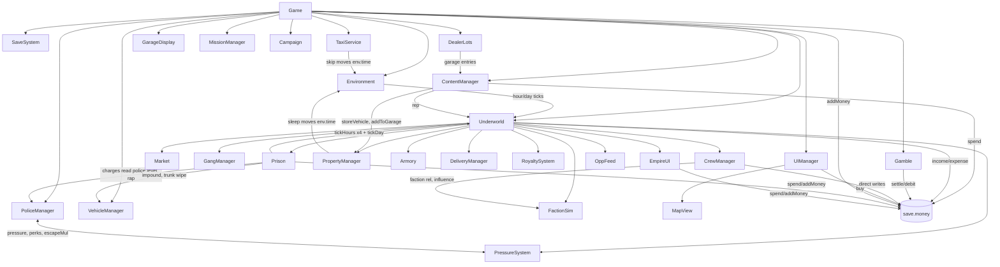

# OVERHAUL_STATUS.md — The Underworld overhaul

This file is the continuity bridge between Claude sessions. Read it after
`docs/THE_UNDERWORLD_MASTER_HANDOFF_FINAL.md` and `docs/THE_UNDERWORLD_BUILD_SESSION_PROMPTS.md`.
Line references (`index.html:NNNN`) are for base revision `3be344e`. Since Session 0.5 the source lives in
`src/` and `index.html` is generated, byte for byte, from it. Translate a reference with
`node underworld/tools/build.mjs --where NNNN` (for example `49776` → `src/game/520-underworld-prison.js:143`).
The mapping stays exact until a session changes the code above that line; after that, search by the quoted name.

---

## Current phase

- Session: **0.5 — Source module split** (owner amendment §45.3). Behavior-preserving; no gameplay change.
- Commit/base revision: `aedb83f` (Session 0 amendments) → the Session 0.5 commit on
  `claude/practical-lamport-zld81y`.
- Date: 2026-10-20

## Completed this session (0.5)

- Split `underworld/index.html` into `underworld/src/` (72 parts, listed in build order in `src/manifest.json`):
  - `shell/00-head.html`, `shell/10-body.html`, `shell/20-game-open.html`, `shell/90-tail.html`: the page around the
    scripts (head and meta tags, HUD/menu markup, the two small boot scripts, closing tags);
  - `styles/main.css`: the whole `<style>` block body;
  - `vendor/three-r160-bundle.js`: the unmodified three.js bundle (31,720 lines);
  - `game/000-prologue.js` … `game/650-core-boot.js`: 66 files, one per section header of the game module, in
    load order, numbered in steps of 10 so later sessions can insert files without renaming.
- Added `tools/build.mjs`: concatenates the parts byte for byte (no transforms), validates the manifest (every
  file under `src/` listed exactly once, Unix newlines, trailing newline) and syntax-checks both module scripts
  with `node --check`, reporting an error as `src/<file>:<line>`. `--check` verifies without writing; `--out`
  writes elsewhere; `--where N` maps an `index.html` line to its source file and line.
- Added `tests/build.mjs` (Node, no browser): fails if `index.html` isn't exactly what `src/` builds.
- README: "Source layout and the build" section; the three.js rebuild instructions now write into `src/vendor/`.

### Why concatenation and not ES `import`/`export` modules (engineering decision, recorded)

The game module is one shared top-level scope: hundreds of `const`/`class` names declared in one section are
used in others (for example `PROP_BY_ID`, `fmtMoney`, `GOODS`, `VEHICLES` everywhere). Rewriting that into
explicit imports would change evaluation order, hoisting and temporal-dead-zone behavior, so it can't be
behavior-preserving in one step, and it would require a bundler at runtime or build time. Ordered concatenation
keeps the single scope, gives a byte-identical deliverable that still opens offline from `file://`, and makes
"behavior-preserving" provable (identical bytes). Later sessions can narrow a subsystem's surface to an explicit
API object (for example the Session 1 `Money` ledger) without a module system. If a real module graph is ever
wanted, it should be its own session.

## Files / systems changed (0.5)

- New: `underworld/src/**` (72 files + `manifest.json`), `underworld/tools/build.mjs`, `underworld/tests/build.mjs`.
- Changed: `underworld/README.md`.
- `underworld/index.html`: regenerated by the build, **byte-identical** to `3be344e`
  (SHA-256 `81ae6a0ec6a63b2dd53cfdcb1d46139f1ef990029316f74b91f93d1ba8211c95`, 2,980,084 bytes).

## Save/schema changes (0.5)

- None. Schema 7, key `pvunderworld.save.v1`.

## Tests run (0.5): full suite before and after

Every available suite (45 browser/Node suites plus the 6 screenshot scripts), run twice, two at a time, as the
README's validation does: first against a frozen copy of the original `3be344e` file, then against the
`index.html` built from `src/`. Every suite that failed in either run was re-run alone on both files. The built
file is byte-identical to the original, so any difference between runs can only come from randomness or machine
load; the table shows that is what happened.

| Suite | before (original, 2 in parallel) | after (built, 2 in parallel) | solo re-run before | solo re-run after |
| --- | --- | --- | --- | --- |
| stress | 30 / 30 | 29 / 30 | 30 / 30 | 30 / 30 |
| soak | 22 / 22 | 22 / 22 |  |  |
| gambling | 56 / 57 | 57 / 57 | 57 / 57 | 56 / 57 |
| casino | 39 / 39 | 38 / 39 | 39 / 39 | 39 / 39 |
| arrest | 126 / 126 | 126 / 126 |  |  |
| homes | 26 / 26 | 26 / 26 |  |  |
| interiors | 22 / 22 | 22 / 22 |  |  |
| prison | 47 / 47 | 47 / 47 |  |  |
| property | 33 / 33 | 33 / 33 |  |  |
| session | 30 / 33 | 33 / 33 | 30 / 33 | 30 / 33 |
| ramps | 21 / 21 | 21 / 21 |  |  |
| vehicles | 39 / 39 | 39 / 39 |  |  |
| inventory | 58 / 58 | 58 / 58 |  |  |
| cargo | 36 / 36 | 36 / 36 |  |  |
| city | 25 / 25 | 25 / 25 |  |  |
| phone | 71 / 71 | 71 / 71 |  |  |
| map | 22 / 22 | 22 / 22 |  |  |
| taxi | 20 / 20 | 18 / 20 | 20 / 20 | 18 / 20 |
| stations | 17 / 17 | 17 / 17 |  |  |
| roads | 20 / 20 | 20 / 20 |  |  |
| shooting | 37 / 37 | 37 / 37 |  |  |
| survival | 9 / 9 | 9 / 9 |  |  |
| ui | 23 / 23 | 23 / 23 |  |  |
| offline | 14 / 14 | 14 / 14 |  |  |
| smoke | 16 / 16 | 16 / 16 |  |  |
| money | 10 / 10 | 10 / 10 |  |  |
| business | 40 / 40 | 40 / 40 |  |  |
| dealers | 34 / 34 | 34 / 34 |  |  |
| street | 11 / 11 | 11 / 11 |  |  |
| pwa | 5 / 5 | 5 / 5 |  |  |
| camera | 20 / 20 | 20 / 20 |  |  |
| police | 13 / 13 | 13 / 13 |  |  |
| gangs | 23 / 23 | 23 / 23 |  |  |
| kingpin | 6 / 6 | 6 / 6 |  |  |
| tutorial | 13 / 13 | 13 / 13 |  |  |
| phoneapps | 19 / 19 | 19 / 19 |  |  |
| static-money | 11 / 11 | 11 / 11 |  |  |
| build | — | 5 / 5 |  |  |
| core | 63 / 64 | 64 / 64 | 64 / 64 | 64 / 64 |
| royale-sim | 23 / 23 | 23 / 23 |  |  |
| shots | exit 0 | exit 0 |  |  |
| cityshots | exit 0 | exit 0 |  |  |
| frontshots | exit 0 | exit 0 |  |  |
| qashots | exit 0 | exit 0 |  |  |
| contact | exit 0 | exit 0 |  |  |
| carshots | exit 0 | exit 0 |  |  |

**Verdict: no behavior change.** Every failure appeared on only one side, or on both, and none is tied to the
split:

| Check | Seen in | Cause |
| --- | --- | --- |
| session: "bought smokes wholesale from Sully" (+2 checks that depend on it) | before ×2, after ×1 of 4 runs | **pre-existing test fragility**: earlier steps (pickpocket, mugging) can leave hot goods in the 12-unit pockets, so only 8 of the 10 smokes fit. Fix the test in Session 1 (it seeds money and pockets anyway). |
| taxi: "the cab actually drives you through town" / "it stays on the roads" | after ×2 of 2; then 5 alternating solo runs: built 5/5 pass, original 4/5 (failed once) | **pre-existing flake**: the cab AI in random traffic covers < 150 m in 25 s now and then, on both files. |
| gambling: "casino interior renders without a frame-rate collapse" | before (parallel) | software-GL frame rate under parallel load; listed in the README |
| gambling: "slot: the three reels stop one after another" | after (solo) | reel-stop timing; listed in the README as timing-sensitive |
| casino: "poker: ~60–68% of played hands win" | after (parallel) | 1,500-hand random sample (62.5% here; the bound sits on a random rate); listed in the README |
| stress: "no frame stall over 2.5 s" | after (parallel) | software-GL stall under parallel load (2,683 ms); listed in the README |
| core: "melee facing W+D (moving): no snap back" | before (parallel) | frame timing under load; 64/64 in all three other runs |

Screenshots (`shots`, `cityshots`, `qashots`, `frontshots`, `carshots`, `contact`): 182 images per run, compared
pixel by pixel. None is identical (paint colours, pedestrians and traffic are random per run): median mean
difference 0.96 / 255 per channel, 90th percentile 7.3. The largest differences were inspected by eye: a car
painted a different random colour, and a rank banner caught mid-fade in one run. The two contact sheets that
differ in size tile whatever images are in the folder at the time. No geometry, lighting or UI difference.

## Performance (0.5)

`tests/perf.mjs`, desktop profile, low quality, SwiftShader, run alone (nothing else running), four alternating
runs per build. The built file is byte-identical, so any difference is run-to-run noise:

| | original `3be344e` | built from `src/` |
| --- | --- | --- |
| update ms/frame, calm | 0.98 / 0.95 / 0.99 / 1.19 | 1.43 / 0.84 / 0.98 / 1.20 |
| update ms/frame, busy | 1.48 / 0.97 / 1.46 / 1.42 | 1.13 / 1.27 / 1.17 / 1.34 |
| render ms/frame, calm | 2.5 / 3.8 / 3.8 / 3.7 | 3.3 / 2.4 / 2.7 / 3.5 |
| draw calls, calm | 116 / 116 / 118 / 121 | 117 / 118 / 118 / 118 |
| triangles, calm | 373.8k-377.6k | 369.6k-378.8k |
| console errors | 0 | 0 |

## Deprecated / removed code (0.5)

- None. Editing `index.html` directly is now deprecated as a workflow: edit `src/`, rebuild.

## Known bugs / risks (0.5)

- `index.html` is a committed build artifact. A deployment that bumps the `build-version` meta tag must edit
  `src/shell/00-head.html` and rebuild; `tests/build.mjs` catches a hand edit.
- Line references elsewhere in this file are for `index.html`; use `--where` (above).
- Flaky checks that predate the split and should be fixed before they mask a real regression: the session
  suite's pocket-space assumption (Session 1), the taxi 25-second drive check, and the four load- or
  sample-sensitive checks above. A full-suite run should be judged with a solo re-run of anything that fails.

## Exact next recommended task

**Session 1 — Save schema + money foundation**, following the plan under "Exact next recommended task
(Session 1 plan)" below, now as edits to `src/game/030-core-save-system.js`, `450-underworld-core.js`,
`630-core-game.js` and the other files the money inventory lists. Do not convert any money behavior until the 8 AWAITING rows in the Appendix B review table are approved
(§45.14, §45.17), and settle DC-19 to DC-21 (they shape the ledger's fields).

## Working tree / commit state (0.5)

- Clean after the Session 0.5 commit; see `git log` on `claude/practical-lamport-zld81y`.

---

# Session 0 record (orientation)

## Session 0: phase

- Session: **0 — Orientation / plan only** (handoff phase 1). No gameplay code changed.
- Commit/base revision: `3be344e` ("Underworld: build-version meta tag (deployment only)"), the head of
  `claude/underworld-gameplay-pass-849yr8`. The uploaded `index_update.html` is byte-identical to
  `underworld/index.html` at that commit (checked with `cmp`). The handoff calls the reviewed build
  "index 16(2).html"; in the repo it is the v7 / schema 7 build described in `underworld/README.md`.
- Working branch: `claude/practical-lamport-zld81y` (fast-forwarded to `3be344e`, then the commit below).
- Date: 2026-10-20

## Session 0: completed

- Read the full Master Handoff and Build Session Prompts. Both are now in the repo under `underworld/docs/`
  (wording unchanged, Markdown layout only), so later sessions don't depend on chat history.
- Audited `underworld/index.html` (55,157 lines; game module from line 32,625, after the inlined three.js r160
  bundle) and `underworld/README.md`. Classified every major subsystem (Appendix A).
- Inventoried every player-money read/write (Appendix B), mapped every §37 conflict to exact code (Appendix C),
  drew the dependency graph (Appendix D), listed save breakpoints (Appendix E), regression hotspots and the tests
  each risky refactor needs (Appendix F), hidden coupling (Appendix G), and started the deprecation list
  (Appendix H) and schema changelog (Appendix I).
- Raised 16 DESIGN CHALLENGES (below; DC-17 and DC-18 were added after the owner's review). Five are IMPORTANT (DC-01 to DC-05); DC-02, DC-03 and DC-04 shape the
  Session 1-2 work.
- Added one test scaffold: `underworld/tests/static-money.mjs` (Node, no browser). It inventories money access
  by function and fails if a direct `save.money` write appears outside today's allowlist. Session 1 shrinks the
  allowlist to the ledger alone.
- Ran a baseline of the suites Session 1 will touch (results under "Tests run").

## Session 0: files / systems changed

- `underworld/OVERHAUL_STATUS.md` (new, this file)
- `underworld/docs/THE_UNDERWORLD_MASTER_HANDOFF_FINAL.md` (new, transcribed spec)
- `underworld/docs/THE_UNDERWORLD_BUILD_SESSION_PROMPTS.md` (new, transcribed prompts, plus a numbering note)
- `underworld/tests/static-money.mjs` (new test, read-only against `index.html`)
- `underworld/README.md` (an "Overhaul in progress" pointer and the new test in the test list)
- `underworld/index.html`: **unchanged**

## Session 0: save/schema changes

- None. Save key `pvunderworld.save.v1`, `SAVE_VERSION = 7`, `UW_VERSION = 1` (index.html:33012-33022, 46903).

## Session 0: deprecated / removed code

- Nothing removed yet. The deprecation list Session 1+ must work through is Appendix H.

## Session 0: tests run

Baseline on the unmodified build, headless Chromium + SwiftShader, offline, run one at a time.

| Test | Result |
| --- | --- |
| `node underworld/tests/static-money.mjs` (new) | PASS: 14 direct writes in 11 functions, 85 funnel calls in 65 call sites, 133 reads in 67 functions |
| `node underworld/tests/smoke.mjs` | 16 / 16 |
| `node underworld/tests/money.mjs` | 10 / 10 |
| `node underworld/tests/cargo.mjs` | 36 / 36 |
| `node underworld/tests/arrest.mjs` | 126 / 126 |
| `node underworld/tests/prison.mjs` | 47 / 47 |
| `node underworld/tests/session.mjs` | 33 / 33 |

The other 39 browser suites were not re-run in this session: no game code changed. Their last recorded results are in
`underworld/README.md` § "Validation record (v7 pass)".

## Session 0: regression checks against earlier phases

- No earlier overhaul phase exists. The build's own v7 validation record (README) is the reference baseline.

## Session 0: performance observations

No real-device measurement was possible in this session. From the README's `tests/perf.mjs` record (desktop
SwiftShader, low quality): game-logic update ~1.0-1.3 ms/frame calm; 116-120 draw calls; ~360k triangles calm.
Static facts that matter for iPhone:

- One 2.98 MB HTML file: about 1.2 MB of inlined three.js plus a ~22,500-line inline game module. Safari parses
  and compiles all of it on every cold launch. Measure parse/compile time on a real device before Session 15.
- Large CPU-side rasters: `LOCAL` local-road raster 1536² RGBA (~9.4 MB as a JS array, plus its GPU texture),
  AO texture 1056², sign and neon canvases.
- Systems the overhaul adds that will cost frame time: 5-level warehouse exteriors/interiors (×N warehouses),
  physical shipments (box-truck AI on the road graph), raid reinforcements (more armed NPCs), the casino
  complex, the two-tier jail, the motorsport complex (large drivable area outside the 960 m lattice), rough
  Cedar Fields terrain. The existing patterns (on-demand interiors via `interiors.addDynamic`, chunk LRU,
  instanced props, `GANG_CAP`, `unitCap`) should be reused for all of them. Budget them in Sessions 3-6.
- `HitchLog` (index.html:52932) and `QualityManager` (index.html:54266) are KEEP. Real-device hitch logs
  should be collected before Session 15.

---

# Standing records (kept current every session)

## DESIGN CHALLENGES raised

Each needs an owner decision before the session named in "Blocks". Nothing below has been implemented.

### DC-01 · Casino is a guaranteed money printer, and its winnings become Clean Bank — IMPORTANT

**Disposition (owner):** ACCEPTED as §45.4. Ordinary casino economics with a modest house edge for routine play; the huge progressive, the $10,000 qualifying wager, the anti-drought system and career-changing jackpots stay. Session 9.

1. **Current specification:** §25: casino winnings are Clean Bank; gambling is optional acceleration; big wins
   genuinely help; "do not secretly punish the player for luck". Session 13: "no safe repeatable loop dominates
   everything". §25 also says a $10,000 max bet qualifies for the progressive.
2. **Problem observed:** the current casino is deliberately rigged for the player (`CASINO`, index.html:51554:
   roulette pockets weighted so a layout wins 60% of rounds; in blackjack a busting card is put back 72% of the
   time and a dealer win over a standing hand is re-dealt 82% of the time; Hold'em deals a favourable deck on 10%
   of hands), and it has no table limits (quick bets up to $1B). The README's own Monte Carlo puts a
   1-hour Royale session at $1,000 a spin at a **mean of +$51.5M, 93.5% of sessions profitable**. Under the new
   money model that is unlimited, near-risk-free **Clean** money. It makes laundering, businesses, the warehouse
   economy and Rank pacing pointless.
3. **Proposed improvement:** honest odds with a real but modest house edge (tables ~1-3%, slots RTP ~92-97%
   shown on the machine); the windfall comes from genuinely random jackpots and the world-time progressive, not
   from rigged base games. Restore table limits by room (floor / high-limit / VIP), and cap the progressive-qualifying bet at
   $10,000, which is how this file reads §25's "$10,000 max bet qualifies".
4. **Why it is better:** keeps "do not secretly punish luck" (the RNG is honest and the odds are shown), keeps
   life-changing jackpots possible, and stops one building from out-earning the entire criminal empire.
5. **Systems affected:** `Gamble`, `CASINO`, `ROYALE*`, the `casino` / `gambling` / `royale-sim` suites (their
   60/40 assertions become house-edge assertions), economy balance.
6. **Tradeoffs / risks:** this reverses the v6 owner request for a no-limit, player-favoured casino. Players who
   liked it will notice.
7. **Blocks:** Session 9 (and the Session 1 ledger must support a chips account).

### DC-02 · Dirty Cash → casino chips → Clean winnings is an unlimited instant laundromat — IMPORTANT (contradiction)

**Disposition (owner):** ACCEPTED as §45.5. Wagers, chips and lottery purchases are Clean Bank only; winnings are Clean Bank; no Dirty route through the casino. The ledger's payment policy must express "Clean only" (Session 1).

1. **Current specification:** §2 "No unlimited instant laundering"; §25 "Casino winnings are Clean Bank". The spec
   doesn't say what currency buys chips.
2. **Problem observed:** if chips (or scratch cards, $1M grand prize on a $100 card) can be bought with Dirty Cash
   and every payout is Clean, the cage is a 0%-fee laundromat. Even with honest odds, a near-even game (blackjack
   ~0.5% edge) launders at ~0.5% instead of the 5-25% the spec intends.
3. **Proposed improvement:** chips and lottery tickets are bought with Clean Bank only. Dirty Cash at the cage is
   accepted only up to a small daily amount without a casino-owned front, and a buy-in above the reporting
   threshold raises police case heat. Net winnings on a dirty buy-in come back as Dirty unless the player owns
   the casino front.
4. **Why it is better:** closes the loophole without touching the "winnings are Clean" rule for normal play.
5. **Systems affected:** ledger payment policy, `Gamble`, scratch cards, `PressureSystem`.
6. **Tradeoffs / risks:** an early player with only Dirty Cash can't gamble much (by design).
7. **Blocks:** Session 1 (the payment-policy API must express "Clean only" / "Dirty capped"), Session 9.

### DC-03 · First-clean-dollar bootstrap can soft-lock laundering — IMPORTANT (circular requirement)

**Disposition (owner):** ACCEPTED as §45.6. An early, low-capacity laundering fixer at ~30–35%; proper fronts supersede it. Dirty-purchasable starter fronts were not adopted (the fixer alone breaks the circle).

1. **Current specification:** major legitimate assets use Clean Bank (§2); laundering needs a front business
   (§2, §26); legal fees use Clean Bank (§24).
2. **Problem observed:** a new career earns only Dirty Cash. Buying the first front needs Clean Bank, and Clean
   Bank comes from fronts, laundering, the casino (Clean-only under DC-02) or legal sales. The only non-circular
   source today would be selling a legally owned car, and the first legally owned car also costs Clean money at a
   licensed dealer. That violates §41 "no circular unlock conditions".
3. **Proposed improvement:** two early, expensive escape valves: (a) a laundering contact (fixer) who washes
   small amounts at ~30% with a daily cap and no business required; (b) the starter fronts (laundromat, car wash,
   pawn) can be bought with Dirty Cash through that fixer at a premium. Saltworks Used Autos already accepts Dirty
   (§13); buying there and reselling legally is itself a small, lossy laundering path, so its resale spread must
   stay worse than the fixer's fee.
4. **Why it is better:** guarantees a path from $0 Dirty to the first Clean dollar at every point, including
   after losing everything (§39 #41, #43).
5. **Systems affected:** ledger, contacts, `PropertyManager.buy`, laundering queue, onboarding.
6. **Tradeoffs / risks:** the fixer's fee must stay worse than any owned front, or nobody buys fronts.
7. **Blocks:** Session 1 (payment policy per purchase), Session 9 (laundering), Session 12 (contact).

### DC-04 · "Money can't buy influence" contradicts "influence comes from businesses" — IMPORTANT (contradiction)

**Disposition (owner):** ACCEPTED as §45.7. No instant Influence or Rank from buying a business; gradual Influence once it is operating and established. Session 2.

1. **Current specification:** §1 money does not buy Rank, Rep, turf, contacts, loyalty or political influence,
   but a rich player may buy any legitimate asset. §30 influence comes from empire position, turf, **businesses**,
   crew, contacts and corruption.
2. **Problem observed:** today `Underworld.computeInfluence` (index.html:47255) adds 15 influence per owned
   business plus each property's `infl` (Club Neon 30, penthouse 40, ...), and `PropertyManager.buy` grants
   +40/+20 Rep per purchase (index.html:49009). Influence then gates Rank 5 and 6 (≥450, ≥800). A casino
   billionaire who buys 50 businesses gets about 750 influence and a Rank boost. That is exactly §39 #6/#7.
3. **Proposed improvement:** an owned business contributes influence only once **established**: operated for N
   world days with a manager, or sitting on turf you control. No Rep is granted for any purchase. Rank gates read
   non-purchasable power: turf held, active crew and lieutenants, staffed warehouses, territory income.
4. **Why it is better:** resolves the contradiction and makes Rank mean what §1 says it means.
5. **Systems affected:** `computeInfluence`, `PropertyManager.buy`, Rank gates, `kingpin` suite.
6. **Tradeoffs / risks:** buying a business feels less immediately rewarding.
7. **Blocks:** Session 2.

### DC-05 · Jail fast-forward plus unified world time turns arrest into an income time-machine — IMPORTANT

**Disposition (owner):** ACCEPTED as §45.8, with the owner's mechanism: 1:1 world time stays; managed legitimate businesses can stay strong, unmanaged operations decline, criminal logistics/distribution suffer substantially without Lieutenants or appropriate crew. Sessions 3/8/9.

1. **Current specification:** §24: every jail day equals an outside day; businesses earn and crew keep working;
   speeds 1×/3×/5×/7×. Gym benefits are capped "to prevent arrest farming".
2. **Problem observed:** `JAIL_SEC_PER_DAY = 2` (index.html:49732). At 7× a world day passes in ~0.29 real
   seconds, so a 1-year sentence is ~1.7 real minutes of chores. That is 365 world days of business income, crew
   work, royalties and ~$219M of progressive growth. Sleeping (`PropertyManager.sleep`, index.html:49052) is a
   second, repeatable half-day skip. Any healthy empire becomes a reason to get arrested on purpose.
3. **Proposed improvement:** keep unified time, but make an unattended empire's expected value less than an
   attended one's: unmanaged businesses decay toward a reduced output after a few absent days, crew loyalty and
   rival pressure accrue per absent day, and a Lieutenant offsets most (not all) of it (this is §39 #35/#36,
   made explicit). Sleep is limited to once per in-game night and requires being tired or hurt.
4. **Why it is better:** closes the exploit without breaking unified time, and gives Lieutenants a measurable job.
5. **Systems affected:** `Prison.update`, `PropertyManager.tickDay`, `CrewManager.tickDay`, sleep, economy.
6. **Tradeoffs / risks:** jail feels costlier for an established player, which is arguably correct.
7. **Blocks:** Session 8 (and Session 3 for Lieutenant semantics).

### DC-06 · Player-configurable day length scales the whole economy — RECOMMENDED

**Disposition (owner):** ACCEPTED as §45.9. Economic simulation decoupled/normalized from the day-length setting. Owning session: Session 1 defines the world clock the ledger and laundering use; per-day income normalization lands with each income system (Sessions 3, 9) and is verified in Session 13.

1. **Current specification:** §33 time of day matters; everything persistent is world-time based (§25, §35).
2. **Problem observed:** Settings › Day length is 4-60 real minutes (`settings.dayLength`, index.html:42014,
   33201). Business income, wages, royalties, laundering and the progressive are per world day, so a 4-minute day
   pays 7.5× more per real hour than a 30-minute day.
3. **Proposed improvement:** fix the economic day (for example 30 or 48 real minutes, decided in Session 13) and
   remove the setting, or keep it presentation-only by scaling per-day amounts by day length.
4. **Why it is better:** one economy to balance, with no settings exploit.
5. **Systems affected:** `Environment`, settings UI, every per-day income.
6. **Tradeoffs / risks:** players lose a customisation; the cab's time skip also moves the clock (index.html:52691).
7. **Blocks:** Session 13 (no impact on Session 1 if the ledger is world-time agnostic).

### DC-07 · "5 in-game minutes" threat timer is ~6 real seconds — RECOMMENDED (unit contradiction)

**Disposition (owner):** ACCEPTED as §45.10. Real-time timer: ~2 min to THREAT IMMINENT, then ~60 s to execution, independent of world-clock speed. Session 4.

1. **Current specification:** §10: an unopened threat warning escalates after about 5 in-game minutes. §9 raid
   windows of 4.5 / 7-10 minutes give no unit.
2. **Problem observed:** at the default 30-minute day, one in-game minute is 1.25 real seconds, so the second
   warning would fire ~6 s after the first. That can't be the intent.
3. **Proposed improvement:** define short tactical timers (threat escalation, raid reinforcement windows, store
   alarms) in **real seconds of play**, and long strategic timers (sentences, laundering, cooldowns, progressive
   growth, robbery restock) in **world days**. Threat escalation: ~5 real minutes.
4. **Why it is better:** removes ambiguity before any timer is built.
5. **Systems affected:** threats, raids, robberies, laundering.
6. **Tradeoffs / risks:** real-time timers keep running while the phone is open; pause rules must be explicit.
7. **Blocks:** Session 4.

### DC-08 · Dirty Cash has no physical form — RECOMMENDED (owner decision)

**Disposition (owner):** REJECTED in favour of the simpler model (§45.1). No weight, no carry cap; arrest exposure is the penalty.

1. **Current specification:** §2 Dirty Cash is carried, stashed and vaulted; §7 "carrying $5,000,000" is fine; the
   vault has capacity that grows with upgrades; arrest seizes carried and in-vehicle cash.
2. **Problem observed:** if On Me is unlimited, the vault cap only limits safety, never logistics, and moving $5M
   is free. The game already has a weight-based cargo system (`CARGO_LB`, `GOOD_CLB`, index.html:46378-46391).
3. **Proposed improvement:** Dirty Cash has weight (a $100 bill is 1 g, so $1M in hundreds ≈ 22 lb; smaller bills
   weigh more). Pockets hold up to a small amount (for example $50k); a duffel or briefcase item raises it to
   ~$1M; trunks hold cash by weight next to product. Vault capacity stays separate from product storage, as §7 requires.
4. **Why it is better:** makes cash logistics, trunk seizure and Driver cash runs meaningful, reusing a system
   that is already conservation-tested.
5. **Systems affected:** ledger locations, cargo, arrest seizure, warehouse vault UI.
6. **Tradeoffs / risks:** more friction early; contradicts the "$5M in your pocket" example unless a bag is owned.
   **Alternative:** unlimited carry (simpler). Session 1 can build either if the location model is generic.
7. **Blocks:** Session 1 (capacity rules for the On Me / Vehicle locations).

### DC-09 · Lieutenant cash stipend is money from nothing — RECOMMENDED

**Disposition (owner):** not ruled on directly. §45.8's operational-efficiency model gives Lieutenants their value; removing the flat stipend is consistent with it and stays a Session 3 proposal for the owner to confirm with the Appendix B review.

1. **Current specification:** §5 the Lieutenant manages warehouse/district, automates dispatch, coordinates defense.
2. **Problem observed:** `CrewManager.work` pays `150 + 2·skill` per held turf per day for each Lieutenant, with no
   product, customers or risk (index.html:48832-48836).
3. **Proposed improvement:** remove the stipend. The Lieutenant's value is automation (dispatch, resupply), a
   throughput or price bonus on Dealers in their district, defense coordination and reduced absence decay (DC-05).
4. **Why it is better:** every dollar comes from a simulated sale, rent or tax; it fits §8's logistics loop.
5. **Systems affected:** `CrewManager.work`, ledger categories, economy.
6. **Tradeoffs / risks:** mid-game income drops until Session 13 rebalances.
7. **Blocks:** Session 3.

### DC-10 · Off-screen turf changes need a rule — RECOMMENDED (clarification)

**Disposition (owner):** ACCEPTED as §45.13. Only explicit Take Turf / showdown success changes ownership, for anyone. The off-screen auto-resolved showdown rule is the proposed implementation (Sessions 2/4).

1. **Current specification:** §4 "No silent ownership flips from background influence"; explicit Take Turf and a
   showdown. §10 rivals do coordinated turf takebacks.
2. **Problem observed:** today ownership is derived every second from influence thresholds
   (`Underworld.recompute`, index.html:47208). FactionSim, Enforcers, Lieutenants and betrayal all move influence,
   and turfs flip with only a banner. The spec doesn't say how rival-vs-rival or rival-vs-player flips work while
   the player is elsewhere or jailed.
3. **Proposed improvement:** persist `owner` per turf as authoritative state. Influence only measures control and
   can make a turf "contestable". Any change of owner, for anyone, goes through a showdown event: played live if
   the player is present, otherwise auto-resolved from defenders (assigned crew, Lieutenant) against attackers,
   with a Critical message and a deep link.
4. **Why it is better:** one rule for every flip, no silent changes, and jail-time losses can be explained.
5. **Systems affected:** `Underworld.recompute` / `onTurfChange`, `FactionSim`, `CrewManager.disloyalty` (coup),
   `kingpin` suite.
6. **Tradeoffs / risks:** turf state becomes saved data instead of derived data (a schema change).
7. **Blocks:** Session 2 (Rank reads turf count) and Session 4.

### DC-11 · Knock-down loot is mugging under another name — RECOMMENDED (clarification)

**Disposition:** open; decided with the Appendix B review (§45.14) before Session 10.

1. **Current specification:** §20 "Dedicated mugging subsystem is cut. Attack = assault/combat."
2. **Problem observed:** `Underworld.onKnock` (index.html:47522) makes 75% of knocked-down civilians spill about
   half their pocket loot. That is the mugging loop with no prompt.
3. **Proposed improvement:** civilians knocked down drop nothing (assault is only a crime). Gang members, dealers
   and bosses keep their drops (robbing criminals is a listed Dirty source).
4. **Why it is better:** honours the cut and leaves pickpocketing as the civilian-theft verb.
5. **Systems affected:** `onKnock`, `CashPickups`, `st.mugs`, `street` suite, tutorial text.
6. **Tradeoffs / risks:** fewer early money options (§39 #41 still holds through pickpocket, chop shop and fence).
7. **Blocks:** Session 10 (wording removal in Session 2/12).

### DC-12 · Ammo categories vs per-weapon reserves — OPTIONAL (contradiction)

**Disposition (owner):** RESOLVED as §45.11. Three shared reserve pools (Handgun, Shotgun, Rifle/SMG); per-weapon magazine sizes; no per-weapon reserve limits. See DC-17 for the pool caps.

1. **Current specification:** §17 ammo categories Handgun / Shotgun / Rifle; reserves Pistol 240, Heavy 144,
   SMG 480, Rifle 360.
2. **Problem observed:** if the pistol, heavy pistol and SMG share the Handgun pool, they can't have three
   different reserve caps.
3. **Proposed improvement:** either a fourth category (SMG uses its own 9 mm pool, Heavy uses magnum), or one
   Handgun pool with a single cap (~480) and per-weapon magazine sizes only.
4. **Why it is better:** a stash and armorer UI with one number per category.
5. **Systems affected:** `Armory`, `WEAPONS`, save ammo fields.
6. **Tradeoffs / risks:** none significant.
7. **Blocks:** whichever session rebuilds weapons (not scheduled explicitly; propose Session 10).

### DC-13 · Single-file source is a maintainability hazard for a 16-session overhaul — RECOMMENDED (engineering)

**Disposition (owner):** ACCEPTED as §45.3: Session 0.5, behavior-preserving, full regression before and after, no gameplay changes in the same commit.

1. **Current specification:** none (the build is one offline `index.html`; README requires that it opens from
   `file://`).
2. **Problem observed:** every session edits a 55k-line file whose game module is one 22.5k-line inline script;
   diffs are hard to review, line anchors drift, and parallel edits conflict.
3. **Proposed improvement:** move the game module into `underworld/src/*.js` (one file per subsystem, same code)
   with a deterministic, dependency-free Node build (`tools/build.mjs`) that concatenates them back into the same
   single offline `index.html`. Tests keep targeting the built file. Do it as its own commit, verified by a
   byte-identical rebuild before any logic change.
4. **Why it is better:** reviewable diffs, stable module boundaries for the APIs the overhaul needs, and the
   deliverable is unchanged.
5. **Systems affected:** repository layout, README, every future session.
6. **Tradeoffs / risks:** one large mechanical commit; the build step must run before tests (add it to each suite's
   runner). Must be done before Session 1 or not at all; doing it mid-overhaul is worse.
7. **Blocks:** optional pre-Session-1 commit. Owner decision.

### DC-14 · Save generation: new key now, migration only for development — RECOMMENDED (engineering + persistence)

**Disposition (owner):** ACCEPTED as §45.2. Dev-save money migrates to Clean Bank; production uses a fresh career and a new schema.

1. **Current specification:** §35 final production uses a clean new save generation; dev saves may migrate.
2. **Problem observed:** `SaveSystem.load`'s `merge()` keeps a saved value only when its type matches the default
   (index.html:33087). Turning `money` from a number into an object would silently drop the old balance to the
   default, with no error.
3. **Proposed improvement:** Session 1 introduces schema 8 under the same key, with an explicit pre-merge
   migration that reads the raw `data.money`. The production cut (Session 16) switches to a new key
   (`pvunderworld.save.v2`) and deletes all `<8` migration code.
4. **Why it is better:** dev saves survive the overhaul, and production starts clean as specified.
5. **Systems affected:** `SaveSystem`, `Underworld.sanitize`, every suite that seeds a save.
6. **Tradeoffs / risks:** migration code is temporary by design and must be on the deprecation list.
7. **Blocks:** Session 1. Owner input needed for Q4 below.

### DC-15 · Burglary report chance stacks per container — RECOMMENDED (spec conformance, noted early)

**Disposition:** spec conformance, no decision needed. Session 10.

`ContentManager.searchContainer` (index.html:44947) rolls 7%+1.5%/search per drawer and 35% per safe, so a full
house search is reported far more often than the spec's ~17-18% overall. Session 10 should roll one report
budget per break-in (weighted by noise) instead. Spec-aligned; listed so it isn't missed.

### DC-16 · Taxi with carried product — OPTIONAL (clarification)

**Disposition:** open; confirm in Session 11. Under §45.1 there is no cash pocket limit, so the cash condition becomes "carrying Dirty Cash is allowed in a cab, at the usual arrest risk".

§27 says the taxi must not bypass cargo shipments or logistics. Pocket-sized product in a cab seems fine; major
shipments, HOT cars and Dirty Cash above the pocket limit (DC-08) should block a hire. Confirm in Session 11.

### DC-17 · Shared ammo pools need one cap each — OPTIONAL (follows from §45.11)

**Disposition (owner):** APPROVED as §45.15. Handgun 240, Shotgun 96, Rifle/SMG 480; per-weapon magazines kept; per-weapon reserve caps removed.

1. **Current specification:** §45.11: three shared reserve pools (Handgun, Shotgun, Rifle/SMG); §17's old per-weapon
   reserves (Pistol 240, Heavy 144, SMG 480, Rifle 360) are removed.
2. **Problem observed:** the pools still need a cap each, and the old numbers disagree inside a pool (SMG 480 vs
   Rifle 360; Pistol 240 vs Heavy 144).
3. **Proposed improvement:** Handgun 240, Shotgun 96, Rifle/SMG 480. Each is the largest old reserve in its pool, so
   no weapon gets less reserve than before. Stashes are uncapped per pool (they are storage, not carry).
4. **Why it is better:** one number per pool in the HUD, the Armorer and stash UIs.
5. **Systems affected:** `Armory`, `WEAPONS`, save ammo fields, arrest seizure of carried ammo.
6. **Tradeoffs / risks:** the heavy pistol shares the 240 Handgun pool with the pistol, so heavy-pistol users get more
   effective reserve than §17 intended. Tune in Session 13 if needed.
7. **Severity:** OPTIONAL. **Blocks:** the weapons rebuild (Session 10).

### DC-18 · The real-time threat timer needs pause and absence rules — RECOMMENDED (follows from §45.10)

**Disposition (owner):** APPROVED WITH ADDITION as §45.16. Runs during active gameplay; the pause menu freezes it; the phone and map do not; app/browser suspension, backgrounding, an inactive tab and genuine loading states freeze it; while jailed, assigned crew and Lieutenants resolve the defense automatically from the asset's actual security and crew state.

1. **Current specification:** §45.10: ~2 min to THREAT IMMINENT, ~60 s to execution, independent of world-clock speed.
2. **Problem observed:** the spec doesn't say whether the timer runs while the game is paused, in the phone or map,
   during a cab skip, in an interior, or while the player is jailed (where 7× time compresses the world).
3. **Proposed improvement:** the timer counts real seconds of *active play* only: it stops while the pause menu is
   open or the app is backgrounded, keeps running with the phone or map open (the player is choosing how to respond)
   and during interiors. A cab skip doesn't advance it. In jail, threats skip the warning chain and resolve at once
   through automatic crew defense (§10) with a Critical message, because the player can't respond.
4. **Why it is better:** no free time from menus, no unwinnable timers while jailed, and §39 #34/#35/#36 behave
   predictably.
5. **Systems affected:** threats/messages (Session 4), prison (Session 8), `TaxiService`.
6. **Tradeoffs / risks:** the phone counting toward the timer could feel strict; playtest it.
7. **Severity:** RECOMMENDED. **Blocks:** Session 4.

### DC-19 · Clean Bank stunt bonuses are a repeatable Clean faucet — RECOMMENDED (follows from §45.17)

**Disposition (owner):** APPROVED as §45.19, plus diminishing Rep returns for farming the same stunt/location if needed.

1. **Current specification:** §45.17: stunt bonuses → Clean Bank. §45.6: the laundering fixer is the intended
   bootstrap for a player's first Clean Bank.
2. **Problem observed:** every stunt pays cash with no cap and can be repeated: any jump pays `(4·distance +
   70·airtime)` ×1.5 if landed clean, a drift pays `score/12` (×1.5 in the wet), each near miss pays $10–80, and a
   unique jump adds $500 once (`StuntTracker`, `src/game/370-core-activities.js`). As Clean Bank, a player can
   farm the drift loop near a safehouse for clean money with no fee and no risk, which undercuts the fixer and the
   fronts.
3. **Proposed improvement:** keep the ruling (stunts pay Clean), but split it: one-time achievements (unique jumps,
   personal-best drifts, the 5/10/all jump milestones) pay their Clean bonus in full; repeatable stunt cash is
   capped per world day (for example $1,500/day, set in Session 13) and Rep keeps accruing past the cap.
4. **Why it is better:** stunts stay rewarding and Clean, without becoming the cheapest laundering route.
5. **Systems affected:** `StuntTracker`, ledger source tags, economy.
6. **Tradeoffs / risks:** a cap is one more number to tune and explain ("daily stunt winnings").
7. **Severity:** RECOMMENDED. **Blocks:** Session 1 only needs the source tag; the cap lands in Session 6 or 13.

### DC-20 · The hospital bill needs a shortfall rule — RECOMMENDED (follows from §45.17)

**Disposition (owner):** APPROVED as §45.20.

1. **Current specification:** §45.17: hospital bill → Clean Bank expense, no silent Dirty fallback, insufficient
   Clean must not soft-lock.
2. **Problem observed:** early players often have $0 Clean Bank. Something must happen to the unpaid part.
3. **Proposed improvement:** the unpaid part becomes **medical debt**, a visible line under Bank. Incoming Clean
   income pays it off first, automatically. Debt never blocks respawn, never touches Dirty Cash, never charges
   interest, and is capped (for example at one bill's worth of $1,500) so repeated deaths can't pile it up. The
   player can also pay it at the hospital in Clean Bank.
4. **Why it is better:** no soft lock, no hidden Dirty fallback, and the cost of dying is still real.
5. **Systems affected:** ledger (a `cleanDebt` field), `Game.respawn`, header and phone display.
6. **Tradeoffs / risks:** one more balance to show; a cap makes the 3rd+ death free until it's paid, which seems
   acceptable for a small bill.
7. **Severity:** RECOMMENDED. **Blocks:** Session 1 (the ledger owns the field).

### DC-21 · Which Dirty Cash pays the crew, and a Clean-rich player can't pay them — RECOMMENDED (follows from §45.17)

**Disposition (owner):** PARTIALLY APPROVED as §45.21: the payroll order and Crew UI are approved; the ATM Clean → Dirty withdrawal is **rejected**. Wages stay Dirty with no Clean fallback; a front/business payroll mechanism would need its own design challenge.

1. **Current specification:** §45.17: crew wages → Dirty Cash, no silent Clean fallback. §45.1: Dirty Cash is held
   by location (On Me, vehicle, safehouse, warehouse vault).
2. **Problem observed:** (a) the spec doesn't say which location payroll draws from. If it's On Me, a player who
   stashes their cash before risky work (§7's own example) leaves the crew unpaid; while jailed, On Me is seized
   and empty, so payroll fails during every sentence. (b) A player whose money is mostly Clean (a casino jackpot,
   business income) has no way to turn it into Dirty, so the crew walks out even though the player is rich.
3. **Proposed improvement:** (a) payroll draws Dirty from storage first, in this order: the warehouse vault of the
   crew's assignment → other warehouse vaults → safehouse stashes → On Me last. The Crew screen shows where
   payroll comes from and how many days it covers. (b) An explicit, visible **cash withdrawal** at a bank or ATM
   turns Clean Bank into Dirty Cash On Me at no fee with a daily limit (Clean → Dirty is never a laundering
   problem; it only loses the paper trail). Nothing happens silently.
4. **Why it is better:** payroll keeps working through jail (§45.8 depends on it), and wealth in the wrong currency
   never strands the player.
5. **Systems affected:** ledger, `CrewManager.tickDay`, Crew UI, a bank/ATM interaction.
6. **Tradeoffs / risks:** a withdrawal limit is another tunable; an ATM needs a world location (existing bank
   buildings or the Fuel & Go stores).
7. **Severity:** RECOMMENDED. **Blocks:** Session 1 (payroll source order and the withdrawal API).

## Owner decisions (Session 0 review)

The owner's decisions are recorded as authoritative amendments in `docs/THE_UNDERWORLD_MASTER_HANDOFF_FINAL.md` §45
(§45.1–§45.14) and as a disposition line under each design challenge above. Answers to the Session 0 questions:

- Q1 → §45.1: no weight, no carry cap.
- Q2 → §45.4/§45.5: modest house edge for routine play; Clean Bank only.
- Q3 → §45.6: laundering fixer at ~30–35%.
- Q4 → §45.2: dev-save money migrates to Clean Bank.
- Q5 → §45.3: Session 0.5 module split, done before Session 1.
- Q6 → §45.14: still open. The classification table (Appendix B) must be reviewed before any income behavior changes.

## Open questions for the owner (original, kept for the record)

- **Q1 (DC-08):** Dirty Cash physical (weight, pocket cap, bag item) or abstract unlimited carry?
- **Q2 (DC-01/02):** honest-odds casino with limits and Clean-only chips, or keep the no-limit 60/40 casino?
- **Q3 (DC-03):** approve the early laundering contact plus Dirty-purchasable starter fronts?
- **Q4 (DC-14):** where does a migrated dev save's legacy `money` go? Recommended default: **Clean Bank** (no
  surprise loss on the next arrest; development only, production starts fresh). Alternatives: Dirty On Me, or
  Dirty in the home stash if one is owned.
- **Q5 (DC-13):** split the source into modules with a single-file build before Session 1?
- **Q6:** confirm the default Dirty/Clean classification in Appendix B (stunt bonuses, hidden packages,
  race winnings, car sales and hospital fees are the ambiguous ones).

## Known bugs / risks

- **Arrest seizes no cash at all today** (`Prison.arrest`, index.html:49776): only goods, carried guns, ammo and
  the vest. Any test asserting "cash survives arrest" encodes the old rule.
- Impounded cars are "released to your garage" with the trunk wiped (index.html:49785): §37 #6.
- `addToGarage` / `assignBays` leave a car with `at = null` ("waits in storage"): abstract overflow, §37 #7
  (index.html:44328, 49299).
- Stolen cars stored in a bay become permanent clean owned cars (`origin: 'stolen'` is cosmetic). No HOT state
  exists anywhere.
- Dealer-lot cars are locked and can only be bought (index.html:49443, 54824): no Steal path.
- `PropertyManager` methods are defined twice: the class body (index.html:49017-49034: `garagePoints`,
  `garageCap`, `garageActionVehicle`) is silently replaced by an `Object.assign(PropertyManager.prototype, …)`
  mixin (index.html:49259). The class-body versions are dead but look live.
- The pause menu's "Training" screen buys upgrades anywhere; the same screen still renders a hidden legacy
  `ARMS` shop whose buy handler writes money and grants guns (index.html:53189, 53453-53480).
- `Prison.update` runs the street calendar as 4 × `tickHours(6)` per day, while free roam runs 24 ×
  `tickHours(1)`. Hour-specific faction and opportunity logic (`tickHours(h, hour)`) sees different hours in jail.
  Unified time must use one tick path (Session 8).
- A stolen car you leave with cargo in its trunk is not saved; a reload loses the cargo (loss, not duplication).
- Debug panel and `dbgCash` (+$5,000) are reachable in production builds via the backquote or F3 key (`debug` input)
  (index.html:54853, 55069). It must route through the ledger, and production should hide it.
- 24 of the 45 browser suites seed money by writing `save.money` directly. They all break when money becomes a ledger.
  Session 1 needs a shared test helper (see the plan below).

## Deferred items (from Session 0)

- Every gameplay change. Session 0 was orientation only.
- Real-device performance baseline (needs an iPhone; collect `window.__pvHitches` and a `perf.mjs`-style probe).
- Full re-run of the 39 browser suites not run here (no game code changed).

## Exact next recommended task (Session 1 plan)

**Session 1 — Save schema + money foundation.** Q1, Q4 and Q5 are answered (§45.1, §45.2, §45.3); under §45.1
there is no carry cap, so the ledger's locations need no capacity rules beyond warehouse vaults (Session 3).
Commit plan:

1. ~~`src/` split plus `tools/build.mjs`~~: done in Session 0.5.
2. **Tests first.** Add `tests/lib.mjs` helpers `grant(page, {dirty, clean, at})` and `balances(page)`, and move
   all 24 suites off direct `save.money` writes (behaviour unchanged, still green on schema 7). Write
   `tests/ledger.mjs` with the Session 1 required cases against the new API before writing the ledger, and commit
   it together with step 3 so every commit stays green: transfer, deposit, withdraw, arrest seizure (On Me +
   caught vehicle), stash survival (safehouse and warehouse property stashes; vault rules come in Session 3),
   save/reload equality, duplicate prevention (transfer, then reload), negative / NaN / overflow refusal.
3. **Ledger (`Money` authority).** One module owns all player money. State in `save.wallet`:
   `{ clean, dirty: { onMe, veh: {uid: n}, prop: {id: n} }, launder: [], seq }`. `veh` is keyed by garage uid;
   cash in a car you don't own lives on the live vehicle, like its trunk, and is lost with it. API:
   `Money.earn(amount, kind, source)`, `Money.pay(amount, policy, source)` (policy: `dirty` / `clean` /
   `either{prefer}`; the casino, chips and lottery use `clean`, §45.5), `Money.move(from, to, amount)`, `Money.seize(locations, reason)`,
   `Money.can(amount, policy)`, `Money.total()`. Every call carries a source tag (`pickpocket`, `fence`,
   `wages`, …) into the ledger history that already exists (`uw.ledger`). The `MoneyFeed` popups subscribe to
   ledger events (the `defineProperty` accessor goes away).
4. **Route every write.** Convert the 14 direct writes and 85 funnel calls in Appendix B with the classification
   column, and fix the 133 reads to ask `Money.can`. `static-money.mjs` then gets an empty allowlist outside the
   ledger. `Game.addMoney`, `ContentManager.spend`, `Underworld.income/expense` and `Gamble.settle/debit` become
   thin wrappers, then are deleted once all their callers are converted.
5. **Arrest seizure.** `Prison.arrest` calls `Money.seize(['onMe', 'veh:<caught>'])`. Stash and warehouse cash
   survive. Clean Bank is untouched.
6. **Schema 8 + migration.** Pre-merge migration of the raw `money` field into Clean Bank (§45.2), sanitize rules, and a v7 fixture
   test. Update README, Appendix I and this file.
7. Run `static-money`, `ledger`, `money`, `arrest`, `prison`, `session`, `cargo`, `inventory`, `gambling`,
   `casino`, `business`, `taxi`, `stations`, `smoke`, `phone`, `phoneapps`, then commit.

Out of scope for Session 1 (later sessions): payout rebalancing, laundering mechanics beyond the queue data
shape, the warehouse vault UI (the location type exists, but warehouses get vaults in Session 3), the header
redesign (Session 11; Session 1 only shows Dirty and Bank where "Cash" is shown today).

## Session 0: working tree / commit state

- Clean? Yes, after the commit below.
- Commit hash/message: see `git log -1` on `claude/practical-lamport-zld81y` (`12e2856` "Underworld overhaul Session 0: orientation,
  OVERHAUL_STATUS, spec docs, static money guard", then a results-only follow-up commit).

---

# Appendix A — Subsystem map and classification

KEEP = preserve, maybe minor patches · REFACTOR = keep the core, change its contract · REPLACE = new
implementation, old one deleted in the same phase · REMOVE = delete.

| Subsystem | Where (index.html) | Class | Notes / owning session |
| --- | --- | --- | --- |
| Core utils, RNG, constants, `DISTRICT_MAP`, `ZONES` | 32658-32830 | KEEP | |
| `RoadNet`, `SUPERBLOCKS`, `Links`, `LOCAL` raster, `GPS`, `gpsRoute` | 32829-32995, 54189-54258 | KEEP | GPS gets new destination kinds in S11; no routes through interiors |
| `SaveSystem` | 33010-33222 | REFACTOR | schema 8, pre-merge migration, production key in S16 (DC-14) |
| `MoneyFeed` (accessor on `save.money`) | 33223-33245 | REPLACE | becomes a ledger event subscriber (S1) |
| `InputManager`, `AudioSystem`, shaders/materials, `GeoBuilder`, `CollisionGrid` | 33246-35003 | KEEP | |
| `World` + `World.prototype` mixins (city v2, props sanity, homes, bends) | 35019-37640 | KEEP | `generate` is monkey-patched twice (36385, 36654); new world sites (impound, track, warehouses) hook here |
| `DoorSystem`, `Signals`, `PropManager`, `ChunkManager`, static scenery | 37652-38217 | KEEP | `DoorSystem` is the base for the authorized warehouse gate (S3) |
| `CharacterRenderer`, `Player` | 38218-38693 | KEEP / REFACTOR | remove `Player.armor` from `upgrades.armor` (38523); health regen rules (§18) |
| `WEAPONS`, `NPC_GUN`, HP/vest constants | 38471-38488 | REFACTOR | weapon roster and armor tiers (§17), DC-12 |
| `CameraRig`, `DynHash` | 38694-38936 | KEEP | vehicle-aware camera refinement (§12) |
| `VEHICLES`, tiers, profiles, geometry | 38937-39342 | KEEP | 10 unique hidden cars added in S6 |
| `Vehicle` physics | 39343-39656 | KEEP | remove `upgrades.handling` grip term (39438); add touch steering assist (§12) |
| `VehicleManager`, particles, shadows, `FXSystem` | 39659-40251 | KEEP | |
| `TrafficManager`, `DriveAI`, `PedManager` | 40252-41123 | KEEP | DriveAI is the base for Driver box trucks (S3/S4) |
| `PoliceManager` (heat 0-5, perception, pursuit, roadblocks, heli) | 41124-41549 | REFACTOR | 5 levels exist; remove `upgrades.cooldown` (41154); HOT-car recognition (S5); vans and armored vans (S7) |
| `CombatSystem` | 41550-41972 | KEEP | |
| `Environment` (day/night, weather) | 41973-42113 | KEEP | day length setting (DC-06) |
| `MissionManager` (endless template contracts), `CONTACTS` | 42114-42537 | REFACTOR | engine kept; contract content replaced by 5-7 onboarding jobs plus independent contracts (S12) |
| Interiors: `InteriorKit`, `FURN`, `housePlan`, mansion, penthouse, `VSpaces`, casino interior, `InteriorManager` | 42538-44047 | KEEP / REFACTOR | modular families reused for warehouse L1-L5, jail, casino complex, robbable shops (S3/S8/S9/S10) |
| `REP_LEVELS` named ladder (Courier/Runner/Wheelman/Operator/Legend) + `_repHud` | 44052-44058, 44169-44186 | REMOVE | numeric Rep stays; every `repLevel` gate becomes a numeric Rep threshold (S2) |
| `DEALER` table | 44060-44064 | REMOVE | dead: only referenced by `GAME_CONFIG` |
| `CAR_MSRP`, `DEALERSHIPS`, `CAR_REP`, `TUNE`, `TUNE_REP` | 44066-44099 | REFACTOR | tune gates by numeric Rep, 4 tracks × 3 stages (§15) |
| `ContentManager` (rep, phone/dialogue, garage service, dealer service, repair/respray/tune, store, wardrobe, tip line, collectibles, secrets, achievements, burglary, store heists, penthouse) | 44157-45088 | REFACTOR (split) | a god object; split by domain as each phase touches it: vehicle services (S5/S6), crime content (S10), phone (S11) |
| `StuntTracker`, `RaceManager`, `RACES` | 45092-45383 | REFACTOR | race rewards and heat, pink slips (S6) |
| `EventManager` (street events) | 45384-45605 | REFACTOR | becomes §22 dynamic events (S10) |
| `Campaign` stage engine (`CAMPAIGN = []`) | 45606-46032 | KEEP (engine) | the onboarding jobs are built on it (S12) |
| `GOODS`, `DEMAND`, `TIERS` | 46043-46069 | REFACTOR | add Black Tar; Hot Goods stays a fence-only category (S3/S13) |
| Turfs, `FACTIONS`, `START_OWNER`, `HQS` | 46070-46131, 46290 | KEEP | rival warehouses added as physical sites (S4) |
| `STAGES` (7 names, already the spec's Rank titles) | 46132-46140 | REFACTOR | becomes the single Rank authority with new gates (S2, DC-04) |
| `PROPS`, `BIZ_CATS`, `BIZ_NEW`, `HOOD`, `HOME_*` | 46142-46290, 49133-49240 | REFACTOR | warehouses become hub records (S3); businesses get laundering capacity and fee tiers (S9) |
| `CREW_ROLES`, `RANKS`, `TRAITS` | 46294-46317 | REFACTOR | Driver meaning, Runner merged into Driver |
| `OFFICERS`, `CRIME_PRESSURE` | 46319-46330 | KEEP / REFACTOR | corruption feeds court outcomes (S7) |
| `CARGO_LB`, `GOOD_CLB`, `cargo*` | 46374-46393 | KEEP | proven by the conservation fuzz; possible cash weight (DC-08) |
| `PED_TYPES`, `PED_JACKPOTS`, `pocketLoot` | 46394-46433 | REFACTOR | §20 values: phones $1-1.5k, watches $10-20k regularly in wealthy districts (S10) |
| `Market` | 46437-46503 | KEEP | |
| `Inv` (lots + cost basis per location) | 46504-46569 | KEEP | the model for located cash |
| `Armory` | 46570-46686 | REFACTOR | roster, ammo categories, armor tiers, lockpicks (S10) |
| `DeliveryManager` (abstract runners, any crew) | 46687-46826 | REPLACE | becomes Driver logistics: physical for shipments, abstract for routine resupply only if the spec allows it; route-risk tiers per §8 (S3) |
| `RoyaltySystem` (territory tax) | 46827-46898 | KEEP | Dirty income |
| `CashPickups` | 46904-46955 | REFACTOR | pickups pay Dirty; mugging spill removed (DC-11) |
| `NeonSigns` | 46956-47012 | KEEP | |
| `Underworld` core (`save.uw`, clock, influence, stage, inventory/access/transfer, chop, pickpocket, onKnock, income/expense) | 47013-47671 | REFACTOR | money moves to the ledger (S1); stage to Rank (S2); turf owner authoritative (DC-10) |
| `FactionSim` | 47672-47931 | REFACTOR | no silent flips; shipments become physical (S4) |
| `GangManager` (+ brains, `GANG_AGGRO`) | 47932-48620 | KEEP / REFACTOR | the aggression model is good; add raid reinforcement waves, evacuation (S4) |
| `CrewManager` | 48621-48909 | REFACTOR | Driver (S3), Lieutenant stipend (DC-09), money writes (S1) |
| `PropertyManager` (+ prototype mixin) | 48910-49330 | REFACTOR | consolidate the mixin, physical parking only, warehouse security/vault (S3/S5) |
| `DealerLots` | 49331-49453 | REFACTOR | Buy or Steal, theft wanted by lot, HOT (S5/S6) |
| `GarageDisplay` | 49454-49505 | KEEP | |
| `PressureSystem` (long-term heat, corruption) | 49506-49639 | REFACTOR | separate police case/evidence from court (S7) |
| `Prison` (+ `INMATES`, prison interior) | 49640-50400 | REPLACE (layout, time, sentencing) / KEEP (activities) | two-tier jail, 1/3/5/7×, fugitive rule, court split (S7/S8) |
| `OppFeed` | 50401-50501 | REFACTOR | becomes Messages with priorities and deep links (S4/S11) |
| `EmpireUI` (phone apps) | 50502-51473 | REFACTOR | six-app architecture and persistent header (S11); money labels in S1 |
| `Gamble` (scratch, Lucky Pump, casino tables, Royale Billions) | 51474-52504 | REFACTOR / REPLACE | odds and limits (DC-01); Royale's fixed ladder becomes the world-time progressive (S9) |
| `TaxiService` | 52505-52763 | KEEP / REFACTOR | refusal rules for HOT car, shipments, cash (S11, DC-16) |
| `EntranceDressing`, `HitchLog`, `Tutorial`, `HudLayout` | 52764-53180 | KEEP / REFACTOR | tutorial wording (mugging, old ranks) in S2/S12 |
| `UPGRADES`, `ARMS`, `UIManager.renderShop/buy` | 53182-53194, 53453-53480 | REMOVE (handling, cooldown, armor, ARMS) | keep Stamina and Health only (S2) |
| `UIManager`, `MapView`, `MAP_CATS`, `MAP_LAYERS` | 53195-54188 | REFACTOR | map knowledge layers and intel (S11) |
| `QualityManager`, post-processing | 54260-54324 | KEEP | |
| `Game` (loop, death, arrest, respawn, save timing, debug) | 54325-55113 | REFACTOR | death fee via the ledger; debug hidden in production |
| `GAME_CONFIG` index | 55118-55136 | REFACTOR | keep as the single tunables index |

# Appendix B — Player money access inventory

Generated by `LIST=1 node underworld/tests/static-money.mjs` at `3be344e`. **Default class** is the proposed
Dirty/Clean rule for Session 1. The ambiguous rows are ruled on in the review table below.

## Direct writes to `save.money` (14 in 11 functions)

| Function | Writes | What | Default class |
| --- | --- | --- | --- |
| `SaveSystem.sanitize` | 2 | refund of a malformed saved blackjack hand; NaN reset | refund to the account the bet came from |
| `ContentManager.spend` | 1 | generic spend (35 callers incl. `this.spend` / `C2.spend`) | per caller |
| `Underworld.expense` | 1 | wages, upkeep, protection, bribes, deliveries | per category, below |
| `CrewManager.disloyalty` | 2 | skimming (3% + $80, max $4k), betrayal theft (12%, max $60k) | Dirty (theft from the count; take from On Me / stashes the crew can reach) |
| `Gamble.settle`, `debit`, `recover`, `pokerLeave`, `barDrink` | 5 | casino stakes and payouts, chip cash-out, bar drinks | stakes, chips, scratch cards: **Clean only** (§45.5); payouts Clean; bar drinks: either (a purchase, not a wager) |
| `UIManager.buy` | 2 | Training upgrades; hidden legacy ARMS shop | upgrades Clean (gym); ARMS removed |
| `Game.addMoney` | 1 | generic income/expense (27 callers) | per caller |

## Funnel calls (85 in 65 call sites), by system

| System → funnel | Sources | Default class |
| --- | --- | --- |
| `Underworld.pickpocket`, `lootCar`, `CashPickups.collect` → addMoney | street theft, glovebox, dropped cash | Dirty |
| `Underworld.sellCar` → addMoney | chop shop | Dirty |
| `EmpireUI.openDeal`, `openFence`, `openArmorer` (hardware sale) → addMoney | street sales, fence, arms buyer | Dirty |
| `ContentManager.storeHeist` (×3), `searchContainer` → addMoney | store till/safe, burglary | Dirty |
| `ContentManager.collectPackage` (×4), `secret` → addMoney | hidden packages, secrets | Dirty (LOCKED, §45.17) |
| `StuntTracker.landed`, `update` (×2) → addMoney | stunt and drift bonuses | Clean (LOCKED, §45.17; cap proposed in DC-19) |
| `MissionManager.pass` → addMoney; `start` → spend | contract pay; race buy-in | Dirty pay; buy-in Dirty |
| `EventManager.tick`, `reward` → addMoney | street-event rewards | Dirty |
| `OppFeed.onKill` → uw.income('bounties') | faction bounties | Dirty |
| `CrewManager.work` → uw.income('dealers'/'lieutenants'/'drivers') | dealer sales; stipends | Dirty; Lieutenant and Driver stipends removed (DC-09, §37 #2) |
| `RoyaltySystem.tickDay`, `FactionSim.tickDay` → uw.income | territory tax, tribute | Dirty |
| `PropertyManager.tickDay` → uw.income('businesses'); uw.expense('upkeep'/'protection') | business income; upkeep; protection | Clean; Clean; Dirty |
| `CrewManager.tickDay` → uw.expense('wages') | payroll | Dirty, no Clean fallback (LOCKED, §45.17; source order DC-21) |
| `PressureSystem.approach`, `tickDay` → uw.expense('bribes') | police payroll | Dirty |
| `DeliveryManager.dispatch` → uw.expense('deliveries') | runner fee | Dirty |
| `CrewManager.hire`, `promote`, `bonus` → spend | crew fees | Dirty |
| `EmpireUI.openArmorer` (×5), `openSpot`, `openTidewaterDeal`, `openBoss` (×2) → spend | guns, ammo, vests, product, respect, truce | Dirty |
| `PropertyManager.buy`, `upgrade`, `repair`; `EmpireUI.propAct` (×2) → spend | property purchase/upgrade/repair, respray/repair at property | Clean (DC-03 exception for starter fronts) |
| `DealerLots.buy` → C2.spend | dealer purchase | Saltworks: either; Meridian/Valen: Clean (§13) |
| `ContentManager.openService` (×3), `openGarage`, `openStore`, `openTipLine`, `offerPenthouse` → spend | repair/respray/tune, store items, tip line, penthouse | repair/tune/store: either; penthouse: Clean |
| `ContentManager.openGarage` → addMoney | selling an owned car from the garage | Clean for a legally owned/clean car; HOT/stolen via a criminal channel → Dirty (LOCKED, §45.17) |
| `TaxiService.finish` → spend | fare | either |
| `Game.respawn` → addMoney(−fee) | hospital bill | Clean, no Dirty fallback, never a soft lock (LOCKED, §45.17; shortfall rule DC-20) |
| `Prison.openLawyer` → spend | lawyer | Clean (§24) |
| `Prison.openGuard` (×2), `releaseBribe` (×2), `openSmokey` (×2) → spend | guard bribes, release bribe, contraband | Dirty (risky corruption route, §24) |
| `Prison.openWork` → addMoney; `openCards` → addMoney/spend | jail work pay; dice | commissary balance (awaiting approval, A10) |
| `Game._bindDebug` → addMoney | debug +$5,000 | dev only; through the ledger |

## For owner review before any income behavior changes (§45.14, §45.17)

The 13 genuinely ambiguous sources. Rows marked LOCKED were ruled on in §45.17; the other 8 were approved as recommended in §45.18. The review is
closed: every money source and sink now has an authoritative treatment.

| # | Status | Income / expense source | Recommended treatment | Alternative | Rationale |
| --- | --- | --- | --- | --- | --- |
| A1 | LOCKED | Hidden-package cash (`collectPackage`, `secret`) | Dirty Cash | — | owner ruling: smuggler stashes |
| A2 | LOCKED | Stunt bonuses: jumps, drifts, near misses (`StuntTracker`) | Clean Bank | — | owner ruling; see DC-19 on capping the repeatable part |
| A3 | APPROVED (§45.18) | Street-race winnings and buy-ins (`MissionManager` race contracts) | Dirty Cash (winnings and buy-in) | Clean Bank | illegal street races; legal track events at the motorsport complex (Session 6) will pay Clean |
| A4 | LOCKED | Vehicle sales | legally owned/clean car → Clean Bank; HOT/stolen car through a criminal channel (chop shop) → Dirty Cash | — | owner ruling; until HOT exists (Session 5) every garage car counts as legally owned |
| A5 | LOCKED | Hospital bill (`respawn`) | Clean Bank expense, no silent Dirty fallback, never a soft lock | — | owner ruling; see DC-20 for the shortfall mechanism |
| A6 | LOCKED | Crew wages (`CrewManager.tickDay`) | Dirty Cash expense, no silent Clean fallback | — | owner ruling; see DC-21 for which Dirty location pays |
| A7 | APPROVED (§45.18) | Crew theft: skimming and betrayal (`CrewManager.disloyalty`) | taken from Dirty Cash in stashes and vaults the thief can reach; a Lieutenant's betrayal can also hit the vault they manage; never Clean Bank | from total wealth incl. Clean Bank | a crew member has your keys, not your bank login |
| A8 | APPROVED (§45.18) | Vehicle services: repair, respray, tuning, store items (`openService`, `openStore`, `propAct`) | licensed garages and shops: Clean Bank; chop shop and Pay & Spray: Dirty Cash | either currency everywhere, Dirty first | matches §13's licensed-vs-shady split and keeps Dirty useful early |
| A9 | APPROVED (§45.18) | Everyday purchases: taxi fares, bar drinks, food, medkits | either currency, Dirty Cash first | Clean Bank only | ordinary cash purchases; Clean-only would make a cab ride a banking decision |
| A10 | APPROVED (§45.18) | Jail work pay and jail dice (`Prison.openWork`, `openCards`) | a separate jail commissary balance (new save field in Session 8); dice stakes from commissary | street Dirty Cash | §24 "Work → commissary"; keeps jail earnings out of the street economy |
| A11 | APPROVED (§45.18) | Cash spilled by knocked-down civilians (`Underworld.onKnock`) | removed (no drop) | Dirty Cash | §20 cuts mugging; gang members, dealers and bosses keep their Dirty drops |
| A12 | APPROVED (§45.18) | Protection money a business pays to a rival faction (`PropertyManager.tickDay`) | Dirty Cash expense | Clean Bank expense | an illegal payment, even though the business is legitimate |
| A13 | APPROVED (§45.18) | Lieutenant and Driver daily stipends (`CrewManager.work`) | removed | kept, paid as Dirty Cash | money from nothing (DC-09, §37 #2); their value comes from logistics and §45.8 efficiency in Session 3 |

## Reads (133 in 67 functions)

Affordability checks (`s.money < price`) and displays (`Cash $x`). In Session 1 each becomes
`Money.can(amount, policy)` or a display of the right balance. The displays are concentrated in
`EmpireUI.openArmorer` (12), `ContentManager.openService` (7), `Prison.openGuard` (7) and the casino.

# Appendix C — §37 current-build conflicts mapped to code

| # | Conflict | Code today | Session |
| --- | --- | --- | --- |
| 1 | single `save.money` | Appendix B; `MoneyFeed` accessor (33223) | 1 |
| 2 | Driver passively steals cars | `CREW_ROLES.driver` text (46302); `CrewManager.work` driver branch: $120-450/day + pressure (48838-48842) | 3 |
| 3 | small warehouse storage | `PROPS` `whse_w` 600 / `whse_d` 900 units, crew +2 each (46149-46150); no vault, security, gate or slots | 3 |
| 4 | jail 1×/2×/3× | `JAIL_SPEEDS` (49735), `Prison.sanitize` speed clamp, UI | 8 |
| 5 | fugitive too punitive | `Prison.charges`: rest of last sentence + 60 days (49768); `escapeOut` sets `S.fugitive` (50383) | 7/8 |
| 6 | impound returns car to garage | `Prison.arrest` (49785): "impounded and released to your garage" | 5 |
| 7 | abstract garage overflow | `addToGarage` (44328), `assignBays` (49299), `DealerLots` toast (49408), `GarageDisplay.update` (49474) | 5 |
| 8 | obsolete upgrades | `UPGRADES` handling/cooldown/armor (53182); reads at 38523, 39438, 41154; dead save fields `upgrades.engine/brakes/durability` (33028) | 2 |
| 9 | old Rep/title language | `REP_LEVELS` (44052) + `_repHud` + `repLevel`/`repName` reads in `MissionManager`, `ContentManager`, `Campaign` and `DealerLots` (42209, 44169-44806, 45073, 45633, 49384); `CONTACT_GATE` thresholds (45623) | 2 |
| 10 | mugging references | `onKnock` civ spill (47530-47531), `st.mugs` (47058), `STAGES[0].hint` "mug" (46133), new-game tip (54500) | 2 (text) / 10 (mechanic) |
| 11 | single-block jail | `INTERIOR_DEFS.prison` (49648), chore spots/drops (49955-49963), escape hatch | 8 |
| 12 | onboarding structure | `CAMPAIGN = []` (45621), `ARCS` (45612) unused, endless `MissionManager` contracts, `CONTACT_GATE` | 12 |

Other places that currently conflict with the spec (not in §37, found during the audit):

- Turf ownership flips silently from influence: `Underworld.recompute` (47208), betrayal coup (`CrewManager.disloyalty`).
- No Black Tar in `GOODS` (46043).
- No HOT vehicle state; stolen cars become clean owned cars when parked (`storeVehicle`, 44336).
- Dealer cars can't be stolen (49443).
- Casino is player-favoured and no-limit (DC-01); Royale is a fixed ladder with play-time pressure, not a
  world-time progressive that grows past $1B.
- Burglary report chance stacks per container (DC-15).
- Two weapon shops (`Armory`/Armorer and the hidden `ARMS` in `UIManager`).
- Penthouse gated by the old named Rep tier "Operator" (44806) and by Stage ≥ 4 for `luxury` (49001).

# Appendix D — Dependency graph

Read paths that gate progression: `save.rep` → `ContentManager.repLevel` (named tiers) and
`Underworld.computeInfluence` → `stage` → `CrewManager.cap`, `genCandidate`, `PropertyManager.buy` (luxury),
`PressureSystem.canApproach`, `attitude`, UI banners.

# Appendix E — Save / schema breakpoints

| Field (today) | Change | Session | Risk |
| --- | --- | --- | --- |
| `money` (number, accessor) | ledger object, Dirty by location, Clean, laundering queue | 1 | `merge()` drops a type-changed field silently (DC-14) |
| `upgrades.{handling,cooldown,armor,engine,brakes,durability}` | delete (keep stamina, health) | 2 | `sanitize` clamps every key; delete keys explicitly |
| `rep`, `uw.stageMax` | Rep numeric stays; Rank state explicit (max reached plus current) | 2 | Rank must never go below stageMax for display |
| `uw.turfs[i].inf` (owner derived) | add authoritative `owner`, `contest` state | 2/4 | migration derives owner once from current influence |
| `uw.storage[propId]` (units) | warehouse hub: product, weapons, cash vault, security components, crew slots, logistics | 3 | `Inv` conservation; vault cap vs product cap |
| `uw.crew[].role = 'driver'` | Driver logistics semantics; runs become Driver jobs | 3 | in-flight `uw.runs` must settle on migration |
| `uw.runs`, `runLog` | Driver jobs (physical/abstract), shipment records | 3/4 | no duplication on reload: goods live in exactly one place |
| `uw.shipment` | physical shipment entities with location, cargo and state | 4 | |
| (new) rival warehouse inventories, raid state | persistent per site | 4 | reload duplication (§39 #39) |
| `garage[]` entries: `at` (bay or null), `origin`, `dmg`, `trunk` | `loc` ∈ bay / street / impound / wreck; `hot`; unique id; no null overflow | 5 | `e.out = false` on load today snaps every car home |
| `dealers` | stock plus theft state | 5/6 | |
| (new) unique cars and clues, track ownership | persistent | 6 | no respawn while owned (§39 #45) |
| `uw.rap`, `uw.fugitive`, `uw.cops` | case/evidence vs court record, escape history | 7 | |
| `uw.jail` (`speed`, `gbp`, `floor`, …) | 1/3/5/7×, favors, commissary, new layout spots | 8 | in-progress sentence migration |
| `gamble.jp`, `gamble.casino.pools`, `gamble.table` | world-time progressive (pool, last world tick, drought), limits | 9 | §39 #37/#38 reload |
| `uw.props[].lvl` | laundering capacity, fee tier | 9 | |
| `timeOfDay`, `uw.day`, `uw.dayOffset`, `settings.dayLength` | single world clock (absolute world minutes) | 1 or 8 | needed by the progressive and cooldowns; `dayOffset` is v4 legacy |
| `SAVE_KEY` | new production key | 16 | delete migrations `<8` |

# Appendix F — Regression hotspots and tests needed before each risky refactor

| Refactor | Hotspot | Tests to write or strengthen first |
| --- | --- | --- |
| Ledger (S1) | 99 write paths, 133 reads; `MoneyFeed` popups; casino `pendingWin` / `shownMoney`; blackjack refund in `sanitize` | `ledger.mjs` (S1 list); `static-money.mjs` empty allowlist; `money.mjs` popups from ledger events; casino reload refunds |
| Arrest seizure (S1) | `Game.onBusted` → `pending.veh` → `Prison.arrest`; 126-check `arrest.mjs` | seize On Me + caught vehicle only; stash and vault untouched; Clean untouched; no cash lost on death |
| Save schema (S1+) | `merge()` type rule; `sanitize` clamps; v7 fixtures | load a committed v7 fixture save; round-trip equality; corrupted-field fuzz |
| Rank (S2) | `computeInfluence` gates; `kingpin.mjs`; tutorial/text | dependency-chain test from a fresh save (§39 #47); money-only path gives no Rank (§39 #6/#7) |
| Warehouses (S3) | `Inv` conservation; `DeliveryManager` reload safety; storage caps | conservation fuzz extended to vault cash; Driver route-risk table (§39 #19/#20) |
| Raids (S4) | `GangManager` caps and perf; persistence | partial-raid persistence across reload (§39 #14/#39); timer tests with a fake clock |
| Vehicles (S5) | `storeVehicle`, bays mixin, `GarageDisplay`, `DealerLots` | parking full → refuse (§39 #9); impound legal/illegal (§39 #10/#11); HOT lifecycle (§39 #8) |
| Jail (S8) | `Prison.update` tick path; chores; escape; `prison.mjs` 47 checks | jail day = world day (§39 #21) via the same tick path; speed unlocks/drops (§39 #22/#23) |
| Casino (S9) | `royale-sim`, `casino`, `gambling` | progressive growth by world time, no reload reset (§39 #37/#38) |

# Appendix G — Hidden coupling found

- Every money-touching system writes `save.money` itself; `MoneyFeed` discovers changes through a property
  accessor instead of an API.
- `PropertyManager.prototype` is patched by `Object.assign` after the class, silently replacing three methods.
- `World.prototype.generate` is wrapped twice (36385, 36654) by later sections.
- `Prison.update` drives `Underworld.tickHours/tickDay` directly; `TaxiService` and `PropertyManager.sleep` move
  `env.time`, which `Underworld.update` then converts into hour ticks.
- `CrewManager` writes faction relations, influence and pressure; `CrewManager.disloyalty` takes money and turf.
- `Prison.arrest` despawns vehicles, wipes garage trunks and edits garage damage (vehicle-system internals).
- `ContentManager` owns Rep, garage storage, every service menu and burglary: Rep changes, vehicles and crime share
  one class.
- `Gamble` reads and writes `save.money` and `save.stats` directly and keeps a display offset (`pendingWin`).
- Tests reach into internals (`window.game.save.money`, `uw.S`) in 24 suites.

# Appendix H — Deprecation list (maintained every session)

| Item | Where | Removed in | Status |
| --- | --- | --- | --- |
| `save.money` scalar + `MoneyFeed` accessor | 33223 | S1 | open |
| `Game.addMoney`, `ContentManager.spend`, `Underworld.income/expense` as raw writers | 54604, 44485, 47594 | S1 | open |
| `SaveSystem.migrateV1` (never called) | 33117 | S1 | open |
| `DEALER` table (dead) | 44060 | S2 | open |
| `REP_LEVELS`, `repLevel`, `repName`, `_repHud` named ladder | 44052, 44169 | S2 | open |
| `UPGRADES` handling/cooldown/armor + reads; `upgrades.engine/brakes/durability` fields | 53182, 38523, 39438, 41154 | S2 | open |
| `ARMS` + hidden `#shopArms` / `#shopCars` + `UIManager.buy('arm')` | 53189, 783-790, 53473 | S2 | open |
| mugging: civ spill in `onKnock`, `st.mugs`, hint/tip text | 47530, 47058, 46133, 54500 | S2 text / S10 mechanic | open |
| Driver car-stealing branch and role text | 48838, 46302 | S3 | open |
| Lieutenant stipend | 48832 | S3 (DC-09) | proposed |
| `DeliveryManager` abstract runners | 46697 | S3 | open |
| `PropertyManager` class-body `garagePoints/garageCap/garageActionVehicle` (shadowed) | 49017-49034 | S3/S5 | open |
| garage overflow (`at = null`) + "waits in storage" toasts | 44328, 49299, 49408 | S5 | open |
| impound "released to your garage" | 49785 | S5 | open |
| `JAIL_SPEEDS` 1/2/3 | 49735 | S8 | open |
| fugitive "rest of sentence + 60 days" | 49768 | S7/S8 | open |
| `uw.dayOffset` v4 calendar inflation | 47114 | S8/S16 | open |
| `CASINO` player bias constants (DC-01) | 51554 | S9 (if approved) | proposed |
| `ROYALE_MAJORS` fixed ladder + play-time pressure | 51593 | S9 | open |
| per-container burglary noise | 44947 | S10 | open |
| all save migrations `< 8` | `SaveSystem.load` | S16 | open |
| editing `index.html` by hand (it is generated from `src/` since 0.5) | `tools/build.mjs`, `tests/build.mjs` | 0.5 | done |

# Appendix I — Save / schema changelog (running)

| Schema | Session | Change |
| --- | --- | --- |
| 7 | pre-overhaul (v7 pass) | baseline: faction `aggro`/`trouble`, cargo by weight, Royale pressure reset |
| — | 0 | no change |
| — | 0.5 | no change (source split only; `index.html` byte-identical) |
